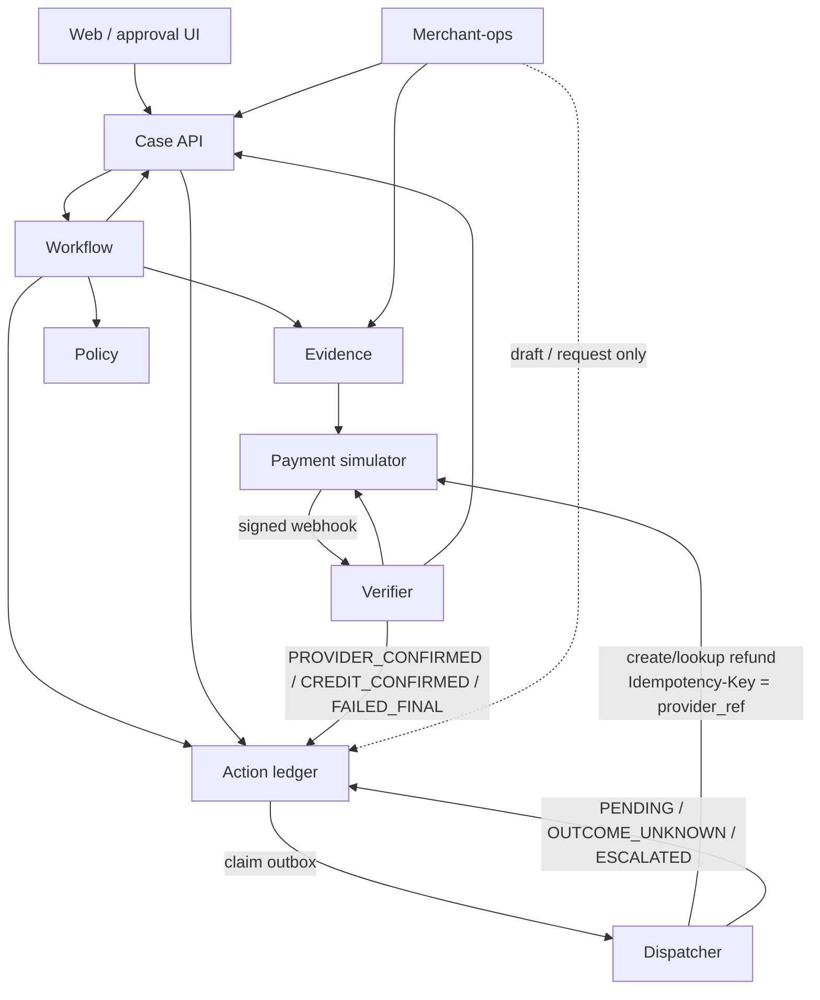
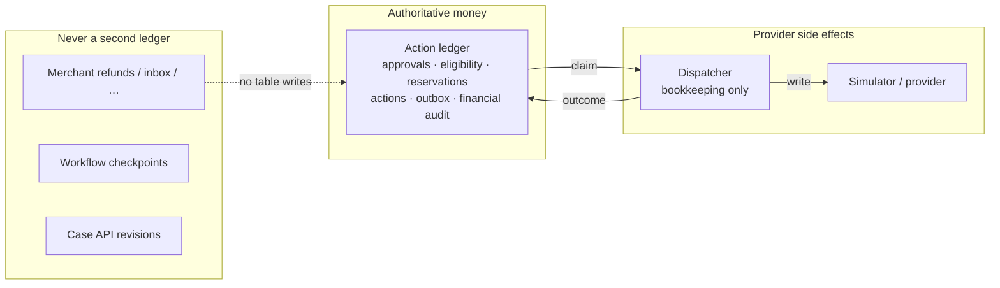
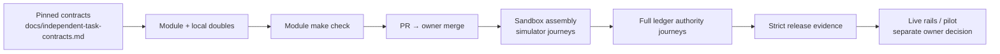

<a id="readme-top"></a>

<div align="center">

# Sentinel

**Policy-governed payment operations: investigate → approve → dispatch → verify credit.**

[](https://github.com/Dijo-404/sentinel/actions/workflows/repository.yml)
[](LICENSE)


[How it works](#how-it-works) · [Quick start](#quick-start) · [Sandbox](#v1-sandbox) · [Docs](#documentation) · [Contributing](#contributing)

</div>

<br/>

> [!IMPORTANT]
> **What `main` proves today:** V1 is **sandbox-ready**. Local compose + runbook can run `real-peers` against the **mock payment simulator** (`payment_provider=simulator`, journey path `provider-sandbox-only`). That proves peer probes and four provider-HTTP journeys. It does **not** prove full SN-009 ledger authority end-to-end, live payment rails, live models, or external pilot acceptance.

## What Sentinel is

Payment ops exception handling for cases like duplicate captures and ambiguous refunds. A model may **propose** a refund; it never authorizes money. Authorization is:

1. Fresh verified evidence  
2. Deterministic policy  
3. Exact supervisor approval (digest + revision bound)  
4. Action-ledger reservation + stable `provider_ref`  
5. Dispatcher provider write (only writer)  
6. Verifier postconditions before “customer credited”

Optional merchant-ops modules (settlement, inbox, refunds drafts, disputes, SLA, analytics, teams, comms) stay advisory / tracking — they never become a second ledger.

## How it works

### Money path (intended runtime)



| Step | Who | Rule |
| :--- | :--- | :--- |
| Propose | Workflow → ledger | Canonical digest; idempotent `operation_key` |
| Decide | Supervisor → ledger | Exact digest + case revision + policy version; expiry |
| Reserve | Workflow → ledger | Evidence + policy outside TX; reserve/outbox/audit atomic |
| Dispatch | Dispatcher | Only provider writer; never mint a second `provider_ref` |
| Interim outcome | Dispatcher → ledger | `PENDING` / `OUTCOME_UNKNOWN` / `ESCALATED` only |
| Final money | Verifier → ledger | Verified evidence; credit ≠ provider accept |

### Who owns money state



Full layering and tables: [architecture](docs/architecture.md).

### Build / evidence ladder



| Level | Command / artifact | Proves | Does not prove |
| :--- | :--- | :--- | :--- |
| Repo metadata | `make check` at repo root | Task ownership, contract hashes, docs links | Payment safety |
| Component | `make -C <module> check` | Owned behavior + fail-closed peers | Multi-service MVP |
| V1 sandbox | [sandbox runbook](integration/core/docs/sandbox-runbook.md) | Simulator HTTP journeys, peer probes | SN-009 money authority E2E |
| Release / pilot | `release/`, `validation/` | Only when owner runs them | Implied by green module CI |

## V1 sandbox

| Fact | Value |
| :--- | :--- |
| Payment provider | Mock simulator only |
| Journey path label | `provider-sandbox-only` |
| Compose | [integration/core/compose.yaml](integration/core/compose.yaml) (Postgres data plane) |
| Runbook | [integration/core/docs/sandbox-runbook.md](integration/core/docs/sandbox-runbook.md) |
| Journeys | pending · merchant mismatch · duplicate payment · refund pending |

```bash
# After following the runbook for peer bring-up:
make -C integration/core check
# Optional live stack: see sandbox-runbook.md (compose + journey script)
```

**Bind / tokens:** loopback (`127.0.0.1`) may use synthetic `tok-*` demo bearers. Non-loopback bind refuses demo tokens — rotate secrets first.

## Quick start

```bash
git clone https://github.com/Dijo-404/sentinel.git
cd sentinel
python3 --version    # 3.11+
make --version
make check           # repository metadata + tool tests only
```

No root app lockfile. Pick a module and follow its README:

```bash
make -C services/action-ledger check
make -C services/dispatcher check
make -C apps/api check
```

## Repository layout

```text
apps/           case API, web shell
services/       ledger, dispatcher, verifier, workflow, evidence, policy,
                simulator, voice, merchant-* , finharness-runtime
packages/       contract-checks, persistence, telemetry, approval-ui,
                finharness-*, indic-context, merchant-comms
integration/    core assembly + sandbox runbook
tooling/        optional module-check discovery
evals/ replay/ benchmarks/ release/ validation/
docs/           architecture, contracts, task register, Phase 1/2 specs
scripts/ tests/ repository validation
AGENTS.md       ownership, money rules, handoff
```

Thirty-four independent tasks (SN-001–034). Each owns its root, lockfile, migrations, tests, and changelog. Register: [docs/task-register.md](docs/task-register.md).

## Configuration

| Scope | What to use |
| :--- | :--- |
| Root | [.env.example](.env.example) is **documentation only** — repo `make check` does not load it |
| Runtime | Each module’s `.env.example` + README; fixture vs `real-peers` |
| Modes | Fixture = injected doubles. Real-peers = fail closed (no silent fixture fallback) |
| Money | Ledger alone owns financial TX state; env kill switches never replace auth |

Details: [docs/configuration.md](docs/configuration.md).

Root Make vars that actually affect repo tooling:

| Variable | Effect |
| :--- | :--- |
| `PYTHON` | Interpreter for root `make check` / `validate` / `test` (default `python3`) |

## Development

1. Read [AGENTS.md](AGENTS.md) and [CONTRIBUTING.md](CONTRIBUTING.md).  
2. Claim one `status:ready` issue from the [Agents queue](https://github.com/Dijo-404/sentinel/issues?q=is%3Aissue%20is%3Aopen%20label%3Aagents).  
3. Use that issue’s feature branch + an independent worktree.  
4. Stay inside owned paths; use contract stubs — do not wait on peers.  
5. Run module `make check`, open PR into `main` with `Refs #N`, move issue to `status:review`.  
6. Owner merges. Agents do not push `main` or enable auto-merge.

```bash
make validate   # independence, ownership, contract hashes, doc links
make test       # repository-tool regression tests
```

## Safety boundaries

- Synthetic data and simulator writes only unless separately authorized.  
- Models propose; authenticated identity + policy + approval + ledger + verified outcomes govern money.  
- On timeout/crash: reconcile the **same** `provider_ref` — never mint another refund ID or release a reservation because a lease expired.  
- Pending / provider-confirmed ≠ customer credit until verifier postconditions pass. Escalation ≠ resolution.  
- Financial audit is unsampled and separate from telemetry.  
- Browser `NEXT_PUBLIC_*` must never hold API bearers or secrets.

## Roadmap

- [x] Independent tasks, pinned contracts, repository CI  
- [x] Module implementations SN-001–034 on `main` (module-local checks)  
- [x] Local V1 sandbox: compose + peers + four simulator journeys  
- [ ] Assembly past `provider-sandbox-only` (case → workflow → ledger authority)  
- [ ] Strict release evidence (eval, replay, tracing) on assembled peers  
- [ ] Owner decisions: live models, live provider adapter, external pilot  

## Documentation

| Guide | Use it for |
| :--- | :--- |
| [Architecture](docs/architecture.md) | Layers, runtime arrows, state ownership |
| [Repository structure](docs/repository-structure.md) | Module roots and shared boundaries |
| [Configuration](docs/configuration.md) | Modes, secrets, databases |
| [Testing](docs/testing.md) | What each evidence level means |
| [Task register](docs/task-register.md) | All 34 tasks ↔ GitHub issues |
| [Contract baseline](docs/independent-task-contracts.md) | Wire types, digests, failure codes |
| [Sandbox runbook](integration/core/docs/sandbox-runbook.md) | Bring up V1 simulator stack |
| [GitHub workflow](docs/github-workflow.md) | Claims, labels, review |
| [Phase 1](docs/sentinel-p1.md) / [Phase 2](docs/sentinel-p2.md) | Planned product intent (not proof of behavior) |
| [Pitch deck](docs/Sentinel_Pitch_Deck.pdf) | Product narrative |
| [Changelog](CHANGELOG.md) | Coordinated repo-level changes |

## Limitations

- Root `make check` ≠ product safety or release readiness.  
- Phase specs are historical intent, not assembled proof.  
- Fixture / module green ≠ multi-service money path or customer credit.  
- Voice, FinHarness, FinBench, merchant-ops are optional — not MVP release gates.

## License

[Apache License 2.0](LICENSE).

<br/>

<div align="center">
  <sub>Built by <a href="https://github.com/Dijo-404">Dijo-404</a> · <a href="#readme-top">Back to top</a></sub>
</div>
