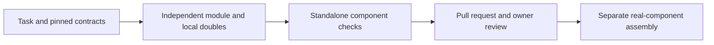

<a id="readme-top"></a>

<div align="center">

# Sentinel

**Policy-governed payment operations, from investigation to verified outcomes.**

[](https://github.com/Dijo-404/sentinel/actions/workflows/repository.yml)
[](LICENSE)


[Quick start](#quick-start) · [Usage](#usage) · [Documentation](#documentation) · [Contributing](#contributing)

</div>

<br/>

> [!NOTE]
> **Early development.** Components are implemented on `main`. Assembly into a product runtime and any external pilot remain separate owner decisions. No live payment integration or external pilot acceptance is claimed.

## Overview

Sentinel is a planned AI teammate for payment operations teams handling exceptions such as duplicate payments and uncertain refund outcomes. Its design combines evidence collection, deterministic policy, exact supervisor approval, controlled simulator execution, and outcome verification. This repository supplies the contracts, independent task boundaries, and development workflow for building those components.

### Features

- **Independent component work.** Twenty-six tasks have disjoint ownership, explicit interfaces, and no task-completion prerequisites.
- **Pinned contracts.** Versioned wire types, canonical action digests, and synthetic examples let components develop against local doubles.
- **Verifiable repository structure.** Standard-library checks validate task metadata, contract hashes, ownership, issue references, and documentation links.
- **Explicit evidence boundaries.** Component checks, real-component assembly, simulated payments, and live inference have separate acceptance requirements.

## Why Sentinel

A provider accepting a refund request does not prove that the customer received credit. Retries after a timeout also need to preserve the original operation identity rather than create another refund.

Sentinel's planned architecture keeps financial authority in one action ledger, limits provider writes to the dispatcher, and requires authoritative postconditions before financial resolution. Models propose actions; deterministic server-side controls authorize them. The [architecture](docs/architecture.md) and [contract baseline](docs/independent-task-contracts.md) define these boundaries for implementation.

## Requirements

| Requirement | Details |
| :--- | :--- |
| **Environment** | A shell with Git, Python, and GNU Make; component requirements are documented separately. |
| **Runtime** | Python 3.11+ for repository validation and regression tests. |
| **Optional** | Authenticated GitHub CLI for issue coordination and explicit task publication. |
| **Component tools** | Each module owns its dependencies, lockfile, and any database/container setup. |

## Installation

Clone the source. Repository checks require no package installation, database, or provider credentials:

```bash
git clone https://github.com/Dijo-404/sentinel.git
cd sentinel
```

There is no root application manifest or shared application lockfile. Follow the selected module's README when its implementation is available.

### Updating

From a clean checkout of your intended branch:

```bash
git pull --ff-only
```

## Quick start

```bash
python3 --version       # confirm Python 3.11 or newer
make --version          # confirm GNU Make is available
make check              # validate repository metadata and run repository-tool tests
```

A passing result confirms repository consistency. Application services have their own checks and acceptance evidence.

## Usage

### Commands

| Command | Description |
| :--- | :--- |
| `make check` | Run repository metadata validation and regression tests. |
| `make validate` | Check task independence, ownership, contract hashes, issue references, and documentation. |
| `make test` | Run repository-tool regression tests. |
| `make check PYTHON=python3.12` | Use a selected Python interpreter for repository checks. |

### Work on a component

Choose a ready issue from the [Agents queue](https://github.com/Dijo-404/sentinel/issues?q=is%3Aissue%20is%3Aopen%20label%3Aagents), read its scope and current comments, and follow the [claim workflow](CONTRIBUTING.md). Use its feature branch and an independent worktree.

Each task delivers its own manifest, lockfile, configuration, fixtures, tests, README, changelog, and module-local `make check`. The scaffold on `main` does not itself provide those module check targets. No component waits for another task's implementation; real-component assembly is a separate owner-run verification step.

## Configuration

The root [.env.example](.env.example) documents intended development defaults. Repository checks do not load it, start services, or enforce runtime controls. Each implemented component owns its actual configuration schema and ignored local environment file.

See the [configuration reference](docs/configuration.md) for fixture/real-peer modes, secret handling, database ownership, and startup validation requirements.

### Environment variables

| Variable | Effect |
| :--- | :--- |
| `PYTHON` | Selects the interpreter used by repository Make targets; defaults to `python3`. |
| `SENTINEL_ENV`, `SENTINEL_MODE` | Documentation-only root examples; consuming components must implement their own behavior. |
| `SENTINEL_PAYMENT_PROVIDER`, `SENTINEL_LOG_LEVEL` | Documentation-only root examples; repository tooling does not read them. |

## Privacy and safety

- Repository checks use local files and need no model, voice, or payment credentials.
- Component development uses synthetic data and simulator payment writes. External payment integrations and pilots require separate authorization.
- Real-peer mode must report unavailable, malformed, unauthorized, or incompatible peers; fixture success cannot substitute for a failed real run.
- Financial audit remains distinct from telemetry. Secrets and private identifiers must stay out of committed fixtures, logs, and metrics.

## How it works



Each module keeps business rules independent of frameworks and external systems, with adapters at its boundaries. Module tests prove behavior against their declared inputs; assembly checks later exercise selected real component versions. The [testing guide](docs/testing.md) explains what each level of evidence establishes.

## Tech stack

| Component | Tool |
| :--- | :--- |
| **Repository tooling** | [Python standard library](https://docs.python.org/3/library/) and [GNU Make](https://www.gnu.org/software/make/) |
| **Repository CI** | [GitHub Actions](https://github.com/Dijo-404/sentinel/actions/workflows/repository.yml) with pinned actions |
| **Planned application stack** | Module-local Python services/libraries and TypeScript UI; choices and boundaries appear in the [architecture](docs/architecture.md) and [Phase 1 specification](docs/sentinel-p1.md). |

## Project structure

```text
.
├── apps/           # case API and web shell
├── services/       # payment, policy, workflow, execution, and verification components
├── packages/       # independent contracts, persistence, UI, telemetry, and SDK packages
├── tooling/        # optional module-check discovery and aggregation
├── integration/    # core journey and real-component assembly tooling
├── evals/          # deterministic safety evaluations
├── replay/         # isolated replay and candidate comparison
├── benchmarks/     # optional FinBench-Indic extension
├── release/        # MVP release-evidence verification
├── validation/     # separately authorized sandbox-pilot validation
├── scripts/        # repository validation and task-publication tools
├── tests/          # repository-tool regression tests
├── docs/           # contracts, specifications, architecture, and task register
├── AGENTS.md       # agent ownership, safety, and handoff rules
├── LICENSE         # Apache License 2.0
└── README.md
```

## Development

Read [AGENTS.md](AGENTS.md), [CONTRIBUTING.md](CONTRIBUTING.md), and the [architecture](docs/architecture.md) before editing. Component work stays inside the task's owned paths and uses module-local dependencies and migrations.

```bash
make validate          # check repository metadata and local documentation links
make test              # run repository-tool regression tests
```

Keep claims and progress on the assigned GitHub issue. Component PRs target `main`; the owner reviews and merges. Update the owned module's documentation and changelog with exact commands, actual results, the pinned contract hash, and untested assembly boundaries.

## Limitations

- The root check validates repository metadata and tools, not payment safety, application behavior, or release readiness.
- Phase 1 and Phase 2 specifications describe planned capabilities. Component scaffolds are not running services.
- Optional voice and Phase 2 modules are not MVP prerequisites.
- Fixture checks do not establish real-component assembly, customer credit, live inference quality, or external pilot acceptance.

## Roadmap

- [x] Repository structure, ownership rules, and independent task definitions.
- [x] Pinned contract baseline, published issue register, and repository CI.
- [ ] Review and merge standalone component implementations from the [task register](docs/task-register.md).
- [ ] Exercise the four payment journeys with compatible real components and the payment simulator.
- [ ] Complete separate owner decisions for release and any external pilot.

## Documentation

| Guide | What's in it |
| :--- | :--- |
| [Architecture](docs/architecture.md) | Dependency direction, runtime boundaries, and state ownership. |
| [Repository structure](docs/repository-structure.md) | Independent module roots and shared maintenance boundaries. |
| [Configuration](docs/configuration.md) | Module configuration, secrets, modes, and database controls. |
| [Testing](docs/testing.md) | Standalone, financial, assembly, and release evidence requirements. |
| [Task register](docs/task-register.md) | All 26 tasks and their GitHub issues. |
| [Contract baseline](docs/independent-task-contracts.md) | Versioned wire types, routes, digest fixtures, and failure semantics. |
| [GitHub workflow](docs/github-workflow.md) | Claims, labels, review, publication, and platform limits. |
| [Phase 1 specification](docs/sentinel-p1.md) | Planned MVP payment operations capabilities. |
| [Phase 2 specification](docs/sentinel-p2.md) | Optional FinHarness and FinBench-Indic extensions. |
| [Pitch deck](docs/Sentinel_Pitch_Deck.pdf) | Product presentation supplied with the specifications. |
| [Changelog](CHANGELOG.md) | Coordinated repository and release changes. |

## Contributing

Read [CONTRIBUTING.md](CONTRIBUTING.md) before opening a PR. Use [GitHub Issues](https://github.com/Dijo-404/sentinel/issues) for bugs and feature requests, and the [Agents queue](https://github.com/Dijo-404/sentinel/issues?q=is%3Aissue%20is%3Aopen%20label%3Aagents) for implementation tasks. Recheck assignment and comments before claiming an issue.

## License

Released under the [Apache License 2.0](LICENSE).

<br/>

<div align="center">
  <sub>Built by <a href="https://github.com/Dijo-404">Dijo-404</a> · <a href="#readme-top">Back to top</a></sub>
</div>
