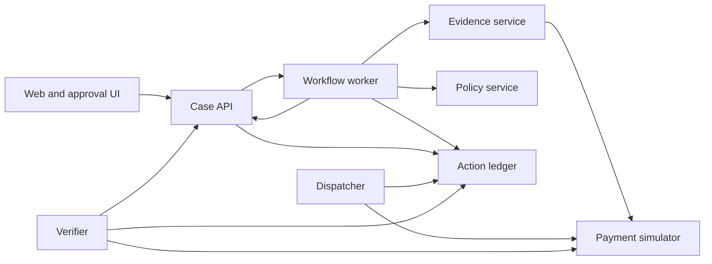

# Sentinel clean architecture

## Product boundaries

Sentinel investigates payment exceptions, proposes policy-governed remediation, obtains exact human approval, executes through controlled adapters and verifies outcomes. The MVP uses synthetic identities and a deterministic payment simulator. FinHarness and FinBench-Indic are optional extensions, not prerequisites for building the MVP components.

The [contract baseline](independent-task-contracts.md) fixes shared wire semantics before implementation. The [task plan](tasks.json) assigns one disjoint root per deliverable. Each module must build, test and be reviewable with all peer implementations absent; local typed peer doubles satisfy development needs. Real-component assembly is tested separately.

## Dependency direction inside a module

```text
HTTP/worker/CLI entry point
  composition root: configure and connect adapters
    application use cases: coordinate domain behavior through ports
      domain: types, states and business invariants

Adapters implement application ports and translate external data.
Domain/application code never imports the outer adapters or composition root.
```

- **Domain:** money/eligibility/state/closure rules, value types and deterministic transformations. Standard-library types are preferred; no FastAPI, SQLAlchemy, LangGraph or provider SDK imports.
- **Application:** explicit use cases and narrow interfaces for storage, evidence, policy, ledger, provider, model, clock and event delivery. Use constructor/function injection; tests supply local ports.
- **Adapters:** HTTP handlers/clients, PostgreSQL repositories, checkpoint storage, signed provider event parsing, model/voice SDKs, telemetry export and filesystem access. Validate untrusted input before entering use cases.
- **Composition:** build validated configuration, select fixture versus real adapters, wire ports, and launch the API/worker/CLI. There is one explicit place to select runtime dependencies.

Use these directories when they hold actual responsibilities. A small pure policy library may need only a few domain files and tests. Do not create empty `domain/application/adapters` trees, generic base repositories or service frameworks to satisfy a diagram.

## Module categories

| Category | Baseline | Boundary |
| --- | --- | --- |
| Python service | FastAPI entry point or worker; module-local Python manifest/lockfile and PostgreSQL setup as needed | Authenticated versioned HTTP or injected typed port |
| Python library/tool | Installable package with local CLI/tests and manifest/lockfile | Public exported ports and versioned JSON artifacts |
| Web application | Next.js/TypeScript with local package manifest/lockfile | Case API client and injected component slots |
| UI package | TypeScript component plus independent preview/test setup | Public typed view/client props; no host-app source imports |
| Telemetry/evaluation/replay/release tooling | Minimal package/executable with local example inputs and negative cases | Injected runner/exporter and evidence/report contracts |

Technology choices follow the source specifications. Actual versions and dependency additions are selected and locked by the owning task. No root dependency installation is necessary for another module to finish.

## Runtime data flow



The arrows are runtime interfaces, not implementation prerequisites. Each component owns local stubs for the arrows it consumes. The workflow has its own Phase 1 structured-model adapter; the optional Indic context package is not required. Voice may remain disabled.

## State and transaction ownership

| Owner | State |
| --- | --- |
| Case API | Case/message/input snapshots, revisions, durable case events and workflow-event delivery |
| Evidence service | Authenticated snapshots, original digested payloads, freshness/provenance and reconciliation facts |
| Workflow | Checkpoints, run budgets, case-run leases and pending result delivery |
| Action ledger | Authoritative approvals, eligibility/reservations, proposals/actions, stable operation/provider references, dispatch leases, outbox and financial audit |
| Dispatcher | Its delivery/recovery bookkeeping; consumes ledger claims, never owns competing financial balances |
| Verifier | Durable webhook inbox, recheck jobs, assessments and pending authenticated outcome delivery |
| Simulator | Synthetic provider records, reference idempotency, credit outcomes and fault schedules |

Each stateful owner has local migrations and a test database. A shared PostgreSQL server is allowed in a development assembly, but schemas/credentials stay separate. No cross-service SQL, shared migration sequence or remote network call inside a financial database transaction.

The ledger keeps reservation, immutable intent/outbox and required audit in one atomic transaction. The dispatcher is the only provider-write adapter and consumes authenticated scope-bound commands. Stable references survive retries, leases, crashes and rollbacks. Missing authority or unknown outcome fails closed and preserves reservations.

## Contracts and failure behavior

Use the supplied exact routes, JSON types, errors, authenticated principal context, digest fixtures and revision/idempotency rules. Keep typed boundary snapshots under the owned module. Reject malformed/unauthorized data before business use. Do not reinterpret an optional field as authority or accept unknown monetary actions.

Workers update cases through the authenticated result API, not case tables. The API owns ordered revision/events; retries are idempotent, conflicting keys/revisions fail, and result delivery is durable. Verified resolution requires a fresh trusted assessment and scenario-specific evidence, not a worker/model's status string.

Real-peer mode never silently selects fixtures on failure. Test doubles are explicit, deterministic and clearly labeled. Financial audit stays unsampled and authoritative even if telemetry is unavailable. Product acceptance distinguishes real components, the simulated payment provider and fake/live inference.

## Integration and change control

SN-014, SN-019 and SN-026 build independent assembly/release/pilot verification tools using local reference peers. They must also reject incomplete or fixture-only evidence in real-component mode. Their completion does not certify a product release.

Consumers continue against the baseline while additive or versioned contract changes are reviewed. Keep compatibility adapters and negative fixtures. Do not hold unrelated tasks hostage to a root lockfile, global refactor, SDK extraction or a contract-checker implementation.
