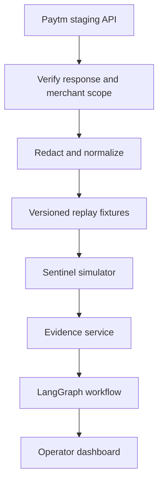
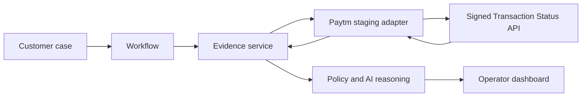
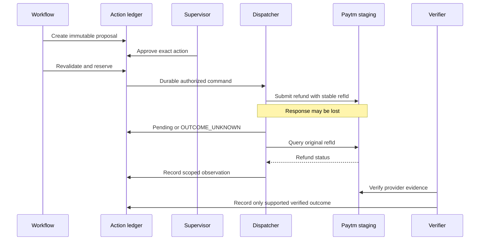

# Sentinel × Paytm — Two-Hour Staging Data Integration

**Technical integration guide | Hackathon sprint | 15 November 2026**

| Field       | Value                                                                                                                                                                            |
| ----------- | -------------------------------------------------------------------------------------------------------------------------------------------------------------------------------- |
| Project     | Sentinel — policy-governed autonomous financial operations teammate                                                                                                              |
| Repository  | [Dijo-404/sentinel](https://github.com/Dijo-404/sentinel)                                                                                                                        |
| Track       | Paytm Build for India AI Hackathon — Autonomous AI Teammates                                                                                                                     |
| Time budget | 120 minutes, conditional on access to test credentials and working local tooling                                                                                                 |
| Environment | Paytm Payment Gateway staging + Sentinel local simulator                                                                                                                         |
| Goal        | Obtain genuine staging payment/refund observations and demonstrate their use in Sentinel                                                                                         |
| Non-goals   | Production payments, unrestricted customer datasets, internal Paytm systems, full production certification                                                                       |
| Status      | Staging MID authenticated for **status** reads; initiate=`239`, refund=`335` on shared test MID. Capture tooling + provider bridge + simulator/FinBench packs landed 2026-11-15. |

> **Core principle:** Use real Paytm API formats and authorized staging observations for investigation; use Sentinel's isolated simulator for deliberate fault injection and final-credit scenarios that staging cannot establish. Never mix the two as though they were one authoritative financial ledger.

## Table of contents

1. [Scope and obtainable data](#1-scope-and-obtainable-data)
2. [Two-hour execution plan](#2-two-hour-execution-plan)
3. [Acquire test credentials](#3-acquire-test-credentials)
4. [Validate credentials with the API Playground](#4-validate-credentials-with-the-api-playground)
5. [Generate staging transactions](#5-generate-staging-transactions)
6. [Retrieve and verify transaction evidence](#6-retrieve-and-verify-transaction-evidence)
7. [Test the refund lifecycle](#7-test-the-refund-lifecycle)
8. [Capture and normalize data](#8-capture-and-normalize-data)
9. [Integrate with Sentinel](#9-integrate-with-sentinel)
10. [Financial safety and verification](#10-financial-safety-and-verification)
11. [FinBench-Indic and replay scenarios](#11-finbench-indic-and-replay-scenarios)
12. [Acceptance tests and demo](#12-acceptance-tests-and-demo)
13. [Troubleshooting and mentor request](#13-troubleshooting-and-mentor-request)
14. [Official references](#14-official-references)

---

## 1. Scope and obtainable data

The objective is to get a small, credible dataset in two hours, not to obtain Paytm's production customer database. A single authentic staging payment, a refund request/status observation and a Sentinel dashboard consuming normalized evidence are more useful for the finals than a large unverified dataset.

### 1.1 Data accessibility

| Data source                       | Access requirement                                            | Two-hour feasibility                | Sentinel use                                       |
| --------------------------------- | ------------------------------------------------------------- | ----------------------------------- | -------------------------------------------------- |
| Public API documentation          | None                                                          | Immediate                           | Request/response contracts, signature semantics    |
| Official example API payloads     | None                                                          | Immediate                           | Contract fixtures; label as documentation examples |
| Response/error codes              | None                                                          | Immediate                           | State mappings, failure classification             |
| Test MID and Merchant Key         | Merchant dashboard test access                                | Conditional; try immediately        | Authenticated staging requests                     |
| Staging payment transactions      | Test credentials + completed test checkout                    | High if credentials work            | Payment investigation and evidence                 |
| Staging refund records            | Eligible captured test payment + refund-enabled test merchant | Conditional                         | Refund lifecycle, reconciliation                   |
| Refund history                    | Authorized merchant test credentials                          | Conditional                         | Existing refund checks                             |
| Dashboard reports                 | Authorized merchant account; report availability varies       | Conditional, not essential          | Merchant analytics/reconciliation                  |
| Production transactions           | Activated merchant account and explicit authorization         | Not a reliable two-hour option      | Future authorized integration                      |
| Internal support tickets          | Paytm approval and approved de-identified samples             | Not self-service                    | Future complaint benchmark                         |
| Proprietary fraud signals         | Paytm internal authorization                                  | Not self-service                    | Future risk integration                            |
| Customer bank-account credit data | Appropriate bank/acquirer or Paytm authorization              | Not a realistic self-service target | Final-credit verification                          |

No public customer-level Paytm dataset is assumed. Public examples, staging observations, synthetic cases and authorized production records are distinct categories.

### 1.2 Target deliverables

**Minimum viable result:**

- One authenticated Paytm staging transaction status response.
- A normalized payment record with source, environment and verification metadata.
- A Sentinel evidence/dashboard view or reproducible fixture showing that record.
- A simulator-based demonstration of failure recovery and verified closure, explicitly labeled simulated.

**Stretch targets, if time and permissions permit:** 5–10 staging payments, 2–3 refund records, a read-only live staging adapter, and a controlled staging refund through Sentinel's ledger and dispatcher. These are collection targets, not guaranteed records available at registration.

### 1.3 Data provenance taxonomy

| Label                  | Meaning                                       | May authorize a real/staging financial write?                       |
| ---------------------- | --------------------------------------------- | ------------------------------------------------------------------- |
| `official-doc-example` | Example from public documentation             | No                                                                  |
| `paytm-staging-live`   | Fresh authorized observation from staging API | Only within validated staging scope and existing financial controls |
| `paytm-staging-replay` | Redacted/normalized saved observation         | No; replay only                                                     |
| `synthetic-simulator`  | Locally generated financial test state        | Simulator only                                                      |
| `synthetic-complaint`  | Generated multilingual customer utterance     | No; claim only                                                      |

## 2. Two-hour execution plan

| Time        | Task                     | Completion condition                                           |
| ----------- | ------------------------ | -------------------------------------------------------------- |
| 00–15 min   | Account and credentials  | Test MID and key available, or mentor asked                    |
| 15–30 min   | API Playground           | Valid authenticated initiation/status query                    |
| 30–50 min   | Generate test payments   | At least one completed success; failure if possible            |
| 50–65 min   | Capture payment evidence | Signed response verified and normalized fixture saved          |
| 65–85 min   | Test refund lifecycle    | Eligible test refund/status observation, or read-only fallback |
| 85–105 min  | Sentinel integration     | Fixture import or read-only adapter + evidence display         |
| 105–120 min | Validation and demo      | Provenance visible, known limitations documented               |

These are planning timeboxes, not guarantees. Account verification, payment capabilities, staging outages or code integration may change the schedule.

### 2.1 Stop-loss decisions

- If credentials are unavailable by minute 15, ask a Paytm mentor for an authorized, preconfigured test merchant; do not spend the entire sprint on production KYC.
- If checkout is blocked, request a known staging order ID under the test MID and perform a status lookup.
- If refunds are unsupported, finish read-only investigation integration.
- If refund status is pending, demonstrate pending honestly; do not invent credit confirmation.
- If Sentinel's full-stack assembly is unstable, capture verified staging observations and replay them in the existing simulator without claiming live execution.
- If no credentials are available, use official documentation examples with explicit provenance, not fabricated staging results.

## 3. Acquire test credentials

### 3.1 Merchant dashboard

1. Open [Paytm Merchant Dashboard](https://dashboard.paytmpayments.com/).
2. Register or sign in with your own authorized mobile number/email.
3. Complete the required authentication steps.
4. Select **Test Mode**, if available.
5. Navigate to **Developer Settings → API Keys → Test API Details → Generate Now**.
6. Record the Test Merchant ID (MID), Merchant Key and website configuration.

Direct link: [Developer API Keys](https://dashboard.paytmpayments.com/next/apikeys).

Paytm distinguishes test credentials from production credentials. Production activation is not needed merely to test a supported staging flow. Individual account onboarding and permissions may still prevent immediate access to test keys.

**Do not use invented business information to bypass verification.** If access is delayed, request a test merchant from the hackathon mentors.

### 3.2 Authorized staging test merchant (this sprint)

| Field                    | Value                                                           |
| ------------------------ | --------------------------------------------------------------- |
| Test Merchant ID (MID)   | `wkyQgn37386655602538`                                          |
| Test Merchant Key        | **local `.env` only** — never commit, never paste into this doc |
| Website                  | `WEBSTAGING`                                                    |
| Industry Type            | `Retail`                                                        |
| Channel ID (Website)     | `WEB`                                                           |
| Channel ID (Mobile Apps) | `WAP`                                                           |

### 3.3 Credential configuration

| Credential            | Purpose                                        | Sprint value                     |
| --------------------- | ---------------------------------------------- | -------------------------------- |
| `PAYTM_MID`           | Merchant-scoped staging identity               | `wkyQgn37386655602538`           |
| `PAYTM_MERCHANT_KEY`  | Request checksum and response verification     | Local secret only                |
| `PAYTM_WEBSITE_NAME`  | Account-specific checkout website              | `WEBSTAGING`                     |
| `PAYTM_INDUSTRY_TYPE` | Merchant industry type                         | `Retail`                         |
| `PAYTM_CHANNEL_ID`    | Checkout channel (`WEB` or `WAP`)              | `WEB` for website utility        |
| `PAYTM_CALLBACK_URL`  | Approved callback URL for the test integration | `http://localhost:8025/callback` |

Proposed `.env.example` (placeholders only; copy to ignored `.env` and fill the key locally):

```dotenv
PAYTM_ENVIRONMENT=staging
PAYTM_MID=wkyQgn37386655602538
PAYTM_MERCHANT_KEY=REPLACE_WITH_TEST_KEY
PAYTM_WEBSITE_NAME=WEBSTAGING
PAYTM_INDUSTRY_TYPE=Retail
PAYTM_CHANNEL_ID=WEB
PAYTM_CALLBACK_URL=http://localhost:8025/callback
PAYTM_PAYMENT_BASE_URL=https://securestage.paytmpayments.com
PAYTM_REFUND_BASE_URL=https://securegw-stage.paytmpayments.in
SENTINEL_ALLOW_PRODUCTION_WRITES=false
```

The names above are proposed for the new integration; the existing Sentinel codebase does not necessarily consume them. The example client below hardcodes staging hosts deliberately.

Add these patterns to an appropriate local `.gitignore` before creating credentials or raw captures:

```gitignore
.env
.env.*
!.env.example
.raw/
__pycache__/
.venv/
```

Never place the merchant key, checkout token, raw secrets or authorization headers in Git commits, Next.js `NEXT_PUBLIC_*` variables, AI prompts, shared dashboards, screen recordings or evaluation datasets. Do not paste credentials into chat. Only share appropriately redacted records.

## 4. Validate credentials with the API Playground

Open [Paytm API Playground](https://www.paytmpayments.com/docs/api-playground). It provides official staging API request generation, signatures, response inspection and code examples.

Enter the authorized staging credentials into the official interface. Select **Initiate Transaction** and use:

| Parameter    | Example                                  |
| ------------ | ---------------------------------------- |
| Request type | `Payment`                                |
| Website name | `WEBSTAGING` (or account-specific value) |
| Order ID     | `SENTINEL-DEMO-001`                      |
| Amount       | `10.00`                                  |
| Currency     | `INR`                                    |
| Customer ID  | `SENTINEL-CUST-001`                      |

Use a new order ID for a new payment. A successful initiation returns a `txnToken`. **Initiation is not payment success.** Complete checkout using a supported test instrument, then query transaction status.

If the Playground has a supported process-transaction flow, it can substitute for building the local checkout app. For the sprint, prioritize a successful signed status response over checkout UI polish.

Do not save the checkout token or signatures in the redacted fixture dataset. If retaining original response bytes for verification, use restricted local storage and a documented retention policy.

## 5. Generate staging transactions

### 5.1 Setup

From the Sentinel repository root, create an isolated integration utility. If the directory already exists, inspect its files rather than overwriting work.

```bash
mkdir -p integration/paytm-sandbox
cd integration/paytm-sandbox
uv init --bare
uv add requests paytmchecksum python-dotenv fastapi uvicorn
```

Create an ignored `.env` file using the actual test credentials. The checksum package is imported as `PaytmChecksum`.

### 5.2 Minimal checkout app

Create `app.py`. This is a local data-generation utility, not an additional financial executor or a production checkout. The hosted payment-page flow and callback behavior may depend on the merchant configuration and current Paytm API version. If the callback must be publicly reachable over HTTPS, configure an authorized test callback or use the Playground instead. The example is intentionally loopback-only.

```python
import html
import json
import os
import uuid

import requests
import PaytmChecksum
from dotenv import load_dotenv
from fastapi import FastAPI, HTTPException
from fastapi.responses import HTMLResponse

load_dotenv()
app = FastAPI()

MID = os.environ["PAYTM_MID"]
KEY = os.environ["PAYTM_MERCHANT_KEY"]
WEBSITE = os.getenv("PAYTM_WEBSITE_NAME", "WEBSTAGING")
BASE = "https://securestage.paytmpayments.com"
CALLBACK = os.getenv("PAYTM_CALLBACK_URL", "http://localhost:8025/callback")


def signed_payload(body: dict) -> dict:
    signature = PaytmChecksum.generateSignature(json.dumps(body), KEY)
    return {"body": body, "head": {"signature": signature}}


@app.get("/", response_class=HTMLResponse)
def home():
    return """
    <html><body>
      <h1>Sentinel Paytm Sandbox</h1>
      <p>Generate a ₹10 staging transaction. No real money.</p>
      <form method="post" action="/checkout">
        <button type="submit">Create test payment</button>
      </form>
    </body></html>
    """


@app.post("/checkout", response_class=HTMLResponse)
def checkout():
    order_id = f"SENTINEL-{uuid.uuid4().hex[:12]}"
    body = {
        "requestType": "Payment",
        "mid": MID,
        "websiteName": WEBSITE,
        "orderId": order_id,
        "callbackUrl": CALLBACK,
        "txnAmount": {"value": "10.00", "currency": "INR"},
        "userInfo": {"custId": "SENTINEL-TEST-CUSTOMER"},
    }
    response = requests.post(
        f"{BASE}/theia/api/v1/initiateTransaction",
        params={"mid": MID, "orderId": order_id},
        json=signed_payload(body),
        timeout=20,
        allow_redirects=False,
    )
    response.raise_for_status()
    result = response.json()
    token = result.get("body", {}).get("txnToken")
    if not token:
        raise HTTPException(400, "Staging transaction initiation failed")

    print(f"Created staging order: {order_id}")
    safe_mid = html.escape(MID, quote=True)
    safe_order = html.escape(order_id, quote=True)
    safe_token = html.escape(token, quote=True)
    return f"""
    <html><body>
      <h2>Staging payment: {safe_order}</h2>
      <p>Amount: INR 10.00</p>
      <form method="post"
        action="{BASE}/theia/api/v1/showPaymentPage?mid={safe_mid}&amp;orderId={safe_order}">
        <input type="hidden" name="mid" value="{safe_mid}">
        <input type="hidden" name="orderId" value="{safe_order}">
        <input type="hidden" name="txnToken" value="{safe_token}">
        <button type="submit">Open Paytm Test Checkout</button>
      </form>
    </body></html>
    """


@app.get("/status/{order_id}")
def transaction_status(order_id: str):
    body = {"mid": MID, "orderId": order_id}
    response = requests.post(
        f"{BASE}/v3/order/status",
        json=signed_payload(body),
        timeout=15,
        allow_redirects=False,
    )
    response.raise_for_status()
    result = response.json()
    data = result.get("body", {})
    signature = result.get("head", {}).get("signature")
    verified = bool(signature and PaytmChecksum.verifySignature(
        json.dumps(data), KEY, signature
    ))
    if not verified:
        raise HTTPException(502, "UNVERIFIED_PROVIDER_RESPONSE")
    if data.get("mid") != MID or data.get("orderId") != order_id:
        raise HTTPException(502, "PROVIDER_SCOPE_MISMATCH")
    return {
        "source": "paytm_staging",
        "signature_verified": True,
        "order_id": data.get("orderId"),
        "transaction_id": data.get("txnId"),
        "amount": data.get("txnAmount"),
        "payment_mode": data.get("paymentMode"),
        "status": data.get("resultInfo", {}).get("resultStatus"),
        "result_code": data.get("resultInfo", {}).get("resultCode"),
    }


@app.post("/callback")
async def callback():
    # Do not trust callback content as proof of payment here.
    # Query the signed Transaction Status API instead.
    return {"message": "Query the order status for verified evidence."}
```

Run locally:

```bash
uv run uvicorn app:app --host 127.0.0.1 --port 8025
```

Open [http://localhost:8025](http://localhost:8025). Select **Create test payment → Open Paytm Test Checkout**. Save the generated order ID from the console or checkout page. Complete the test checkout with [Paytm's documented test instruments](https://www.paytmpayments.com/docs/test-instruments/testing-integration/). Use only test card/net banking/UPI details provided for the supported staging flow, never actual card credentials.

The sample creates ₹10 payments. To generate other amounts, change the test amount in the utility deliberately or use the official Playground. Do not expose this utility publicly; it has no user authentication and is not intended to replace Sentinel's identity controls.

### 5.3 Proposed payment records

| Order | Amount | Intended outcome | Purpose                                         |
| ----- | -----: | ---------------- | ----------------------------------------------- |
| A     |    ₹10 | Successful       | Base evidence                                   |
| B     |    ₹10 | Successful       | Second payment for synthetic duplicate scenario |
| C     |    ₹20 | Failed           | Failure classification                          |
| D     |    ₹50 | Successful       | Partial refund candidate                        |
| E     |   ₹100 | Successful       | Full refund candidate                           |

For a duplicate-payment demo, explicitly associate two distinct Paytm test order IDs with **one synthetic logical merchant obligation** in Sentinel. Equal payment amounts alone do not prove a duplicate. The merchant fulfillment facts are generated locally, not obtained from Paytm's transaction API.

## 6. Retrieve and verify transaction evidence

### 6.1 Official endpoint

```http
POST https://securestage.paytmpayments.com/v3/order/status
Content-Type: application/json
```

Request body before adding checksum:

```json
{
  "mid": "YOUR_TEST_MID",
  "orderId": "YOUR_COMPLETED_STAGING_ORDER"
}
```

Wrap as `{ "body": ..., "head": { "signature": ... } }` using the official checksum utility. See [Transaction Status API](https://www.paytmpayments.com/docs/api/v3/transaction-status-api/).

If using the local utility, open `http://localhost:8025/status/YOUR_ORDER_ID`.

### 6.2 Field mapping

| Paytm field               | Sentinel meaning                                               |
| ------------------------- | -------------------------------------------------------------- |
| `mid`                     | Configured merchant identifier; validate tenant-to-MID mapping |
| `orderId`                 | Provider-side merchant order reference                         |
| `txnId`                   | Provider transaction reference                                 |
| `txnAmount`               | Monetary amount; convert exactly to integer paise              |
| `resultInfo.resultStatus` | Raw provider status                                            |
| `resultInfo.resultCode`   | Exact provider response code                                   |
| `paymentMode`             | Payment method metadata                                        |
| `bankTxnId`               | Bank reference when available, not proof of refund credit      |

Illustrative mapping (not an observed record):

| Status/code          | Interpretation                                                                               |
| -------------------- | -------------------------------------------------------------------------------------------- |
| `TXN_SUCCESS` / `01` | Successful provider payment; validate identities and eligibility before treating as captured |
| `PENDING` / `400`    | Pending confirmation; wait/recheck                                                           |
| `331`                | No record found in the query; do not infer definitive nonexecution after an ambiguous write  |
| Other codes          | Preserve raw code; use documented version-specific mapping or mark unknown                   |

Validate response signature according to Paytm's exact API-version signing rules. If the sample serialization does not match the provider's requirements, use the official SDK or documented canonical serialization. Do not disable verification to make a demo work. A verified signature proves authenticity under the merchant key, not entitlement to a refund, order fulfillment, or final bank credit.

## 7. Test the refund lifecycle

Use a separate eligible successful staging payment for an initial manual Playground refund. This manual test is outside Sentinel's authoritative workflow and must be imported as a provider observation, not represented as a Sentinel-approved action.

Suggested test: ₹5 partial refund against a ₹10 test payment. If unsupported, use an eligible full refund on a separate order. Never use real money.

### 7.1 Staging endpoints

| Operation          | Endpoint                                                                 |
| ------------------ | ------------------------------------------------------------------------ |
| Payment initiation | `https://securestage.paytmpayments.com/theia/api/v1/initiateTransaction` |
| Transaction status | `https://securestage.paytmpayments.com/v3/order/status`                  |
| Refund initiation  | `https://securegw-stage.paytmpayments.in/refund/apply`                   |
| Refund status      | `https://securegw-stage.paytmpayments.in/v2/refund/status`               |

Check the official documentation for the selected API version and merchant configuration; payment and refund hosts differ.

### 7.2 Refund request

```json
{
  "mid": "YOUR_TEST_MID",
  "txnType": "REFUND",
  "orderId": "YOUR_STAGING_ORDER_ID",
  "txnId": "YOUR_PAYTM_TRANSACTION_ID",
  "refId": "SNT-REFUND-001",
  "refundAmount": "5.00"
}
```

`refId` is the merchant-generated refund reference. Paytm documents duplicate-reference rejection; do not assume it will return the original successful response on a retry. Preserve the same reference and query the original operation through the refund status API. Persist the reference before transmission.

### 7.3 Proposed refund provider adapter

This is a staging-only scaffold to be invoked by Sentinel's existing dispatcher. It does not independently authorize refunds. Adapt the methods to the actual `payment-provider.v1` contract rather than introducing a parallel financial API. The example uses `requests` synchronously; if called from an async worker, use an appropriate async HTTP adapter or a bounded thread execution strategy.

```python
from decimal import Decimal
import json
import os

import requests
import PaytmChecksum


class UnknownFinancialOutcome(RuntimeError):
    """A submitted operation may have reached the provider."""


class PaytmStagingProvider:
    REFUND_URL = "https://securegw-stage.paytmpayments.in"

    def __init__(self):
        self.mid = os.environ["PAYTM_MID"]
        self.key = os.environ["PAYTM_MERCHANT_KEY"]

    def _post(self, path: str, body: dict) -> dict:
        signature = PaytmChecksum.generateSignature(json.dumps(body), self.key)
        response = requests.post(
            f"{self.REFUND_URL}{path}",
            json={"body": body, "head": {"signature": signature}},
            timeout=15,
            allow_redirects=False,
        )
        response.raise_for_status()
        result = response.json()
        data = result.get("body", {})
        checksum = result.get("head", {}).get("signature")
        if not checksum or not PaytmChecksum.verifySignature(
            json.dumps(data), self.key, checksum
        ):
            raise ValueError("Unverified Paytm response")
        return data

    def submit_approved_refund(self, *, order_id: str, transaction_id: str,
                               provider_ref: str, amount_minor: int) -> dict:
        # Only the authenticated dispatcher may call this method,
        # with an already reserved, ledger-issued financial command.
        if type(amount_minor) is not int or amount_minor <= 0:
            raise ValueError("Invalid minor-unit amount")
        if not order_id or not transaction_id or not provider_ref:
            raise ValueError("Missing stable identifiers")
        amount = Decimal(amount_minor) / Decimal(100)
        body = {
            "mid": self.mid,
            "txnType": "REFUND",
            "orderId": order_id,
            "txnId": transaction_id,
            "refId": provider_ref,
            "refundAmount": format(amount, ".2f"),
        }
        try:
            return self._post("/refund/apply", body)
        except (requests.RequestException, ValueError, TypeError, AttributeError) as exc:
            # Do not generate a new reference or release the reservation.
            raise UnknownFinancialOutcome(provider_ref) from exc

    def get_refund_status(self, *, order_id: str, provider_ref: str) -> dict:
        return self._post("/v2/refund/status", {
            "mid": self.mid,
            "orderId": order_id,
            "refId": provider_ref,
        })
```

**Additional required integration work:** validate returned merchant, transaction, order, reference, currency and amount against the immutable command and relevant API semantics; map documented rejection vs. acceptance vs. unknown states; enforce authenticated service scope and existing ledger reservations. The raw returned dictionary is not automatically an approved or verified outcome. A malformed or mismatched write response is ambiguous until reconciled.

### 7.4 Refund evidence fields

| Field                      | Meaning                                      |
| -------------------------- | -------------------------------------------- |
| `refundId`                 | Paytm-generated refund ID                    |
| `refId`                    | Stable merchant-generated refund reference   |
| `txnId`                    | Original payment transaction                 |
| `refundAmount`             | Refund amount                                |
| `totalRefundAmount`        | Cumulative refund information when available |
| `acceptRefundStatus`       | Provider acceptance status                   |
| `userCreditInitiateStatus` | Acquirer-side refund initiation status       |
| `rrn`                      | Refund tracking reference where returned     |
| `userCreditExpectedDate`   | Expected customer credit date where returned |

Use the official [Refund API](https://www.paytmpayments.com/docs/api/refund-api/) and [Refund Status API](https://www.paytmpayments.com/docs/api/refund-status-api/) to validate exact schema and available fields.

## 8. Capture and normalize data

### 8.1 Proposed directory layout

```text
integration/paytm-sandbox/
├── README.md
├── app.py
├── capture.py                 # proposed capture/redaction utility
├── .env.example
├── .gitignore
├── pyproject.toml
├── uv.lock
├── .raw/                      # ignored, restricted original observations
├── fixtures/
│   ├── payment_success_001.json
│   ├── payment_success_002.json
│   ├── payment_failed_001.json
│   ├── refund_requested_001.json
│   └── refund_status_001.json
└── normalized/
    ├── payments.json
    ├── merchant_orders.json
    ├── refunds.json
    └── manifest.json
```

### 8.2 Capture procedure

1. Fetch an observation using authorized staging credentials.
2. Verify its checksum and expected merchant/order/transaction scope.
3. Record observation time in UTC, exact API version/path and provider result code.
4. Preserve original bytes and their digest only if necessary, in restricted storage; never store merchant keys or checkout tokens in fixtures.
5. Remove PII and unnecessary bank/customer identifiers; use stable sanitized identifiers across related records.
6. Convert monetary values to integer minor units without rounding silently.
7. Save the normalized record and label it replay-only.
8. Record a separate hash of the sanitized fixture in the dataset manifest.

Example normalized fixture, illustrative values only:

```json
{
  "fixture_id": "paytm-payment-001",
  "source": "paytm_staging",
  "provider": "paytm",
  "environment": "staging",
  "evidence_mode": "paytm-staging-replay",
  "original_signature_verified": true,
  "redacted": true,
  "replay_only": true,
  "payment": {
    "transaction_ref": "SANITIZED-TXN-001",
    "order_ref": "SENTINEL-ORDER-A",
    "amount_minor": 1000,
    "currency": "INR",
    "provider_status": "TXN_SUCCESS",
    "provider_result_code": "01",
    "normalized_status": "CAPTURED"
  }
}
```

The value `original_signature_verified: true` must be set only after actual verification. Redaction changes the payload; the original provider signature no longer authenticates the altered bytes. A saved fixture is not fresh evidence for financial authorization.

Example amount normalization helper:

```python
from decimal import Decimal, InvalidOperation


def inr_to_minor(value: str) -> int:
    try:
        amount = Decimal(value)
    except (InvalidOperation, ValueError, TypeError) as exc:
        raise ValueError("Invalid monetary value") from exc
    if not amount.is_finite() or amount < 0:
        raise ValueError("Invalid monetary value")
    minor = amount * Decimal(100)
    if minor != minor.to_integral_value():
        raise ValueError("Amount has sub-paise precision")
    return int(minor)
```

Do not use binary floating-point values for financial balances. Check contractual range limits in the adapter/domain model as well.

## 9. Integrate with Sentinel

### 9.1 Approach A — Replay fixtures (P0, fastest)



- Import the normalized payments into a dedicated simulator seed pack, using the existing simulator's supported schema and seeding mechanism.
- Create separate synthetic merchant fulfillment and customer-credit fixtures where required.
- Preserve provenance at the record and evidence-envelope levels. Clearly show **Paytm staging replay** for imported observations and **Synthetic simulator** for locally generated facts.
- Execute the normal Sentinel workflow, policy and verification tests entirely within the simulator.
- Keep the simulator's monetary state separate from Paytm staging balances. Replaying a captured Paytm transaction is not permission to send a Paytm refund.

This approach is compatible with the current [simulator](https://github.com/Dijo-404/sentinel/tree/main/services/simulator), [evidence service](https://github.com/Dijo-404/sentinel/tree/main/services/evidence), and [FinBench-Indic](https://github.com/Dijo-404/sentinel/tree/main/benchmarks/finbench_indic).

### 9.2 Approach B — Live staging reads (P1)



Introduce a narrow provider adapter with the following methods (proposed names):

| Method                                | Responsibility                                      |
| ------------------------------------- | --------------------------------------------------- |
| `get_transaction_status(order_id)`    | Retrieve fresh scoped payment observation           |
| `get_refund_status(order_id, ref_id)` | Retrieve an existing refund status                  |
| `normalize_transaction(response)`     | Map payment into existing canonical provider types  |
| `normalize_refund(response)`          | Map refund evidence into existing types             |
| `verify_response_signature(response)` | Authenticate provider observation                   |
| `get_capabilities()`                  | Report supported and unsupported provider functions |

An authenticated server-side mapping must associate the Sentinel tenant and merchant with an authorized Paytm MID. Customer-entered references are lookup hints, not authority. Validate ownership and case scope before calling Paytm.

Return evidence provenance similar to:

```json
{
  "provider": "paytm",
  "environment": "staging",
  "evidence_mode": "provider-observation",
  "signature_verified": true
}
```

The current provider contract is broader than Paytm's public Transaction Status API: the simulator provides merchant orders and explicit customer-credit evidence. These must remain unsupported or be obtained from a separately authorized source in live staging mode. Do not silently switch to fixture evidence when a provider fails.

### 9.3 Approach C — Ledger-controlled staging refund (stretch)



Do not create a second write path in the web application, MCP tool, workflow node, merchant portal or Playground automation. The existing ledger remains the single authority; the existing dispatcher remains the only Sentinel provider writer.

### 9.4 Existing module integration map

| Existing module             | Required change for this sprint                                                       |
| --------------------------- | ------------------------------------------------------------------------------------- |
| `services/simulator`        | Import a dedicated Paytm-format replay seed pack; keep fixture mode explicit          |
| `services/evidence`         | Optional read-only Paytm adapter and provenance display                               |
| `services/workflow`         | Consume canonical evidence; no new payment-write tool                                 |
| `services/policy`           | Preserve verified eligibility and approval requirements                               |
| `services/action-ledger`    | Preserve reservations, stable operation/provider references and audit                 |
| `services/dispatcher`       | Optional staging provider adapter; translate stable `provider_ref` into Paytm `refId` |
| `services/verifier`         | Provider-specific status mapping; no fabricated final credit                          |
| `apps/web`                  | Evidence source labels, raw provider state and normalized state; mask identifiers     |
| `packages/telemetry`        | Provider operation latency, errors and retry suppression without sensitive data       |
| `benchmarks/finbench_indic` | Import grouped, redacted replay scenarios                                             |

Read [Sentinel architecture](https://github.com/Dijo-404/sentinel/blob/main/docs/architecture.md) and [independent task contracts](https://github.com/Dijo-404/sentinel/blob/main/docs/independent-task-contracts.md) before altering service boundaries. Do not introduce breaking cross-module contracts during the sprint unless required and reviewed.

## 10. Financial safety and verification

### 10.1 Preserve Sentinel's invariants

- The AI proposes; deterministic policy and an authenticated supervisor authorize.
- Approval binds to the exact payload digest, case revision, policy version and expiry.
- Reserve the amount atomically before dispatch; reserved + pending + refunded must not exceed captured amount.
- Persist a stable operation/provider reference before attempting the provider write.
- Treat a timeout, malformed response, invalid signature or contradictory response after submission as an unknown outcome.
- Retain the reservation during uncertainty. Query the original reference; never mint a new refund identity simply because a request timed out.
- Escalate when safe recovery is unavailable. Do not assume generic HTTP retries or an `Idempotency-Key` header have Paytm-specific semantics.

### 10.2 Provider status is not customer credit

| Observation                                           | Sentinel treatment                                               |
| ----------------------------------------------------- | ---------------------------------------------------------------- |
| Refund request registered                             | Pending                                                          |
| Provider acceptance                                   | Provider acceptance recorded; not final credit                   |
| Acquirer initiation / bank acceptance                 | Provider-confirmed stage only if documented semantics support it |
| RRN available                                         | Tracking evidence, not automatic proof of credit                 |
| Expected credit date                                  | Continue waiting for sufficient evidence                         |
| Independently authorized customer-credit confirmation | `CREDIT_CONFIRMED` if case-specific conditions hold              |
| Contradictory or insufficient data                    | Wait/reconcile/escalate; no verified closure                     |

Paytm's public refund interface may not expose sufficient evidence of final customer bank credit. Even a staging success cannot prove that a real customer's account received money. Keep the live staging case pending if evidence is incomplete, and use the local simulator to demonstrate synthetic credit and verified closure separately.

### 10.3 Observability and audit

Suggested low-cardinality metrics:

```text
paytm_provider_requests_total{operation,outcome,environment}
paytm_provider_request_duration_seconds{operation,environment}
paytm_signature_verification_failures_total{operation}
paytm_refund_outcome_unknown_total{environment}
paytm_refund_reconciliation_total{outcome}
```

Correlate request, case and action IDs in restricted traces; do not put identifiers, emails, merchant keys, raw complaints or tokens in metric labels. Financial audit remains unsampled and authoritative in the action ledger. Operational telemetry is not the financial audit record.

## 11. FinBench-Indic and replay scenarios

### 11.1 Dataset target

| Scenario                                  | Source                                          |                    Target |
| ----------------------------------------- | ----------------------------------------------- | ------------------------: |
| Successful payment                        | Paytm staging                                   |                       3–5 |
| Failed payment                            | Paytm staging                                   |                       2–3 |
| Refund request and status                 | Paytm staging                                   | 1–2 of each, if supported |
| Duplicate payment                         | Two staging payments + synthetic order relation |                         1 |
| Merchant order mismatch                   | Staging payment + synthetic merchant state      |                         1 |
| Network timeout after submission          | Simulator fault injection                       |                       1–2 |
| Credit pending                            | Simulator                                       |                       1–2 |
| Unauthorized refund                       | Sentinel safety tests                           |                       2–3 |
| Tamil/Hindi/English/code-mixed utterances | Synthetic complaints                            |                     15–30 |

All targets are optional beyond the minimum viable result. Record actual counts and failure reasons rather than reporting targets as completed.

### 11.2 Evaluation grouping

One payment scenario may be expressed in English, Tamil, Hindi and code-mixed forms. Include an incorrect-amount complaint, ambiguous refund question and attempted prompt injection. Assign the variants a shared `group_id` and keep them within the same benchmark split to avoid data leakage.

Example benchmark fixture (proposed schema, adapt to the existing FinBench manifest):

```json
{
  "group_id": "paytm-replay-duplicate-001",
  "source": "paytm-staging-replay-plus-synthetic-order",
  "environment": "simulator",
  "language": "en-IN",
  "complaint": "I paid ten rupees twice for one order.",
  "expected_intent": "duplicate_payment",
  "expected_amount_minor": 1000,
  "expected_financial_action": "PROPOSE_REFUND",
  "requires_supervisor_approval": true,
  "allow_live_provider_write": false
}
```

The fixture's expected outcome is a synthetic test oracle. It is not an actual Paytm customer complaint or historical case outcome.

## 12. Acceptance tests and demo

### 12.1 Test checklist

| Test                                  | Expected result                                                  |
| ------------------------------------- | ---------------------------------------------------------------- |
| Authorized staging status lookup      | Correct merchant/order/transaction evidence or explicit failure  |
| Invalid checksum                      | Evidence rejected; no financial authorization                    |
| Wrong merchant or order               | Scope mismatch; fail closed                                      |
| Failed payment                        | No refund proposal for a payment not captured                    |
| Unknown status or no record           | Remain uncertain; do not infer safe refund eligibility           |
| Partial refund                        | Exact minor-unit amount and stable refId                         |
| Repeated refund reference             | Reconcile original operation; no new financial identity          |
| Timeout after acceptance (simulator)  | `OUTCOME_UNKNOWN`, reservation retained, reconciliation succeeds |
| Missing customer credit               | No `CREDIT_CONFIRMED` or verified refund closure                 |
| Operator attempts supervisor decision | Denied; ledger unchanged                                         |
| Replay fixture in live execution path | Rejected as stale/replay-only evidence                           |
| Provider unavailable                  | Explicit error; no silent simulated substitution                 |

Existing Sentinel checks to use after making compatible changes:

```bash
# From repository root
make check                         # repository metadata, not product safety
make -C services/evidence check
make -C services/action-ledger check
make -C services/dispatcher check
make -C services/verifier check
make -C benchmarks/finbench_indic check
```

If the local integrated stack is running, use the documented [sandbox runbook](https://github.com/Dijo-404/sentinel/blob/main/integration/core/docs/sandbox-runbook.md). Provider-only and full-authority-path results must retain their actual evidence labels. A simulator or fixture pass does not prove a live Paytm integration.

### 12.2 Five-minute demonstration

1. Show the Paytm test merchant environment without displaying keys.
2. Open a completed staging transaction and its official status response.
3. Show the normalized evidence in Sentinel with a **Paytm staging** source label.
4. Open the operator case workspace. Explain the transaction evidence and synthetic merchant order relationship.
5. Show an existing staging refund status if one was generated; explain why provider acceptance is not final credit.
6. Switch explicitly to the local simulator for the timeout and duplicate-refund scenario. Demonstrate exact supervisor approval, ledger reservation, stable reference, recovery and synthetic credit verification.
7. Show the audit trail and replay benchmark, if available.

### 12.3 Judge-ready wording

If only staging capture and replay work:

> We captured authorized observations from Paytm's official staging APIs, verified their authenticity and normalized the data into Sentinel's evidence format. Our simulator replays these formats while testing failure recovery and financial safety in an isolated environment.

If read-only live staging integration works:

> Sentinel retrieves payment evidence directly from Paytm's staging Transaction Status API using merchant-scoped authentication, then uses its own workflow to investigate the case.

If the ledger-controlled staging refund also passes:

> Our dispatcher submits an authorized test refund using Paytm's documented refund interface and preserves the original merchant refund reference for status reconciliation.

Only use the statement supported by your actual results. Do not claim real payment rails, customer bank credit, production Paytm deployment or full autonomous browser-to-credit integration on the basis of these tests alone.

## 13. Troubleshooting and mentor request

| Blocker                                      | Immediate action                                                                          |
| -------------------------------------------- | ----------------------------------------------------------------------------------------- |
| Test MID/key not visible                     | Ask mentor for an authorized test merchant; avoid production onboarding time sink         |
| Checksum failure                             | Confirm exact signing body and SDK serialization, matching key and environment            |
| Invalid MID/website                          | Check test credentials and account-provided website name                                  |
| Checkout opens but payment does not complete | Use supported official test instruments or request an existing test order                 |
| Local callback cannot be reached             | Use official Playground or approved HTTPS test callback; query signed status for evidence |
| Refund unavailable or merchant not eligible  | Finish payment investigation integration; don't attempt a real refund                     |
| Refund remains pending                       | Show actual pending status; do not fabricate credit evidence                              |
| Refund duplicate-reference rejection         | Query original refId, retain reservation until outcome reconciled                         |
| Missing fields or unexpected response schema | Preserve raw status and fail closed; update version-specific mapping after checking docs  |
| Sentinel integration not ready               | Capture and normalize staging responses for isolated replay                               |

### Message to Paytm mentors

> Hi, we are building Sentinel for the Autonomous AI Teammates track. Our solution investigates payment exceptions, applies deterministic refund policies, obtains supervisor approval and verifies outcomes. Could you provide an authorized staging Merchant ID and Merchant Key, preferably with a few successful test payments and refund functionality enabled? We only need transaction status, refund status and a controlled test refund. No production credentials or sensitive customer records are required.

## 14. Official references

The following are the official resources used in the preceding integration guidance. Verify the selected API version, account permissions and host before implementation.

- [Paytm Merchant Dashboard](https://dashboard.paytmpayments.com/)
- [Developer API Keys](https://dashboard.paytmpayments.com/next/apikeys)
- [Paytm API Playground](https://www.paytmpayments.com/docs/api-playground)
- [Test instruments and integration testing](https://www.paytmpayments.com/docs/test-instruments/testing-integration/)
- [Initiate Transaction API](https://www.paytmpayments.com/docs/api/initiate-transaction-api/)
- [Transaction Status API v3](https://www.paytmpayments.com/docs/api/v3/transaction-status-api/)
- [Refund API](https://www.paytmpayments.com/docs/api/refund-api/)
- [Refund Status API](https://www.paytmpayments.com/docs/api/refund-status-api/)
- [Refund List API](https://www.paytmpayments.com/docs/api/refund-api-list-api/)
- [Callback and webhook documentation](https://www.paytmpayments.com/docs/callback-and-webhook)
- [Settlement reports on dashboard](https://www.paytmpayments.com/docs/settlement-reports-on-dashboard)
- [Settlement API](https://www.paytmpayments.com/docs/api/settlement-api) — documented production-only; outside this sprint
- [Official Paytm agent integration skills](https://github.com/paytm/paytm-agent-skills)
- [Sentinel repository](https://github.com/Dijo-404/sentinel)

---

## Final delivery checklist

- [x] Authorized test MID/key obtained or documented access blocker.
- [x] Actual staging **status** queried (signed `334` observations). Initiate/refund blocked on this MID.
- [x] Response signature validated on status (compact JSON).
- [x] Redacted fixture and provenance manifest saved (`integration/paytm-sandbox`).
- [x] Simulator `paytm_staging` pack + FinBench `paytm_*` groups.
- [x] Staging refund/status tested — provider returns `335` (documented).
- [x] Synthetic merchant/credit facts clearly labeled.
- [x] No production credentials committed; merchant key local `.env` only.
- [ ] Demo claims match actual observations (do not claim TXN_SUCCESS until initiate-capable MID).

**Recommended repository location:** `docs/integrations/paytm-staging.md`.

**Implementation note:** This guide is based on the supplied two-hour integration plan. The pasted source contained truncated code and rendered diagram markup; the examples above restore the corresponding code and diagrams from the preceding conversation, with small defensive refinements (POST for checkout creation, fail-closed scope checks, and an explicit unknown-outcome exception). The snippets are scaffolding, not tested integrations. The user's actual Paytm account access, response-signing behavior, refund eligibility, and Sentinel assembly results remain to be validated.
