# Sentinel — Role-Based Portals, Identity & User Flows

**Technical specification | Proposed product extension | v1.0**

| Field | Value |
|---|---|
| Product | Sentinel — autonomous AI teammate for payment operations |
| Repository | [Dijo-404/sentinel](https://github.com/Dijo-404/sentinel) |
| Target | Six human-facing portals, centralized identity, scoped RBAC, and secure inter-role workflows |
| Frontend | Existing Next.js / TypeScript application in `apps/web` |
| Backend | FastAPI, PostgreSQL, existing Sentinel services and versioned contracts |
| Status | Design and implementation plan; not a claim of completed functionality |
| Data / payment environment | Synthetic accounts and simulated payment provider for the hackathon; authorized external integrations only after separate review |

## 0. Executive summary

Sentinel investigates payment exceptions, proposes policy-governed resolutions, obtains human authorization for refunds, dispatches financial actions safely and closes cases only after evidence-backed verification. The submitted product pitch emphasizes the separation of AI recommendations, deterministic rules, human decisions and verified outcomes.

This specification adds six dedicated human-facing workspaces to that product. Each has its own login URL, dashboard, navigation and permitted operations, while sharing a single identity system and UI design system. Customers self-register; staff and merchant users are provisioned by a Platform Admin. The administrator assigns staff roles, organizational membership and scope, but cannot manufacture financial approval or perform direct payment-provider writes.

The six roles are Customer, Merchant, Support Operator, Supervisor, Risk & Fraud Officer and Platform Admin. Merchant staff additionally retain four existing merchant-scoped subroles: viewer, operator, approver and admin. Internal workflow, dispatcher and verifier identities are not human roles and never receive interactive login pages. Existing sandbox-admin identities remain development-only.

The design extends the current repository instead of replacing its independent services. The action ledger remains the sole authoritative owner of financial approvals, reservations, action records, dispatch commands and financial audit. A new identity and access module introduces dynamic account lifecycle management. A backend-for-frontend (BFF) or equivalent authenticated gateway translates verified human sessions into narrowly scoped, verifiable service credentials; it never forwards a user-supplied role header as authorization.

### 0.1 Non-negotiable principles

1. Customers cannot select a staff role at registration. Customer registration creates customer membership only; customer data is never a staff-directory entry that an admin casually promotes into a staff account.
2. Role assignment is separate from resource access. Tenant, merchant, subject, case and queue restrictions must be enforced server-side on every request.
3. All refunds require a valid Sentinel supervisor approval bound to the exact action, digest, revision, policy and expiry. Merchant internal approval is not financial approval.
4. AI may propose but cannot authenticate users, grant roles, approve refunds, bypass holds, or directly call payment-write APIs.
5. Platform administration does not imply payment approval, fraud clearance or unrestricted access to raw customer data.
6. A provider accepting a refund does not establish that customer credit was confirmed. Only trusted case-specific evidence supports verified closure.
7. Financial execution survives human logout, account suspension, role changes and runtime restarts. Uncertain actions retain their original reference and reservation until reconciled.
8. Demo and production identities, payment data and credentials must never be mixed. Fixture success must be labeled and cannot stand in for real-component assembly evidence.

### 0.2 Scope and implementation evidence

| Component | Current repository baseline (previously inspected) | Target extension in this specification |
|---|---|---|
| Core human authorization | `customer`, `operator`, `supervisor` principals; synthetic opaque bearer-token maps | Real account lifecycle, secure sessions and centrally managed role assignments |
| Service identities | `workflow`, `dispatcher`, `verifier`, `sandbox-admin` | Retain separate machine authentication and restricted sandbox administration |
| Web shell | `/intake`, `/cases/[caseId]`, `/ops`, evidence pages; fixture and real-peer adapters | Six role portals, dedicated login pages, protected layouts and real dashboard aggregation |
| Case API | Intake, messages, scoped queries, events/SSE, ops queue, escalation, supervisor decision proxy | Identity integration, role-specific list/read endpoints, assignments and risk workflows |
| Approval UI | Independent typed component with digest/revision/expiry checks | Embed into supervisor portal using authenticated real-peer client |
| Merchant operations | Independent settlement, inbox, refund, dispute, SLA, analytics, comms and team modules | Merchant-facing portal and role-scoped service adapters |
| Merchant team roles | `viewer`, `operator`, `approver`, `admin` under tenant + merchant | Identity-backed memberships; platform-admin provisioning by default |
| Fraud | Existing `FRAUD` owner queue | Dedicated `risk_officer` principal, dashboard and authorized risk decisions |
| Observability / FinHarness / FinBench | Standalone packages and optional extensions | Restricted administrative observability and evaluation workspace |
| Assembly | Previously documented provider-only sandbox path; full case→workflow→ledger evidence not established | Prove complete role-driven flows across real components in the simulator |

**Design assumption:** This is based on the previously inspected repository baseline and the requested six-role design, not a fresh execution or full re-audit of the latest branch. Existing files and contracts must be rechecked before editing. New endpoints, permissions, UI routes and migrations below are proposals, not assertions that they already exist.

---

## 1. Role and account model

### 1.1 Human-facing roles

| Role ID (proposed canonical identifier) | Display name | Provisioning | Home dashboard |
|---|---|---|---|
| `customer` | Customer | Self-registration and verified identity | `/customer/dashboard` |
| `merchant` | Merchant | Platform-admin invitation + merchant membership | `/merchant/dashboard` |
| `operator` | Support Operator | Platform-admin invitation | `/operator/dashboard` |
| `supervisor` | Supervisor | Platform-admin invitation with privileged-role review | `/supervisor/dashboard` |
| `risk_officer` | Risk & Fraud Officer | Platform-admin invitation with approved risk scope | `/risk/dashboard` |
| `platform_admin` | Platform Admin | Controlled bootstrap or independently authorized privileged invitation | `/admin/dashboard` |

`customer`, `operator` and `supervisor` are existing contract role names. `merchant`, `risk_officer` and `platform_admin` are proposed platform-level additions. Do not alias `platform_admin` to `sandbox-admin` or silently map a merchant `approver` to `supervisor`.

A user may have multiple staff assignments when explicitly authorized. A workspace is a selected active assignment, not a permission escalation. For the MVP, avoid merging customer and staff identities; use separate account classes and enforce their non-overlapping provisioning rules. If a person is both a customer and a staff member, use distinct accounts or a later reviewed identity-linking design.

### 1.2 Merchant subroles

A merchant user is a member of exactly the merchant organizations granted by the administrator. A membership contains one or more authorized merchant-scoped subroles:

| Subrole | Allowed responsibilities | Explicit limitation |
|---|---|---|
| `viewer` | View scoped transactions, settlement summaries, disputes and reports | Cannot submit or approve requests |
| `operator` | Investigate exceptions, submit refund requests, respond to disputes and perform allowed operational tasks | Cannot approve ledger refunds |
| `approver` | Review internal merchant requests and approve/reject them where configured | Advisory/internal approval only; cannot authorize money in Sentinel |
| `admin` | Manage merchant settings and view team directory; optional delegated staff management later | Cannot assign platform roles or access unrelated merchants |

For the requested initial design, **Platform Admin is the sole staff-provisioning authority**, including merchant staff. Merchant-admin self-service staff invitations remain disabled behind a feature flag until a delegated model is explicitly approved. Merchant roles and platform roles use separate namespaces so that `merchant:admin` cannot become `platform_admin`, and `merchant:operator` cannot become the platform `operator`.

### 1.3 Non-human principals

| Principal | Purpose | Credential type | Login / dashboard |
|---|---|---|---|
| `workflow` | Process case work, retrieve evidence, propose/reserve via authorized ledger ports | Scoped workload credential | None |
| `dispatcher` | Claim ledger commands, submit/reconcile simulator/provider operations | Scoped workload credential | None |
| `verifier` | Authenticate provider events, assess proof and publish outcomes | Scoped workload credential | None |
| `sandbox-admin` | Seed/reset simulated data and faults for authorized development | Development-only credential | No ordinary staff login; optional restricted demo console |

Additional service principals may be registered for API-to-service calls where required, using the specific existing contract role and scope. Do not give all services one universal bearer token. A service must never use a client-supplied staff identity to mint itself a more privileged principal.

### 1.4 Access resolution

Authorization is the intersection of account status, verified identity, active assignment, tenant, role permissions and resource scope. Deny by default. A grant to read a merchant transaction does not grant the right to read every case within the tenant. A valid supervisor role cannot approve an unrelated tenant's action. A risk officer's access to fraud evidence must be scoped to an authorized investigation or queue.

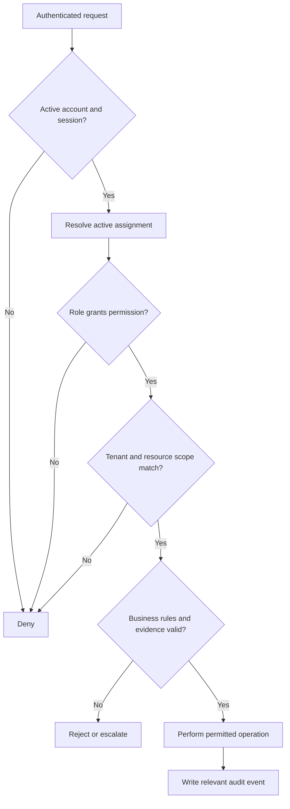

---

## 2. Shared authentication and onboarding

### 2.1 Page map

| Role | Login | Registration / activation | Protected landing |
|---|---|---|---|
| Customer | `/customer/login` | `/customer/register` | `/customer/dashboard` |
| Merchant | `/merchant/login` | `/auth/accept-invitation` | `/merchant/dashboard` |
| Support Operator | `/operator/login` | `/auth/accept-invitation` | `/operator/dashboard` |
| Supervisor | `/supervisor/login` | `/auth/accept-invitation` | `/supervisor/dashboard` |
| Risk Officer | `/risk/login` | `/auth/accept-invitation` | `/risk/dashboard` |
| Platform Admin | `/admin/login` | Controlled invitation/bootstrap | `/admin/dashboard` |

Shared pages: `/auth/verify`, `/auth/mfa`, `/auth/forgot-password`, `/auth/reset-password`, `/auth/workspaces`, `/unauthorized`, `/account/security`. Each role login screen uses a shared authentication component and a role-specific heading and visual identity. Login routes are presentation hints; they do not grant roles.

### 2.2 Login screen requirements

- Sentinel logo and role-specific title; short description of the workspace.
- Customer: verified mobile/email login or registered credential, preferred-language selector, self-registration link.
- Staff/merchant: corporate email + approved authentication method, MFA challenge and recovery guidance; **no public sign-up link**.
- Role mismatch: explain that this account does not have that workspace; offer the user's legitimately assigned workspace(s), without exposing other users' data.
- Generic authentication failures to avoid account enumeration. Accessible labels, keyboard navigation, clear error text, loading states and no secrets in query parameters.
- Safe redirects: allow only validated same-origin role routes; reject external redirect destinations.

### 2.3 Customer registration

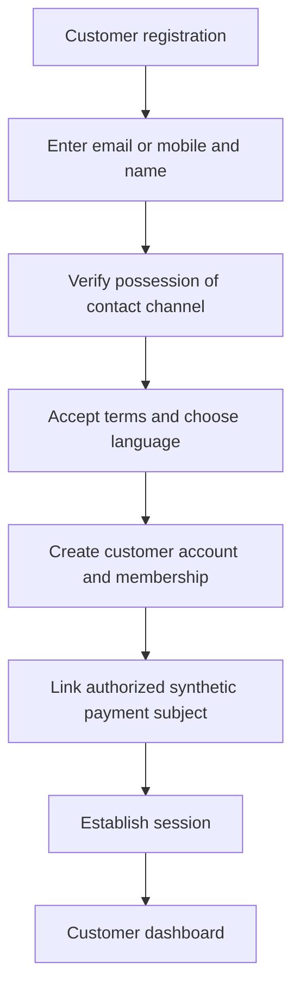

The server derives the customer role itself. Ignore or reject any submitted `roles`, `tenant_id`, `subject_refs` or privileged fields. The verified payment subject must be linked through an approved identity mapping; contact verification alone is not proof of ownership of any arbitrary payment. In the simulator, seed explicit synthetic identities and mappings. In production, require an authorized identity/provider integration.

If account verification fails, keep the account pending and deny protected APIs. If no linked payment history exists, display an empty state and a safely scoped support intake; do not accept an arbitrary transaction reference as evidence of ownership. For real account recovery, verify through the identity provider and revoke prior sessions when credentials reset.

### 2.4 Staff invitation and activation

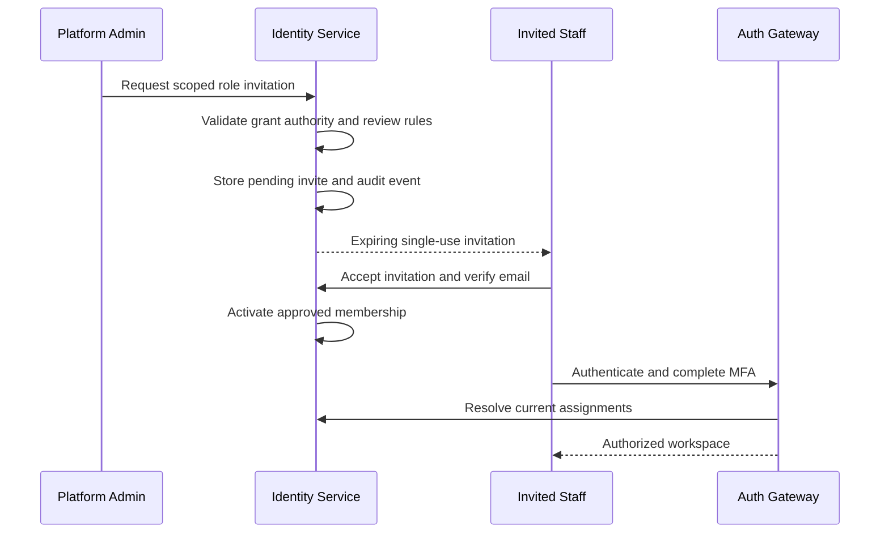

The invite binds target email/identity, tenant, role, optional merchant and team scope, creator, expiry and approval state. Store only a hash of its secret token. Consume atomically once, and reject expired, revoked, used or mismatched invitations. Do not activate a privileged invite while an independent approval is outstanding. If a user already exists, invite a new authorized assignment rather than creating duplicate credentials. An existing customer account cannot be turned into a staff identity through the invitation endpoint in the MVP.

### 2.5 Session architecture

Recommended production direction: an established OIDC identity provider or a maintained authentication framework. Use authorization code + PKCE where applicable. Maintain application roles and scopes in Sentinel's identity database, not in editable frontend fields. For a local hackathon demo, an isolated identity adapter may authenticate seeded synthetic users, but still enforce server-side role checks and actual per-user sessions; label this as demo authentication.

- Browser: opaque, random session identifier in `HttpOnly`, `Secure` (HTTPS), appropriate `SameSite` cookie. Local HTTP development is explicitly separate. Do not store long-lived bearer credentials in browser localStorage.
- Session service: stores hashed session tokens, user ID, active assignment, issue/expiry time, authorization version and revocation status. Rotate identifiers on login, privilege change and refresh.
- Server: resolve current assignment and account status on protected operations; revoke sessions or invalidate authorization versions after role removal, suspension or password reset. Sensitive financial approval requires fresh authentication/MFA according to policy.
- CSRF: protect cookie-authenticated mutations with origin checks and a CSRF token or equivalent robust framework protection. Restrict CORS and content types; rate-limit login, recovery and invitation acceptance.
- Staff MFA: mandatory for admin, supervisor and risk roles; recommended for all staff. Use provider-supported TOTP/passkeys or another approved method. Never collect UPI PINs, banking OTPs or CVVs.
- Logout: revoke the session; does not terminate already submitted financial operations.
- Service credentials: short-lived, audience-bound, scope-bound credentials where supported. Keep human approvals attributable to the original authenticated supervisor. Never proxy all approvals through a shared supervisor token.

### 2.6 Workspace selection

After successful authentication, `GET /v1/auth/workspaces` returns authorized assignments. One assignment routes directly to its dashboard. Multiple assignments open a workspace chooser; selection is validated against current assignments and rotates or updates the session's active scope. Every API independently verifies the selected assignment. Role removal causes stale tabs to return 403/401 and refresh the workspace list.

---

## 3. Customer portal

**Goal:** Report payment problems, understand progress, provide information and see verified resolutions without exposing internal payment infrastructure or requiring financial expertise.

**Login:** `/customer/login` · **Dashboard:** `/customer/dashboard` · **Primary backend:** Case API + customer-scoped transaction adapter.

### 3.1 Navigation and pages

| Route | Purpose | Key UI elements |
|---|---|---|
| `/customer/dashboard` | Personal overview | Open issues, action required, pending refunds, recent payments, report button |
| `/customer/transactions` | Authorized transaction history | Search/filter by date/status, masked references, amount and merchant |
| `/customer/transactions/[transactionId]` | Transaction detail | Payment status, related cases, report issue |
| `/customer/report` | New complaint | Selected transaction, text/voice input, language, review extracted details |
| `/customer/cases` | My issues | Status filters, latest update, action required |
| `/customer/cases/[caseId]` | Case timeline | Messages, customer-visible evidence summary, next action, refund reference/status |
| `/customer/assistant` | Contextual AI help | Guided intake, multilingual chat, voice when enabled |
| `/customer/notifications` | Notifications | Verification requests, status updates, resolution summaries |
| `/customer/profile` | Personal preferences | Language, contact settings, security |

### 3.2 Dashboard states

Dashboard reads only the authenticated customer's authorized subjects/cases. Cards: open cases, waiting for customer response, refunds being processed, verified resolved cases. Avoid presenting pending/initiated refunds as money received. Each card links to a scoped filtered view. A timeline distinguishes payment state, case state and refund state; those are related but different.

Empty state: no transactions or issues, with a clear report/support action. Loading state: skeletons and an accessible status indicator. Provider outage: show that transaction status is temporarily unavailable, never invent a payment status. Use locale-aware currency formatting while transmitting integer paise.

### 3.3 Journey C1 — Duplicate payment, happy path

**Preconditions:** Customer has a verified account and owns the synthetic transaction subject. Simulator has two captured ₹1,500 payments linked to one fulfilled order, and duplicate eligibility is supported by authoritative records. Equal amounts alone are not proof of duplication.

1. Customer logs in, opens transaction history and selects a payment. The server confirms the transaction belongs to the customer's subject.
2. Selects `Report an issue` → `Charged twice`. Case intake may also start directly in the AI assistant.
3. Customer records Tamil audio or types in Tamil/Hindi/English. Optional Sarvam speech-to-text creates a source-preserving transcript. No live speech capability is assumed if voice is disabled.
4. Show the original statement and canonical summary: reported amount ₹1,500, suspected duplicate, selected transaction. Ask for correction if transcription or extraction is ambiguous. Never use a reported amount as authoritative refund eligibility.
5. Submit with an idempotency key; Case API creates `SNT-0042`, records immutable complaint/input revision and schedules the workflow. Duplicate submission with the same key and payload returns the same logical result.
6. Customer lands on case detail. Status `Investigating`; SSE or polling updates the timeline using durable event sequence cursors.
7. Sentinel retrieves gateway, merchant, prior refund and applicable settlement evidence. AI proposes a resolution; deterministic rules validate it. If eligible, the workflow creates an unreserved refund proposal and requests a supervisor decision.
8. Customer sees `Refund under review`, not internal model traces, reviewer personal data, policy internals or raw evidence IDs.
9. Supervisor approval and ledger reservation occur in staff workflows. Customer sees `Refund processing` once authoritative action evidence supports that state.
10. If the provider commits but the response times out, the customer sees an honest update such as `We are confirming your refund`; the case remains open and original reference is reconciled.
11. When trusted customer-credit evidence is confirmed, the verifier and Case API publish a verified outcome. Customer sees amount, masked refund reference, completion time and plain-language summary.
12. Customer may provide feedback or raise a follow-up with new evidence. A follow-up is linked to the original case; it must not issue a new refund or erase the original financial audit.

**Postcondition:** Exactly the intended simulated refund is recorded, customer-facing status is verified, and the case has a complete audit trail. Customer cannot trigger direct execution at any point.

### 3.4 Journey C2 — Pending payment and clarification

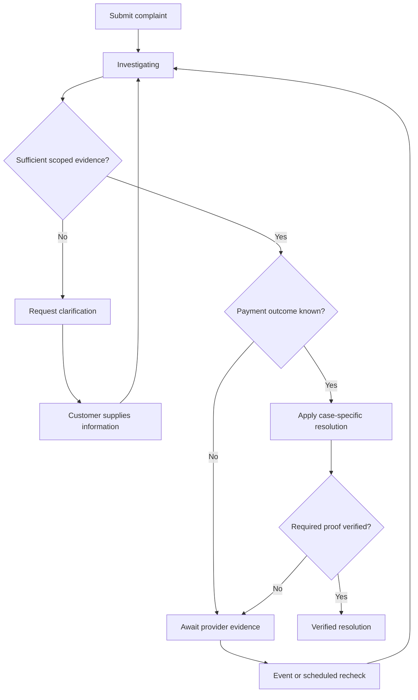

Customer may upload a receipt only if an attachment pipeline is implemented: restricted MIME types, malware scan, size limits, access-controlled storage and retention. Extracted receipt details are untrusted claims until provider evidence confirms them. If customer supplies a wrong transaction ID, request correction without revealing another customer's record. Do not expose sensitive fraud flags; use `Specialist review` messaging.

### 3.5 Customer permissions and acceptance

- Can create and read own cases, send own case messages, see own transactions and receive updates.
- Cannot directly access raw ledger records, internal policy details, other customer records or staff endpoints.
- Cannot approve a refund, select staff role or force case state.
- Must see clear pending vs confirmed status, and be able to resume the same case after logout/login.
- Acceptance: cross-subject reads denied; duplicate submissions safe; missing identity linkage fail closed; voice unavailable fallback to text is explicit; customer-facing data never includes unapproved secrets or internal risk conclusions.

---

## 4. Merchant portal

**Goal:** Give businesses a scoped payments operations workspace covering transactions, settlements, exceptions, refund requests, disputes, SLA tasks and team visibility.

**Login:** `/merchant/login` · **Dashboard:** `/merchant/dashboard` · **Primary backend:** existing merchant-ops modules + Case API/evidence ports.

### 4.1 Navigation and pages

| Route | Purpose | Key UI elements |
|---|---|---|
| `/merchant/dashboard` | Business overview | Captured payment volume, settlement status, unresolved exceptions, pending requests |
| `/merchant/transactions` | Merchant payment explorer | Date/status filters, reference, amount, order match |
| `/merchant/transactions/[id]` | Payment evidence | Order linkage, existing refunds, create request |
| `/merchant/settlements` | Settlement reconciliation | Expected vs actual, date, difference, finding status |
| `/merchant/settlements/[id]` | Settlement details | Matched/unmatched entries, evidence, investigation actions |
| `/merchant/exceptions` | Exception inbox | Unpaid order mismatch, delayed payment, priority, assignment |
| `/merchant/refunds` | Refund requests | Requested amount, internal approval, ledger/provider/credit status |
| `/merchant/refunds/new` | Create refund request | Transaction selection, reason, amount, validation summary |
| `/merchant/disputes` | Dispute management | Customer complaint packet, deadlines, permitted evidence |
| `/merchant/tasks` | SLA tasks | Due dates, owners, overdue items |
| `/merchant/analytics` | Scoped business trends | Success rates, volumes, refund latency, reconciliation trends |
| `/merchant/team` | Memberships | Staff, subroles, advisory limits, invite request to platform admin |
| `/merchant/settings` | Business preferences | Notification language and configuration |

### 4.2 Merchant onboarding and dashboard

Platform Admin creates or approves the business record, assigns `merchant_ref` and tenant, and invites staff with a subrole. Merchant staff authenticate through the same identity service. If they belong to multiple merchant organizations, choose an authorized merchant workspace. Do not put cross-merchant selectors on screens without membership validation.

Dashboard data should derive from merchant analytics and scoped evidence. Financial totals distinguish captured volume, settlement amounts and refunds; do not label all transaction volume as revenue or all expected settlement as cash received. Use sample data banners for simulator metrics. Viewer mode presents no mutation actions.

### 4.3 Journey M1 — Successful payment but merchant order unpaid

1. Merchant operator logs in and opens exception inbox.
2. Selects an exception linked to a merchant order and confirmed payment. Merchant scope is checked on the server.
3. Sentinel loads verified gateway/merchant records and shows timestamps, mismatches, order reference and amount. If evidence is stale, request a new snapshot.
4. AI suggests a reconciliation action; the evidence/policy layer validates the suggested action. Merchant may submit supporting order information.
5. If the applicable merchant workflow permits an order-side update, an authorized operator or adapter performs it with idempotency and audit. Otherwise, open/escalate a case to the support operator. This is not an implicit refund.
6. Verifier checks the updated order against required payment evidence. If unresolved or conflicting, the case remains open and assigned.
7. Merchant receives verified reconciliation summary and sees the exception removed from the active queue only when the relevant closure predicate is satisfied.

**Current baseline limitation:** The previously documented merchant-mismatch provider journey ends in `NEEDS_HUMAN`. A direct verified merchant-order update is proposed future functionality and must be proven through the assembled adapter; do not claim that the existing provider-only test already closes this case.

### 4.4 Journey M2 — Refund request and approvals

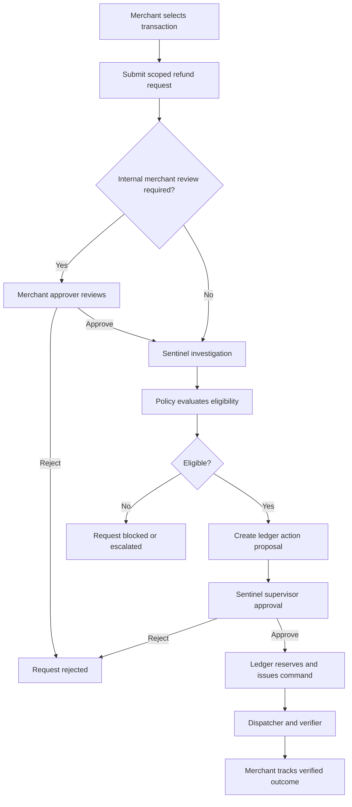

The merchant enters reason and amount in INR; frontend parses decimal strings into integer paise without floating-point arithmetic. Backend revalidates transaction ownership, currency and eligibility. The request entity tracks the merchant's internal process, but does not own authoritative financial balances. When internal approval is required, a merchant approver records a scoped decision on the request. Only Sentinel supervisor approval can authorize the subsequent ledger reservation. If the amount changes or prior refunds consume available balance, generate a new proposal or reject safely; never adjust an approved payload silently.

### 4.5 Journey M3 — Settlement discrepancy

Example synthetic settlement: expected ₹2,45,000, received ₹2,42,500, discrepancy ₹2,500. Merchant opens settlement date, inspects line items, filters unmatched payments and sees evidence provenance. Sentinel categorizes discrepancy as timing delay, missing item, fee/adjustment, or unresolved mismatch only where records support it. Merchant operator can attach supporting evidence, create a case and track ownership/SLA. Do not mark a discrepancy reconciled solely because a model generated an explanation. No unauthorized settlement transfers are initiated.

### 4.6 Journey M4 — Disputes, tasks and team

- Disputes: select case, review permissible complaint facts, attach permitted evidence, respond before deadline, track support/risk review. Hide internal fraud investigations and unrelated customer data.
- SLA: assigned tasks appear with due time, owner, reason and escalation path; completion of a task does not imply financial resolution.
- Analytics: drill down only to authorized merchant data; use consistent denominators and distinguish resolved from escalated or waiting cases.
- Team: merchant admin views membership and advisory approval limits; requests a staff change through platform admin. Delegated invitations are off initially. Merchant user may change own permitted profile preferences, not their role.

**Acceptance:** merchant A cannot access merchant B through forged URL/query/header; viewer cannot submit a refund; merchant approver cannot call ledger decision API; merchant admin cannot assign platform roles; refund request tracking never becomes a second financial ledger.

---

## 5. Support Operator portal

**Goal:** Help human support staff investigate exceptions, manage workloads, provide customer assistance and escalate cases while Sentinel performs safe autonomous investigation.

**Login:** `/operator/login` · **Dashboard:** `/operator/dashboard` · **Primary backend:** Case API, evidence, workflow, operator queue and case assignment extension.

### 5.1 Navigation and dashboard

| Route | Purpose | Key UI elements |
|---|---|---|
| `/operator/dashboard` | Workload overview | Assigned/open/overdue cases, intervention count, SLA, recent verified outcomes |
| `/operator/queue` | Assigned and authorized queue | Priority, status, language, merchant, due time, ownership |
| `/operator/cases/[caseId]` | Case workspace | Complaint, timeline, evidence, AI recommendation, action controls |
| `/operator/cases/[caseId]/evidence` | Evidence details | Source, observed time, freshness, digest, conflicting facts |
| `/operator/escalations` | Escalated cases | Destination queue, reason, owner, status |
| `/operator/messages` | Customer communications | Conversation history and verified draft replies |
| `/operator/assistant` | AI copilot | Scoped case summary, clarification and policy guidance |
| `/operator/knowledge` | Approved support policies | Versioned procedures, searchable guidance |
| `/operator/activity` | Operational history | Own actions, assignment history, completed tasks |

Queue tabs: Assigned to me, Unassigned (if permitted), Waiting for customer, Needs human review, Awaiting approval, Waiting for provider, Escalated and Verified. Use server-side pagination, not full datasets. Dashboard aggregates are calculated from authorized scope. Automated cases need not be manually assigned unless human intervention is required.

### 5.2 Journey O1 — Investigate an exception

1. Operator authenticates with staff identity, enters assigned support workspace and sees priority queue.
2. Claims an unassigned authorized case or opens an assigned case. Assignment uses optimistic revision or atomic claim to prevent two operators assuming ownership simultaneously.
3. Reviews complaint, transcript, messages, case state and AI investigation. Distinguish customer claims from verified provider facts.
4. Opens evidence panel; compare two payments, one order, prior refunds, freshness and tenant scope. On missing/conflicting data, request additional evidence instead of forcing resolution.
5. If the workflow needs customer clarification, send an authorized case message. Case API increments revision and schedules workflow resume. Older approval proposals must not silently remain valid if their bound context changed.
6. Operator may initiate an allowed investigation/reconciliation request through the workflow; cannot directly write financial tables or provider APIs.
7. If a refund proposal is required, the workflow creates the immutable ledger proposal and routes to supervisor. Operator sees exact amount and reason but no approve button.
8. If fraud/conflict/risk requires specialist review, escalate with reason code and destination queue. Case retains owner/next action; escalation is not a resolved outcome.
9. Monitor workflow events. If outcome is unknown after timeout, operator sees reconciliation state and must not manually resend a refund.
10. Review evidence-backed outcome and send customer update. Use customer-safe status language, translated if needed; no AI statement may claim completion beyond authoritative status.
11. Complete operational task and leave case closure to verifier/Case API. If customer disputes verified outcome, create a linked follow-up for review rather than issuing a duplicate payment action.

### 5.3 Journey O2 — Human takeover

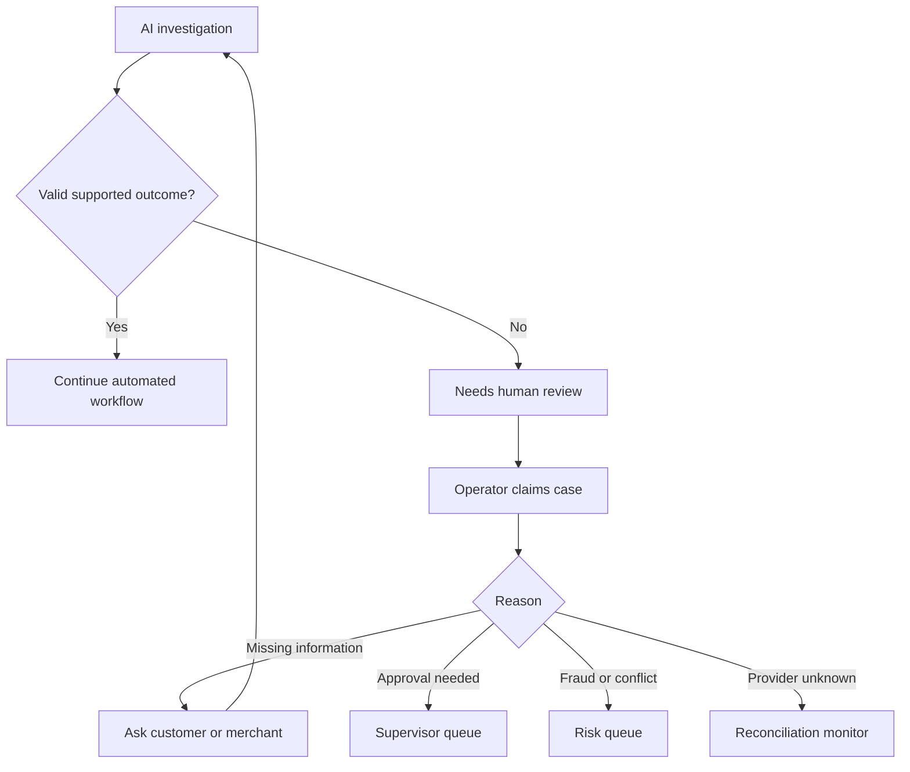

A human takeover should not create a competing agent or duplicate action. Use case revision, workflow events and assignment ownership. Retry investigation only through documented use cases with bounded budgets and idempotency. For stale case revisions, reload and present conflict information; never overwrite concurrent updates.

### 5.4 Case workspace design

Three-column desktop layout with a responsive single-column mobile fallback:

- Left: customer conversation, language, assigned owner and SLA.
- Center: chronological case events and evidence records, provenance/freshness indicators, expandable safe metadata, status transitions.
- Right: AI summary, policy result, allowed next actions, escalation destination and linked proposal/approval history.

The AI copilot receives only authorized case context. It cannot query arbitrary cases outside the operator's scope and cannot execute a financial action through a chat command. Show source references for factual recommendations and explicit model-unavailable states.

**Acceptance:** operator can view authorized evidence and send messages, but supervisor-only decision routes return 403 even if called directly. Unauthorized claims, cross-tenant reads and stale revisions fail. A provider timeout produces a visible pending/unknown status, not a new financial request.

---

## 6. Supervisor portal

**Goal:** Provide accountable, exact financial authorization and operational oversight. This is not an unrestricted payments console.

**Login:** `/supervisor/login` · **Dashboard:** `/supervisor/dashboard` · **Primary backend:** Case API decision proxy + authoritative action ledger + existing approval UI.

### 6.1 Navigation and dashboard

| Route | Purpose | Key UI elements |
|---|---|---|
| `/supervisor/dashboard` | Approval and team overview | Pending count, oldest request, expired/stale requests, team SLA, financial exposure |
| `/supervisor/approvals` | Approval queue | Case, amount, policy, merchant, age, evidence freshness, risk indicators |
| `/supervisor/approvals/[actionId]` | Exact decision workspace | Evidence, digest, revision, expiry, prior refunds, approve/reject controls |
| `/supervisor/history` | Decisions and outcomes | Approved/rejected/expired, provider and credit status, reviewer history |
| `/supervisor/team` | Operational oversight | Scoped workloads, assignments, escalation queues |
| `/supervisor/cases/[caseId]` | Case review | Evidence and timeline, linked approval/action |
| `/supervisor/escalations` | Management exceptions | Reason, required decision, ownership |
| `/supervisor/audit` | Financial decision history | Scoped immutable action and approval audit summaries |

Exposure should come from authoritative ledger balances, not sums of every proposal. Distinguish proposed, reserved, pending and confirmed amounts. Approval history shows the action's subsequent state even if the approval has already been consumed.

### 6.2 Exact approval data contract

The existing ledger and approval UI already define digest/revision-bound decisions. Reuse these contracts; do not create a second approval database in the identity service.

Illustrative immutable proposal:

```json
{
  "action_id": "action-demo-42",
  "case_id": "SNT-0042",
  "transaction_ref": "TXN-8842",
  "action": "REFUND",
  "amount_minor": 150000,
  "currency": "INR",
  "reason_code": "DUPLICATE_PAYMENT",
  "case_revision": 3,
  "policy_version": "demo-policy-v1",
  "action_digest": "<server-computed-canonical-digest>",
  "evidence_ids": ["payment-b", "order-42"]
}
```

This is a conceptual UI projection; actual wire types must match `action-ledger.v1` and `DecisionRequest` exactly. Never accept an arbitrary client-computed digest or treat evidence IDs alone as proof.

### 6.3 Journey S1 — Approve duplicate refund

1. Supervisor signs in and completes MFA; current approval assignment and tenant scope are verified.
2. Opens pending approval queue. Selects `SNT-0042` proposal for ₹1,500 against `TXN-8842`.
3. Reviews original complaint, two confirmed payment records, one fulfilled order, existing refunds/reservations, currency, evidence age and policy decision.
4. The UI renders the exact immutable amount, transaction, action digest, case revision, policy version and decision expiry from the authoritative record. No free-text amount editor is provided.
5. If stale data or an active risk restriction is detected, block approval and request refresh or specialist review. Check maker/checker restrictions where applicable.
6. Supervisor selects Approve, confirms exact action, and supplies a reason if policy requires. For high-risk operations, require fresh MFA according to configured rules.
7. Case API forwards the original authenticated supervisor authority (or a verified delegated credential that preserves subject and scope) and exact `DecisionRequest` to the ledger. It must not substitute a generic supervisor identity.
8. Ledger validates reviewer role/scope, current revision, digest, policy and expiry, then records the decision and associated financial audit. A repeated identical decision is handled idempotently according to contract; conflicting decisions fail.
9. Workflow resumes from durable approval event, rechecks evidence/policy/current balance and reserves amount atomically. Approval alone is not provider execution.
10. Dispatcher claims the command and submits using stable reference. Unknown outcomes retain reservation; verifier distinguishes provider confirmation from credit confirmation.
11. Supervisor monitors actual execution and verification in history. The UI may show `Approved`, `Reserved`, `Refund pending`, `Outcome unknown`, `Provider confirmed`, `Credit confirmed`, or `Failed final` as distinct states.

### 6.4 Journey S2 — Reject, stale approval, new proposal

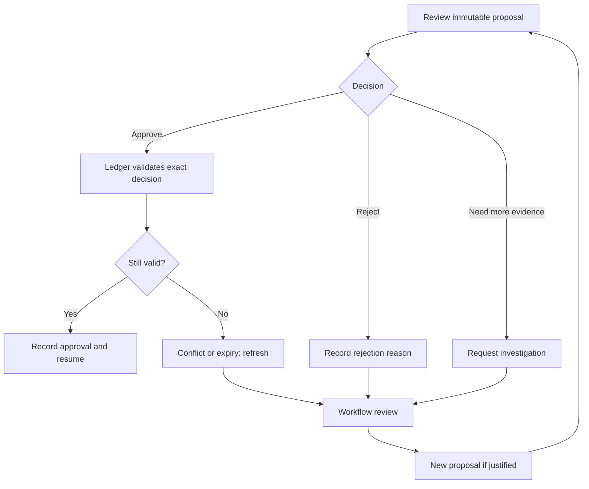

A change in amount, transaction or bound case context requires a new eligible action/digest and fresh approval. Do not update the approved action in place. `Need more evidence` can be an operational request or explicit rejection reason depending on the existing contract; do not invent a third financial decision enum without versioning it. Existing ledger decision enum is `APPROVE|REJECT`.

### 6.5 Supervisor restrictions and acceptance

- No direct payment-provider writes, no arbitrary ledger balance changes, no override of financial invariant or fraud hold.
- Cannot approve another tenant's case, expired proposal, invalid digest or unauthorized amount.
- If supervisor is suspended or loses permission before an unexecuted action is dispatched, policy must define whether reapproval is required; default to fail closed before reservation/dispatch where approval validity is no longer established. Once submission may have occurred, continue reconciliation rather than canceling uncertain financial state.
- Separation of duties: configure restrictions on self-approval and high-risk actions; any extra approver scheme must be a versioned ledger/policy extension, not a UI-only check.
- Acceptance: actual existing approval component is connected to real Case API/ledger in simulator; stale/rejected approval never produces provider write; concurrent refund reservation cannot exceed captured amount; no action closes without trusted evidence.

---

## 7. Risk & Fraud Officer portal

**Goal:** Investigate suspected fraud and conflicting payment evidence, control authorized risk restrictions, and return legitimate cases to the normal resolution flow without granting implicit refund authority.

**Login:** `/risk/login` · **Dashboard:** `/risk/dashboard` · **Primary backend:** new risk investigation module integrated with Case API, evidence service and financial policy/ledger controls.

**Baseline:** Existing contracts define a `FRAUD` escalation destination, but the proposed `risk_officer` human principal and dedicated risk management API are extensions. Do not make the portal rely on an unrestricted operator token as a shortcut.

### 7.1 Navigation and dashboard

| Route | Purpose | Key UI elements |
|---|---|---|
| `/risk/dashboard` | Risk operations overview | Open investigations, new alerts, aging cases, holds, blocked actions |
| `/risk/queue` | Scoped fraud queue | Severity, reason codes, case owner, evidence freshness, due time |
| `/risk/investigations/[caseId]` | Investigation workspace | Case facts, linked records, history, findings and authorized decision controls |
| `/risk/transactions` | Restricted transaction explorer | Search within granted investigation scope, related transactions, refund history |
| `/risk/holds` | Financial-action restrictions | Active restriction, reason, applicable action, review owner, expiry/review date |
| `/risk/reports` | Investigation reports | Findings, evidence links, review status, disposition |
| `/risk/analytics` | Risk trends | Alert reasons, fraud queue volume, confirmed vs unconfirmed outcomes |
| `/risk/audit` | Risk decision audit | Who decided, evidence references, timestamps, prior/new state |

Use an evidence-first UI. Avoid presenting a model-generated risk score as proof of fraud. Labels should distinguish suspected, under investigation, legitimate, inconclusive and confirmed by the applicable human review procedure. Sensitive facts should remain masked unless needed and authorized. Do not show fraud allegations in the customer's portal.

### 7.2 Journey R1 — Suspicious duplicate refund

**Precondition:** The case has an authenticated escalation event, a fraud reason code and an assigned risk queue. The proposed risk officer has an active role assignment for that tenant/queue.

1. A complaint claims duplicate payment, but payment ownership or merchant evidence conflicts. Alternatively, repeated refund requests indicate a possible abuse pattern. Sentinel's deterministic rules escalate instead of authorizing financial execution.
2. Case API records escalation reason, current revision, evidence IDs and destination `FRAUD`. The new risk module creates an investigation and assigns an owner or exposes it in an authorized queue.
3. Risk officer logs in with MFA and opens the case. Backend rechecks identity, tenant, investigation scope and permitted evidence fields.
4. Officer examines verified gateway/merchant records, prior refunds, ledger action state, related scoped cases, timeline and conflicting facts. Customer-provided statements remain claims until independently confirmed.
5. Officer may request fresh evidence or ask the support operator to obtain missing information from the customer/merchant. Requests append events rather than editing the original complaint.
6. Officer records structured findings and evidence references. Suggested classifications: `LEGITIMATE`, `INSUFFICIENT_EVIDENCE`, `SUSPICIOUS`, `CONFIRMED_FRAUD` (the last only under approved review criteria).
7. If the case is legitimate, propose clearing the relevant risk restriction. The authorized risk-decision endpoint validates scope, expected investigation/case revision, reason, evidence and any independent review requirements.
8. On successful clearance, Case API and workflow receive a durable event. The workflow investigates current state again and generates a fresh eligible resolution proposal where necessary. The risk officer does not approve the refund.
9. If suspicious, maintain or apply an authorized restriction and define a review/next action. If confirmed fraud under approved procedure, route to designated fraud operations. The case remains escalated or follows an explicit fraud disposition, not `VERIFIED_RESOLVED` merely because a report exists.
10. Audit records preserve actor, decision, evidence, restriction state and case revision. Subsequent actions must respect the applicable risk policy before financial reservation/dispatch.

### 7.3 Risk decision and hold semantics

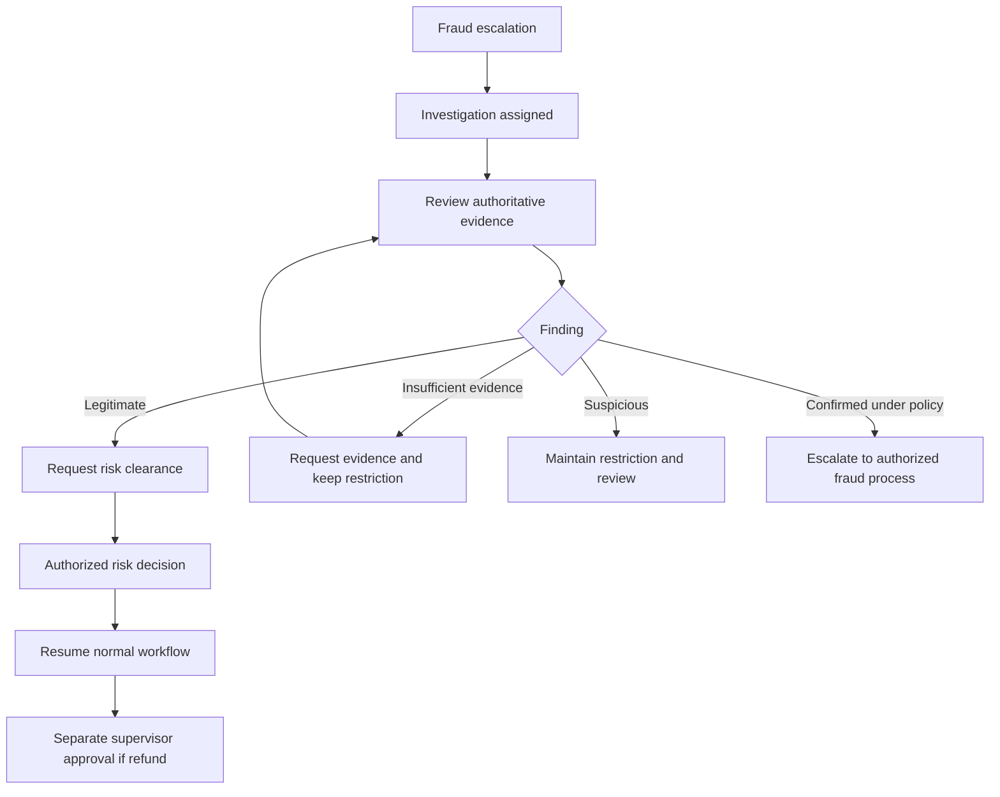

Proposed `RiskRestriction` record: `restriction_id`, `tenant_id`, `case_id`, optional `transaction_ref`/`action_id`, `reason_code`, `status`, `created_at`, `review_due_at`, `created_by`, `policy_version`, `evidence_ids`, `revision` and optional `cleared_by`/`clearance_reason`. Restrictions are versioned and audit-backed. They do not represent bank account freezes or real-world legal determinations.

A restriction blocks applicable new financial actions through policy/ledger authorization. A risk officer cannot release a reserved amount by editing a hold, and an already submitted/uncertain refund must still be reconciled. Avoid implementing a database flag that the dispatcher never checks: define a versioned, authorized risk-check interface and enforce its freshness at the action boundaries. If the risk service is unavailable, fail closed for actions requiring that check.

### 7.4 Journey R2 — Investigation handoff and review

Risk officer requests missing evidence; operator communicates with customer/merchant; the case remains assigned to risk or the explicitly designated owner. Reassignment requires permission and leaves an audit record. A second authorized reviewer may be required for sensitive findings or clearance. On review, new evidence updates the investigation revision; old decisions cannot be replayed against changed scope. The officer sees the final disposition and related financial status, but cannot manufacture financial outcome evidence.

**Acceptance:** Risk users cannot approve ledger refunds or assign roles. Other roles cannot clear risk holds unless explicitly authorized. Cross-tenant investigation and related-transaction searches fail. A fraud-escalated case is not counted as a verified resolution. Clearing a restriction causes a normal re-evaluation, not automatic payment execution. Uncertain already-dispatched actions continue reconciliation.

---

## 8. Platform Admin portal

**Goal:** Centralize identity, staff provisioning, scoped authorization, operational configuration and system governance. This role is the only initial human authority for staff role assignment, subject to independent controls for privileged grants.

**Login:** `/admin/login` · **Dashboard:** `/admin/dashboard` · **Primary backend:** new identity service and restricted admin aggregation APIs, with existing system/telemetry and optional evaluation ports.

### 8.1 Navigation and dashboard

| Route | Purpose | Key UI elements |
|---|---|---|
| `/admin/dashboard` | Platform overview | Active staff, pending invitations, active merchants, system health, case volumes and alerts |
| `/admin/users` | Staff directory | Search, role, tenant, scope, invitation/account status, actions |
| `/admin/users/invite` | Provision staff | Name, work email, role, tenant, team/merchant scope, review and invite |
| `/admin/users/[userId]` | Staff account detail | Active assignments, profile, sessions, history, suspend/reactivate |
| `/admin/roles` | Role catalog | Permission matrix, assignable roles, privilege classification and grant rules |
| `/admin/tenants` | Organization management | Authorized organizations and lifecycle state |
| `/admin/merchants` | Merchant onboarding | Business records, membership scopes, contacts and team assignments |
| `/admin/teams` | Operational teams | Queues, member assignments, authorized workload scope |
| `/admin/policies` | Policy management | Draft versions, test results, reviewer status, rollout history |
| `/admin/integrations` | Provider configuration | Connection health, environment, scopes, credential references (never raw secrets) |
| `/admin/observability` | Operational monitoring | Service health, queues, traces, alerts, cost and safety metrics |
| `/admin/ai` | AI configuration | Model adapters, prompt/runtime versions, execution budgets, feature flags |
| `/admin/evaluations` | Evaluation / replay | FinBench-Indic runs, safety regressions, candidate comparisons, promotion review |
| `/admin/audit` | Governance audit | Staff role changes, invitations, security events, configuration decisions |
| `/admin/security` | Access security | MFA policy, session revocation, access reviews, privileged change requests |

Customer accounts may appear in a separate restricted support-account lookup only where there is a legitimate administrative need; do not place customer registration or role conversion in the staff invitation form. Aggregate customer counts do not grant raw customer financial-data access. Admin should see operational health and redacted incident summaries by default, not every transcript and transaction.

### 8.2 Journey A1 — Bootstrap the first Platform Admin

There is no public `/admin/register` endpoint. Bootstrap the first admin through a deployment-controlled command or an approved identity-provider mapping, with explicit tenant/global scope and a security audit. In the sandbox, seed a clearly synthetic admin and documented credentials from local secret configuration; never commit production credentials. Disable bootstrap once initialized, or require a tightly controlled break-glass recovery process with audit and independent review.

An administrator may grant ordinary scoped staff roles within their grant authority. Granting another `platform_admin`, elevated supervisor or broad cross-tenant scope requires independent authorization according to policy. A sole demo admin may provision seeded operator/supervisor/risk accounts under a clearly labeled sandbox policy; production privilege expansion must not rely on self-approval.

### 8.3 Journey A2 — Invite a new user

1. Admin authenticates, completes MFA and opens `User management → Invite staff`.
2. Enter full name and work email. Customer role is not an available option; no public staff signup.
3. Select organization/tenant. Server returns only assignable organizations within the administrator's grant scope.
4. Select role from Merchant Staff, Support Operator, Supervisor, Risk Officer and Platform Admin (last only through the privileged grant process).
5. Configure role-specific scope: merchant + subrole; support team/queue; supervisor approval scope; risk queue; or explicit administrative scope. Reject incomplete or incompatible combinations.
6. Review effective permissions and restrictions. Show who can access financial evidence, approve refunds or view risk data. Role labels alone are insufficient.
7. Submit invitation. Backend validates active admin authority, target account class, role catalog, tenant/scope, duplicate membership and privilege review. Write invitation and audit event atomically.
8. Send a single-use expiring activation link via approved invitation delivery; for offline demo use a clearly marked local delivery/test adapter. Do not expose a reusable token in logs.
9. Recipient opens link, verifies work email, completes account activation, configures MFA and accepts the approved assignment.
10. Recipient authenticates via role-specific login and lands in authorized workspace. Admin sees invitation status `ACCEPTED` and account `ACTIVE`.

### 8.4 Journey A3 — Modify role and scope

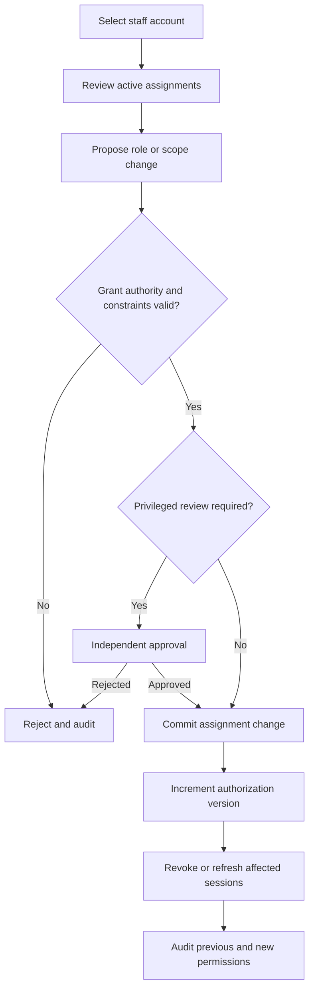

Example: employee `usr_103` is promoted from operator to supervisor within `tenant_paytm`. Admin creates an authorized supervisor assignment, removes or retains operator assignment only as intended, and records promotion reason. Privileged review is applied where configured. Session authorization version increments; old tabs must not continue using stale operator/supervisor privileges. An active staff assignment does not retroactively authorize old decisions.

If changing merchant membership, revoke access to old merchant resources and reassess assigned tasks. If changing a supervisor role with open approvals, apply the policy for still-unexecuted actions and new reapproval; already-submitted financial operations retain reconciliation responsibility. Do not edit past audit actors or rewrite approval history.

### 8.5 Journey A4 — Suspend, deactivate or reactivate staff

- Admin selects an account and reason, confirms action and completes step-up authentication for sensitive accounts.
- Identity service updates account status, increments authorization version, revokes sessions and pending invitations where applicable, and records audit.
- Protected requests fail immediately or within a documented bounded revocation window; critical approval checks resolve current authorization before recording decisions.
- Open support/risk tasks are reassigned through an explicit operational queue process. A suspended employee cannot claim new cases or submit new financial decisions.
- In-flight workflows and dispatched/unknown financial actions continue under workload identities. Never cancel reconciliation merely because a staff account is disabled.
- Reactivation requires a separate authorized action, review of current assignments, and new session; it must not restore revoked tokens or removed roles automatically.

Protect against deleting the last active authorized administrator; use a controlled recovery procedure rather than an insecure public bootstrap. Prefer deactivation and auditable history over hard deletion of staff identities referenced by financial records. Apply retention/privacy requirements to personal profile fields through an approved policy.

### 8.6 Journey A5 — Manage policies and integrations

Admin creates a draft policy version, not an immediate override. The policy service validates schema and permitted parameters. Run deterministic financial safety tests and relevant assembled regression tests. Independent authorized reviewers approve sensitive policy changes; release tooling records version, hashes, test evidence, actor and scope. Activate for compatible new workflows. Preserve existing case version pins and reconcile unknown outcomes using original operation identities.

Configuration boundaries:

| Configuration | Admin action | Required constraint |
|---|---|---|
| Refund policy | Propose versioned changes | Existing invariants and mandatory approval cannot be removed casually; financial-policy review and tests required |
| Escalation rules | Draft reason/routing changes | Review of risk and workflow semantics |
| Model provider / prompt | Select approved configuration or propose candidate | No direct payment authority; evaluation and release gates |
| Payment adapter | Manage authorized connection configuration | Secrets in vault/config reference; production integrations separately authorized |
| Feature flags | Enable approved functionality for scope | Default off for optional or unsafe/unvalidated paths; rollback preserves in-flight state |
| Staff permissions | Assign known scoped roles | Grant authority, independent review for privileged grants, audit and session invalidation |

Do not expose an admin "force refund" button. Do not allow changing a payment status, marking a customer credited, or editing immutable ledger history. These remain the domain of authorized financial and verification services.

### 8.7 Journey A6 — Observability and evaluation center

Admin reviews redacted operational dashboards, identifies stalled cases and service errors, opens authorized traces, checks financial safety signals and sees benchmark results. The role is not a blanket permission to read all case payloads. For a specific incident requiring detailed evidence, require the relevant incident/case scope and audit access.

Optional Phase 2 panels: FinHarness runtime mode (`legacy`, `shadow`, `harness` as supported by the actual runtime); pinned workflow/model/policy versions; FinBench-Indic dataset/split/run metadata; Replay Lab candidate and regression results. New runtime routes start with read-only shadow execution; no duplicate financial writes or production credentials in evaluation. Promotion requires passed safety gates and authorized review. Display recorded/fake/live/system evidence modes distinctly.

**Acceptance:** customer role is rejected by staff grant API; staff cannot self-register; admin cannot self-elevate beyond grant scope; stale privileged sessions denied; admin-only endpoints reject merchant admin, operator, risk and customer; secret values redacted; policy changes cannot bypass ledger approval; financial audit remains immutable and separate from identity audit.

---

## 9. Permission catalog and enforcement matrix

This matrix defines the proposed target product, not the exact current service route permissions. `S` = allowed only within authorized resource scope; `M` = depends on merchant subrole; `P` = allowed through a controlled policy/review process; `—` = not granted. Permissions must be explicitly mapped to endpoints; hiding buttons is only UX.

| Capability | Customer | Merchant | Operator | Supervisor | Risk | Platform Admin |
|---|---|---|---|---|---|---|
| Read own account | S | S | S | S | S | S |
| Read customer-owned payments | S | M (own merchant transaction only) | S | S | S (investigation) | — by default |
| Create customer complaint | S | — (merchant request instead) | S (on behalf of verified subject) | — | — | — |
| Read customer case/timeline | S | M (merchant-safe view) | S | S | S (investigation) | — by default |
| Send case messages | S | M (merchant channel) | S | S if granted | P via investigation channel | — |
| Investigate payment evidence | — | M | S | S | S | — by default |
| Claim/assign support case | — | — | S | S | — | P (team governance, not financial) |
| Submit refund request | S | M | S | S (separate reviewer if required) | — | — |
| Approve merchant internal request | — | M (approver) | — | — | — | — |
| Submit exact financial approval | — | — | — | S (ledger + policy) | — | — |
| Call provider write directly | — | — | — | — | — | — |
| Escalate case | Request review only | M | S | S | S | — |
| Investigate fraud / record findings | — | — | — | S read if granted | S | — |
| Clear authorized risk restriction | — | — | — | — unless separate assignment | P | — |
| View business analytics | Own case history | M | S | S | S risk | S redacted aggregates |
| View approval/action audit | Own public outcome | M safe summary | S case summary | S | S investigation | P redacted / explicitly granted |
| Manage merchant organization settings | — | M (admin) | — | — | — | S |
| Invite/assign staff | — | — initial MVP | — | — | — | P |
| Manage platform role catalog | — | — | — | — | — | P |
| Manage security / revoke sessions | Own sessions | Own sessions | Own sessions | Own sessions | Own sessions | S administrative |
| Draft/activate configuration | — | Own preferences | — | — | Policy reviewer if assigned | Policy reviewer if assigned | P |
| Run FinBench / manage evaluation | — | — | — | P review | P review | P |
| Access raw secrets | — | — | — | — | — | — (use credential references) |

### 9.1 Proposed granular permission identifiers

```text
account.self.read
account.self.update
case.create.customer
case.create.on_behalf
case.read.customer
case.read.staff
case.message.customer
case.message.staff
case.assign
case.escalate
evidence.read.scoped
merchant.transaction.read
merchant.settlement.read
merchant.exception.manage
merchant.refund.request
merchant.refund.internal_decide
merchant.dispute.manage
merchant.team.read
merchant.settings.manage
financial.proposal.read
financial.approval.decide
financial.audit.read
risk.investigation.read
risk.investigation.assign
risk.finding.record
risk.restriction.propose
risk.restriction.decide
identity.staff.invite
identity.staff.manage
identity.role.grant
identity.role.revoke
identity.session.revoke
identity.audit.read
platform.tenant.manage
platform.merchant.manage
platform.policy.propose
platform.policy.review
platform.config.manage
platform.telemetry.read
platform.evaluation.run
platform.evaluation.review
```

Service-only permissions are separate: e.g. `ledger.reserve`, `ledger.claim_dispatch`, `provider.refund.submit`, `provider.refund.reconcile`, `verification.outcome.record`. They must not be included in any human portal's role catalog. The actual backend can map these proposed permissions to existing contract roles and route scopes; preserve versioned interoperability rather than changing every peer at once.

### 9.2 Enforcement example (illustrative Python)

```python
from dataclasses import dataclass

@dataclass(frozen=True)
class AccessContext:
    user_id: str
    assignment_id: str
    tenant_id: str
    permissions: frozenset[str]
    merchant_refs: frozenset[str]
    subject_refs: frozenset[str]
    queue_ids: frozenset[str]
    authz_version: int


def require_permission(ctx: AccessContext, permission: str) -> None:
    if permission not in ctx.permissions:
        raise Forbidden("Permission denied")


def authorize_case_read(ctx: AccessContext, case) -> None:
    # Context must be resolved from a verified, current server-side session.
    if case.tenant_id != ctx.tenant_id:
        raise Forbidden("Resource unavailable")
    if "case.read.customer" in ctx.permissions:
        if case.subject_ref not in ctx.subject_refs:
            raise Forbidden("Resource unavailable")
        return
    require_permission(ctx, "case.read.staff")
    if not authorized_staff_case_scope(ctx, case):
        raise Forbidden("Resource unavailable")
```

`Forbidden` and `authorized_staff_case_scope` represent application-specific implementation; the snippet is not complete production middleware. Validate case/merchant scopes against authoritative records. For staff who hold multiple assignments, resolve one active scope and do not accidentally union privileges across tenants. For highly sensitive actions, require specific resource attributes and current role grants, plus domain invariants. Use 404 instead of 403 for certain out-of-scope resource queries if required to reduce identifier enumeration, while preserving internal audit reason codes.

---

## 10. Cross-role lifecycle — the flagship ₹1,500 demo

This journey is the acceptance path for the submitted Sentinel pitch. It exercises customer, operator (optional for routine investigation), supervisor and admin provisioning. Merchant participation supplies order evidence; risk officer is demonstrated on a separate suspicious variant, not inserted artificially into a clean case.

```mermaid
sequenceDiagram
    participant A as Admin
    participant C as Customer
    participant W as Case API / Workflow
    participant M as Merchant Evidence
    participant O as Operator
    participant S as Supervisor
    participant L as Action Ledger
    participant D as Dispatcher
    participant P as Payment Simulator
    participant V as Verifier
    A->>A: Invite staff and assign scoped roles
    C->>W: Submit Tamil duplicate-payment complaint
    W->>P: Retrieve authorized payment facts
    W->>M: Retrieve order evidence
    M-->>W: One fulfilled order
    W->>W: Propose duplicate refund; validate policy
    W->>L: Create immutable unreserved proposal
    opt Human operational review
        W-->>O: Present case and evidence
        O->>W: Request clarification or escalate if needed
    end
    W-->>S: Pending exact approval
    S->>L: Authorized decision via Case API
    W->>L: Revalidate and reserve 150000 paise
    D->>L: Claim authorized command
    D->>P: Submit refund with original provider reference
    Note over D,P: Simulator commits, but response is lost
    D->>L: Report unknown outcome
    D->>P: Reconcile original refund reference
    P-->>D: Existing refund found
    D->>L: Record provider outcome
    V->>P: Check authoritative simulated credit evidence
    V->>L: Record verified outcome
    V->>W: Publish authenticated case result
    W-->>C: Verified refund status
    W-->>O: Case resolved
    W-->>S: Financial outcome visible
```

### 10.1 Lifecycle mapping

UI labels should be derived from current authoritative case/action records, not used as new backend enum values. Reuse actual `CaseState` and `ActionState` wire types, versioning only where necessary.

| Event | Customer view | Operator view | Supervisor view | Merchant view |
|---|---|---|---|---|
| Complaint accepted | Investigating | New / queued | Not yet in approval queue | Related exception if authorized |
| Missing evidence | More information needed | Needs input | No approval available | Evidence requested |
| Proposal created | Refund under review | Awaiting supervisor | Pending exact approval | Request under review |
| Approval recorded | Under review / preparing refund | Approved; awaiting reservation | Approved, not yet executed | Approval recorded (safe summary) |
| Ledger reserved | Refund processing | Reserved / dispatch ready | Reserved amount | Processing |
| Response lost | Confirming refund status | Outcome unknown, reconcile | Unknown with reserved exposure | Confirming status |
| Provider confirms only | Refund processing | Provider confirmed, credit pending | Provider confirmed | Provider confirmed; credit pending |
| Credit verified | Refunded / resolved | Verified resolved | Verified outcome | Confirmed refund |
| Risk escalation | Specialist review | Fraud queue, not resolved | Action blocked / review needed | Specialist review (safe summary) |

### 10.2 Failure handling responsibilities

| Failure | User experience | Required backend response |
|---|---|---|
| Unauthorized access | Generic access denied / unavailable | Deny scoped resource, audit sensitive attempts |
| Stale case or approval | Refresh required; no silent overwrite | 409 or existing conflict error; retain authoritative state |
| Model outage / malformed proposal | Investigation delayed or human review | Bounded retry / escalation; no fabricated proposal |
| Provider timeout | Await confirmation | Preserve original operation/provider reference and reservation |
| Duplicate webhook | No duplicate timeline outcome | Durable dedupe and current-state reconciliation |
| Credit pending | No "money returned" claim | Scheduled recheck / event-driven resume |
| Account suspended mid-case | User signed out; case continues | Revoke human session; retain workflow and reconcile in-flight money |
| Risk peer unavailable | Review needed / action blocked | Fail closed for applicable new writes, continue safe reconciliation |
| Telemetry outage | Monitoring degraded indicator | Keep authoritative financial audit and state; no bypass of controls |

---

## 11. Identity and access data model

Use a dedicated identity-owned PostgreSQL schema or database. Do not write other services' tables. Existing Case API owns cases/messages/events; action ledger owns approvals/reservations/financial audit; merchant services own merchant operational records. The identity system owns identity and access facts only. Existing merchant-team records should become a projection or an adapter to authoritative membership assignments, not a competing role authority.

### 11.1 Entity definitions

| Entity | Important fields and constraints |
|---|---|
| `users` | `user_id` UUID, `account_type` (`customer`/`staff`), normalized verified contact/identity reference, display name, status, `authz_version`, timestamps; unique provider identity |
| `external_identities` | user ID, issuer, subject, verification metadata; unique `(issuer, subject)`; no duplicate mapping |
| `tenants` | tenant UUID/reference, name, status, timestamps |
| `merchant_directory` | tenant + merchant reference, display name, lifecycle; references existing merchant identity contract |
| `roles` | role ID, namespace, display name, account type, privilege classification, version, enabled |
| `permissions` | permission ID, description, human/service classification |
| `role_permissions` | role + permission, version; unique mapping |
| `user_role_assignments` | assignment ID, user, role, tenant, optional team/merchant scope, state, granted by, grant/review ref, timestamps, revocation info |
| `merchant_memberships` | assignment ID, merchant reference, subrole(s), status; scoped to tenant; one authoritative mapping |
| `customer_subject_links` | customer account, tenant, verified provider/customer subject, status, proof reference; unique approved linkage |
| `teams` | tenant, team ID, queue type, name, active state |
| `team_memberships` | user/assignment, team, active state |
| `staff_invitations` | invite ID, target contact, proposed role/scope, token hash, expiry, inviter, review state, accepted/revoked timestamps |
| `privileged_change_requests` | target, requested change, maker, independent reviewer, state, reasons, expected version, expiry |
| `sessions` | session token hash, user, active assignment, issued/expiry/last-seen, authz version, MFA state, revoked time |
| `identity_audit_events` | immutable event ID, actor, tenant/scope, target, action, before/after sanitized values, reason, request ID, timestamp |
| `identity_outbox` | event ID, aggregate, version, payload, creation, publication status; durable role/suspension propagation |

`case_assignments` and `risk_investigations` are **not identity-owned**. Add them to Case API or a dedicated operational service and risk module respectively. They reference identity IDs and enforce scope via authorized ports. Do not create foreign keys across independent service databases; validate relationships via service contracts and maintain local projections where needed.

### 11.2 Entity relationship diagram

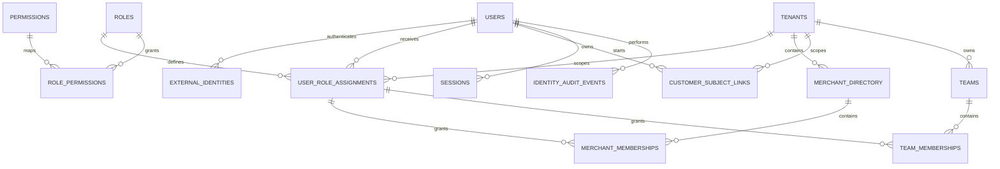

### 11.3 Illustrative PostgreSQL schema excerpt

The following DDL establishes a starting structure, not a complete migration. Extend it with catalog FKs, invitation/review tables, normalized identity links, tenant-aware composite FKs, applicable RLS and migration tests before deployment. Enforce role/scope compatibility in transactional domain use cases and database constraints where feasible.

```sql
CREATE TABLE identity.users (
    user_id uuid PRIMARY KEY,
    account_type text NOT NULL CHECK (account_type IN ('customer', 'staff')),
    display_name text NOT NULL,
    status text NOT NULL CHECK (status IN ('pending', 'active', 'suspended', 'deactivated')),
    authz_version bigint NOT NULL DEFAULT 1 CHECK (authz_version >= 1),
    created_at timestamptz NOT NULL DEFAULT now(),
    updated_at timestamptz NOT NULL DEFAULT now()
);

CREATE TABLE identity.role_assignments (
    assignment_id uuid PRIMARY KEY,
    user_id uuid NOT NULL REFERENCES identity.users(user_id),
    tenant_id uuid NOT NULL,
    role_id text NOT NULL,
    scope_key text NOT NULL,
    merchant_ref text,
    team_id uuid,
    status text NOT NULL CHECK (status IN ('pending', 'active', 'revoked')),
    granted_by uuid REFERENCES identity.users(user_id),
    granted_at timestamptz NOT NULL DEFAULT now(),
    revoked_at timestamptz,
    grant_review_id uuid
);

CREATE UNIQUE INDEX one_active_role_scope
ON identity.role_assignments (user_id, tenant_id, role_id, scope_key)
WHERE status = 'active';

CREATE TABLE identity.sessions (
    session_id uuid PRIMARY KEY,
    token_hash bytea NOT NULL UNIQUE,
    user_id uuid NOT NULL REFERENCES identity.users(user_id),
    assignment_id uuid REFERENCES identity.role_assignments(assignment_id),
    authz_version bigint NOT NULL,
    mfa_verified_at timestamptz,
    issued_at timestamptz NOT NULL DEFAULT now(),
    expires_at timestamptz NOT NULL,
    revoked_at timestamptz,
    CHECK (expires_at > issued_at)
);
```

Do not expose `scope_key` as a free-form authority selector. Derive it from validated role and scope fields. Enforce that a selected session assignment belongs to the session user and is currently active (composite FK or equivalent verified transaction). Role grant/revoke and authz-version update plus audit/outbox write occur atomically. Use identity-owned transaction locks for concurrent administrative changes; do not couple these transactions to remote payment network calls.

### 11.4 Privacy and retention

Store contact data only as needed, mask it in UI/logs, encrypt sensitive fields as appropriate, and use secret management for provider credentials. Financial ledger audit and identity audit have distinct ownership, access controls and retention requirements. An append-only audit event does not imply storing every raw personal detail forever; use stable IDs and minimized before/after metadata. Avoid phone/email/transaction identifiers in metric labels. Define deletion/anonymization and required financial-record retention with authorized compliance review before production.

---

## 12. API and service integration contracts

The endpoints below are a proposed external API surface. Preserve existing routes/semantics where available. A route listed as new does not currently exist merely because a frontend needs it. Implement versioned adapters and contract tests before enabling real-peer mode.

### 12.1 Authentication endpoints

| Method / route | Input / behavior |
|---|---|
| `POST /v1/auth/customer/register` | Verified-contact enrollment request; server assigns only customer role |
| `POST /v1/auth/customer/verify` | Verify customer contact challenge; establish approved identity link separately |
| `POST /v1/auth/login` | Approved credential/identity flow; generic errors, rate-limits; no caller-controlled role |
| `POST /v1/auth/mfa/verify` | Complete trusted provider challenge / step-up |
| `POST /v1/auth/accept-invitation` | Single-use token and verified recipient; activate approved scope |
| `POST /v1/auth/refresh` | Rotate session and resolve current authorization |
| `POST /v1/auth/logout` | Revoke current session |
| `GET /v1/auth/me` | Account status, active assignment, safe profile, permissions projection |
| `GET /v1/auth/workspaces` | Current authorized workspace list |
| `POST /v1/auth/workspaces/select` | Select an existing authorized assignment; rotate/update session |

Production OIDC callback/challenge details depend on the chosen provider. Do not build a custom password cryptography scheme; if passwords are used by an approved framework, use maintained password hashing and credential recovery mechanisms.

### 12.2 Admin endpoints

| Method / route | Permission / behavior |
|---|---|
| `GET /v1/admin/users` | `identity.staff.manage`; staff-only paginated directory within admin scope |
| `POST /v1/admin/invitations` | `identity.staff.invite`; validate role, account class, tenant, grant authority |
| `GET /v1/admin/invitations` | Scoped invitation history/status |
| `POST /v1/admin/invitations/{id}/revoke` | Authorized revoke; token invalidation and audit |
| `GET /v1/admin/users/{id}` | Scoped staff detail |
| `PATCH /v1/admin/users/{id}` | Allowed profile changes only; do not smuggle role updates through generic patch |
| `POST /v1/admin/users/{id}/roles` | `identity.role.grant`; scoped grant or create privileged change request |
| `DELETE /v1/admin/users/{id}/roles/{assignmentId}` | `identity.role.revoke`; audited revocation and session invalidation |
| `POST /v1/admin/users/{id}/suspend` | Authorized status transition, revoke sessions |
| `POST /v1/admin/users/{id}/reactivate` | Explicit reviewed reactivation |
| `GET /v1/admin/roles` | Role catalog and assignable scopes |
| `POST /v1/admin/privileged-changes/{id}/decision` | Independent authorized review, exact requested change and revision |
| `GET /v1/admin/audit-events` | `identity.audit.read`; paginated redacted audit |
| `POST /v1/admin/users/{id}/sessions/revoke` | `identity.session.revoke`; scoped revocation |

Example proposed invitation payload:

```json
{
  "display_name": "Demo Payments Operator",
  "work_email": "operator@example.test",
  "tenant_id": "tenant-demo",
  "role_id": "operator",
  "scope": {"team_id": "payments-support"},
  "reason": "New support staff onboarding",
  "idempotency_key": "invite-demo-op-001"
}
```

Response: invitation ID, pending/approved status, expiry and sanitized role/scope summary. Do not return plaintext invitation secrets in normal admin API responses; delivery adapter handles them. Reject `role_id=customer` or service role identifiers. Do not accept `granted_by` from request body; derive actor from authenticated context.

### 12.3 Portal and domain APIs

| Portal | Proposed endpoint | Integration |
|---|---|---|
| Customer | `GET /v1/customer/dashboard` | Scoped cases and payment-subject aggregation |
| Customer | `GET /v1/customer/transactions` | Authorized customer transaction adapter, new if absent |
| Customer | `GET /v1/customer/cases` | Customer-scoped list (new projection if absent) |
| Customer | `POST /v1/cases` | Existing authenticated intake; server-resolved subject |
| Customer/operator | `POST /v1/cases/{caseId}/messages` | Existing revision-bound messages |
| Customer/operator/supervisor | `GET /v1/cases/{caseId}/events` | Existing SSE/JSON; apply role-specific response projection |
| Merchant | `GET /v1/merchant/dashboard` | Merchant analytics and scoped operational data |
| Merchant | `GET /v1/merchant/transactions` | Merchant transaction projection |
| Merchant | `GET /v1/merchant/settlements` | Merchant settlement module adapter |
| Merchant | `GET /v1/merchant/exceptions` | Merchant inbox module adapter |
| Merchant | `POST /v1/merchant/refund-requests` | Merchant refund request module; no direct ledger execution |
| Merchant | `GET /v1/merchant/disputes` | Merchant dispute service |
| Merchant | `GET /v1/merchant/team` | Authoritative membership projection |
| Operator | `GET /v1/operator/dashboard` | Scoped queue aggregates |
| Operator/supervisor | `GET /v1/ops/cases` | Existing ops queue; tenant/queue filter extension where required |
| Operator/supervisor | `GET /v1/ops/cases/{caseId}/evidence` | Existing authorized evidence proxy |
| Operator | `POST /v1/ops/cases/{caseId}/claim` | New atomic assignment action |
| Operator/supervisor | `POST /v1/ops/cases/{caseId}/escalate` | Existing escalation route and revision |
| Supervisor | `GET /v1/supervisor/dashboard` | Approval/exposure/team aggregates |
| Supervisor | `GET /v1/supervisor/approvals` | New authorized ledger-backed list projection |
| Supervisor | `POST /v1/ops/actions/{actionId}/decisions` | Existing case-api proxy; exact authenticated supervisor decision |
| Risk | `GET /v1/risk/dashboard` | New scoped risk aggregate |
| Risk | `GET /v1/risk/investigations` | New investigation list |
| Risk | `POST /v1/risk/investigations/{id}/findings` | Versioned finding record |
| Risk | `POST /v1/risk/restrictions/{id}/decision` | New policy-controlled risk decision |
| Admin | `GET /v1/admin/dashboard` | Redacted identity/platform aggregates |
| Admin | `GET /v1/admin/system-health` | Restricted operational health projection |
| Admin | `POST /v1/admin/evaluations/runs` | Optional sandbox evaluation runner |

Use typed Pydantic request/response models, pagination cursors, idempotency for creation/mutation where applicable, optimistic revisions for mutable resources, bounded input sizes, and stable error codes. Monetary fields are integer minor units. Return minimal role-appropriate representations; do not expose internal provider credentials or raw evidence to a customer or merchant.

### 12.4 Human identity propagation to existing services

The existing synthetic token-map contract is not a complete dynamic identity service. Introduce a reviewed authentication adapter for verified issuers or delegated credentials while preserving existing `Principal` semantics: `principal_id`, `tenant_id`, roles, subject refs and case scope. Proposed merchant/risk/admin roles require explicit contract extensions and service-specific mapping. The original supervisor identity must survive the decision proxy.

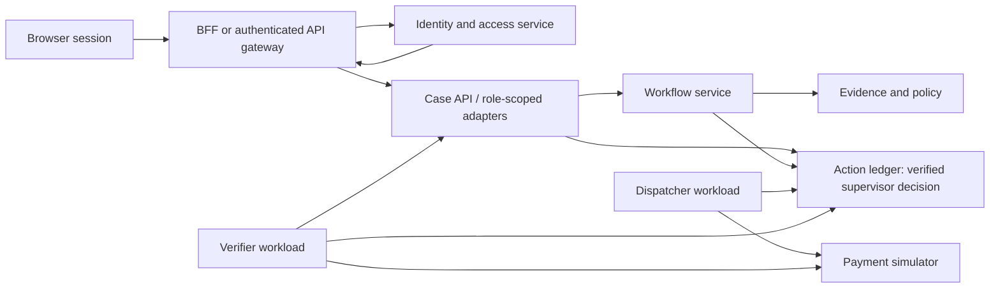

Migration options: (A) use existing synthetic scoped tokens for explicit demo users while implementing the central browser session adapter; ensure per-user identity and role changes are actually enforced, not only frontend redirects. (B) extend peer auth adapters to validate short-lived signed tokens from an approved issuer, with audience and scope. (C) use a narrowly scoped authenticated gateway that preserves user subject and verifies authorization at each service boundary. Choose and test one architecture; never silently substitute a broad service identity for a user's financial approval. Production requires stronger peer authentication, key rotation and revocation strategy than a static demo token map.

---

## 13. Frontend implementation and visual system

Use one Next.js application with shared TypeScript types, design tokens, API clients and role-specific layouts. Preserve existing route compatibility during migration. The following tree is a target structure; merge with the actual `apps/web` conventions rather than creating empty duplicate scaffolds.

```text
apps/web/src/
  app/
    page.tsx                         # product landing, customer/staff entry
    auth/
      accept-invitation/page.tsx
      verify/page.tsx
      mfa/page.tsx
      workspaces/page.tsx
      forgot-password/page.tsx
      reset-password/page.tsx
    customer/
      login/page.tsx
      register/page.tsx
      (protected)/
        layout.tsx
        dashboard/page.tsx
        transactions/page.tsx
        transactions/[transactionId]/page.tsx
        report/page.tsx
        cases/page.tsx
        cases/[caseId]/page.tsx
        assistant/page.tsx
        notifications/page.tsx
        profile/page.tsx
    merchant/
      login/page.tsx
      (protected)/
        layout.tsx
        dashboard/page.tsx
        transactions/page.tsx
        settlements/page.tsx
        settlements/[settlementId]/page.tsx
        exceptions/page.tsx
        refunds/page.tsx
        refunds/new/page.tsx
        disputes/page.tsx
        tasks/page.tsx
        analytics/page.tsx
        team/page.tsx
        settings/page.tsx
    operator/
      login/page.tsx
      (protected)/
        layout.tsx
        dashboard/page.tsx
        queue/page.tsx
        cases/[caseId]/page.tsx
        cases/[caseId]/evidence/page.tsx
        escalations/page.tsx
        messages/page.tsx
        assistant/page.tsx
        knowledge/page.tsx
        activity/page.tsx
    supervisor/
      login/page.tsx
      (protected)/
        layout.tsx
        dashboard/page.tsx
        approvals/page.tsx
        approvals/[actionId]/page.tsx
        history/page.tsx
        team/page.tsx
        escalations/page.tsx
        audit/page.tsx
    risk/
      login/page.tsx
      (protected)/
        layout.tsx
        dashboard/page.tsx
        queue/page.tsx
        investigations/[caseId]/page.tsx
        transactions/page.tsx
        holds/page.tsx
        reports/page.tsx
        analytics/page.tsx
        audit/page.tsx
    admin/
      login/page.tsx
      (protected)/
        layout.tsx
        dashboard/page.tsx
        users/page.tsx
        users/invite/page.tsx
        users/[userId]/page.tsx
        roles/page.tsx
        tenants/page.tsx
        merchants/page.tsx
        teams/page.tsx
        policies/page.tsx
        integrations/page.tsx
        observability/page.tsx
        ai/page.tsx
        evaluations/page.tsx
        audit/page.tsx
        security/page.tsx
    unauthorized/page.tsx
  components/
    auth/                            # shared forms, MFA, workspace chooser
    layout/                          # AppShell, SideNav, breadcrumbs
    cases/                           # timeline, messages, state badge
    evidence/                        # provenance, freshness, record view
    approvals/                       # integrate SN-013 ApprovalPanel
    dashboards/                      # KPI cards, queues, charts
    identity/                        # staff invite, permission preview
    ui/                              # accessible primitives
  lib/
    server/auth.ts                   # server-side session resolution
    server/authorization.ts          # scoped permission checks
    server/api-client.ts             # verified peer communication
    permissions.ts                   # safe UI permission projection
    format-money.ts                  # integer-paise display
```

Route groups `(protected)` keep login pages outside authenticated layouts. Perform server-side authorization at the data-access layer, route handlers and mutation endpoints. Middleware may redirect unauthenticated navigation for convenience, but is not the sole authorization barrier. Do not cache authenticated dashboard responses across users or tenants; include identity/scope in safe cache keys or disable shared caching. Never expose service bearer tokens through `NEXT_PUBLIC_*` settings.

### 13.1 Design system

Use the submitted Sentinel deck's monochrome enterprise aesthetic: dark graphite/white surfaces, blue primary actions, restrained borders and highly legible typography. Keep consistent navigation and components across portals, while differentiating purpose by role and content rather than arbitrary palettes.

- Customer: mobile-first, simple wording, large report/voice controls, clear case timeline, minimal financial terminology, regional-language support.
- Merchant: data-rich tables, settlement charts, exception inbox, transaction detail and scoped business filters.
- Operator: desktop case workspace with evidence-first panels, keyboard-friendly queue and persistent case timeline.
- Supervisor: high-contrast exact amount and decision context, visually distinct reject/approve, stale-state indicator, no editable financial payload.
- Risk: clear provenance, severity/uncertainty labels, restricted evidence views, structured findings and review controls.
- Admin: staff table, role/scope assignment form, permission preview, configuration version history and system health.

Every dashboard needs loading, empty, error, unauthorized, stale-data and service-unavailable states. Use accessible contrast, semantic headings and table headers, visible focus, keyboard interaction, non-color-only status cues and confirmation dialogs for sensitive mutations. Show simulator/fixture banners consistently; no invented live stats. For Tamil/Hindi localization, keep translated text readable with appropriate fallback fonts and preserve original user statements when showing translations.

### 13.2 Shared components and data contracts

| Component | Inputs | Behavior |
|---|---|---|
| `RoleLogin` | requested portal, locale | Authenticates; server resolves role, never grants it |
| `ProtectedShell` | current verified session, authorized navigation | Enforces role scope, shows active workspace and logout |
| `StatusBadge` | canonical case/action state | Maps known states to role-appropriate labels |
| `CaseTimeline` | sanitized authorized events | Ordered events, resumable cursor, stale/reconnect handling |
| `EvidencePanel` | scoped evidence DTOs | Provenance/freshness, masked sensitive values, conflicts |
| `ApprovalPanel` | existing SN-013 typed case/action/evidence/decide client | Exact digest/revision/expiry decision, refresh/conflict handling |
| `InviteStaffForm` | assignable roles/scopes | Server-validated invite, privilege preview and review status |
| `PermissionPreview` | proposed role and scope | Readable summary; advisory UI only, no enforcement authority |
| `Money` | integer minor units + currency | Correct localized formatting, no floating-point transaction calculations |
| `ServiceStatus` | authorized health status | Clear degraded/unavailable states, no fabricated success |

---

## 14. Backend architecture and repository integration

### 14.1 New and modified modules

```text
services/identity/                  # proposed new owned module
  src/sentinel_identity/
    domain/                         # user, role, grant, session, invitation rules
    application/                    # registration, invites, grants, revoke, resolve
    adapters/                       # PostgreSQL, trusted identity provider, HTTP
    bootstrap.py
  migrations/
  contracts/                       # identity.v1 proposed wire contract
  tests/
  README.md
  Makefile

services/risk/                      # proposed new owned module
  src/sentinel_risk/
    domain/
    application/
    adapters/
  migrations/
  contracts/
  tests/
  README.md
  Makefile

apps/api/                           # extend current case API
  # verified identity resolver, role projections, assignment endpoints

apps/web/                           # extend existing role shell
packages/approval-ui/               # reuse, do not fork financial decision logic
services/merchant-teams/             # adapt to authoritative identity membership
services/workflow/                  # identity-compatible input; risk resume event
services/policy/                    # versioned risk and role-aware checks where needed
services/action-ledger/             # preserve sole financial authority; auth adapter
services/dispatcher/                # preserve workload identity and safe recovery
services/verifier/                  # preserve evidence-backed closure
integration/core/                   # full-stack role and payment journey tests
release/mvp/                        # release evidence includes assembled RBAC journeys
```

The repository uses independent module ownership, pinned wire contracts and module-local dependency manifests. Keep that pattern. Add an identity task and risk task with their own owned roots, local doubles, contract snapshots and tests. Review cross-module contract changes through a coordinated migration; do not alter unrelated module internals to satisfy a new UI. Use the existing `AGENTS.md`, `CONTRIBUTING.md` and task register process before making repository changes.

### 14.2 Identity integration migration

1. Define `identity.v1` contract and versioned human-role catalog. Decide verified issuer/delegation strategy and update principal validation rules for new roles deliberately.
2. Build the identity service and seed one synthetic customer, merchant, operator, supervisor, risk officer and admin with distinct accounts/scopes. Add negative cross-tenant demo identities.
3. Build secure browser sessions and dedicated login screens; make protected pages use actual authenticated identity, not a fixture role toggle.
4. Integrate existing Case API and ledger approval identity paths. Ensure original supervisor identity is preserved. Maintain real-peer failures without fallback.
5. Adapt merchant staff service to a single authoritative membership store; migration may project identity changes to merchant operational records via outbox. Avoid simultaneous conflicting role authorities.
6. Implement queue assignments and risk integration; enforce new restrictions in policy/ledger interfaces rather than only UI.
7. Replace fixture dashboard aggregates and placeholder approval/voice slots with real scoped clients. Keep voice explicitly disabled if unavailable.
8. Assemble and test all critical role journeys in simulator. Only then enable optional FinHarness management and advanced portals.

### 14.3 Scalability and security

- Horizontally scale stateless API/BFF and portal workers. Keep durable identity/session state in PostgreSQL or an approved shared session store; use bounded caching with revocation/version invalidation.
- Use indexed tenant + scope + status queries, pagination, per-role dashboard materialized/read projections when justified, and explicit freshness. Do not load all cases and filter in browser.
- Partition operational queues by tenant/team and use durable events; multiple operators cannot claim the same case without conflict handling.
- Continue financial concurrency controls in SN-009: row-level locks, atomic reservations and outbox, stable idempotency keys, no remote calls inside financial DB transaction.
- Enforce tenant isolation in queries, service credentials and database constraints/RLS where appropriate. Test RLS under actual runtime roles; do not rely on a superuser connection bypassing it.
- Use least-privilege database credentials per service, encrypted transport, secret references, audit logging, rate limits, secure headers and restricted network access to financial services.
- Treat all customer input, receipts, merchant notes and model responses as untrusted. Prompt injection must not change permissions, tools or finance policy. Model calls receive minimized scoped context only.
- Limit financial actions to authorized dispatcher; sandbox-admin actions and fault injection only in isolated demo environment.

---

## 15. Observability, audit and operational metrics

Reuse OpenTelemetry, Prometheus/Grafana, trace/log backends and optional Langfuse. Add identity and role-specific operational metrics. Distinguish customer-visible case timeline, operational telemetry and authoritative financial/identity audit records; they have different guarantees and access needs.

### 15.1 Trace spans (proposed naming)

```text
identity.session.authenticate
identity.workspace.resolve
identity.staff.invite
identity.role.assign
identity.role.revoke
identity.session.revoke
case.intake.create
case.assignment.claim
case.evidence.fetch
workflow.model.propose
policy.evaluate
ledger.approval.decide
ledger.reservation.create
dispatcher.refund.submit
dispatcher.refund.reconcile
verifier.credit.assess
case.result.publish
risk.investigation.record
risk.restriction.decide
```

Propagate request/trace IDs across verified service boundaries. Long-running case events may link traces rather than hold a single open request span for hours. Store protected case/action correlation IDs in restricted traces and case audit, not high-cardinality metric labels. Redact tokens, invitation secrets, contact data, raw complaint audio and sensitive evidence. Do not log full authorization headers.

### 15.2 Metrics and dashboard definitions

| Proposed metric | Operational meaning |
|---|---|
| `identity_login_attempts_total{role,result}` | Authentication reliability and failure signals |
| `identity_staff_invitations_total{result}` | Staff onboarding outcomes |
| `identity_role_changes_total{role,operation}` | Role grants/revocations and audit reconciliation |
| `identity_authz_denied_total{permission,reason}` | Authorization violations; bounded reason labels |
| `identity_session_revocation_latency_seconds` | Time until revoked access is denied |
| `case_queue_depth{queue,status}` | Backlog and escalation health |
| `case_assignment_conflicts_total` | Concurrent claim/update conflicts |
| `approval_wait_seconds` | Time between eligible proposal and decision |
| `financial_action_blocked_total{reason}` | Policy and safety controls triggered |
| `refund_unknown_outcomes` | Current unknown refund actions (gauge) |
| `verified_resolution_total{scenario}` | Case-specific verified outcomes |
| `risk_investigation_age_seconds` | Investigation backlog duration |
| `risk_restrictions_active` | Active authorized restrictions (gauge) |
| `workflow_investigation_duration_seconds` | Investigation processing time, not total bank wait |
| `evaluation_safety_failures_total{suite}` | Optional evaluation/release failures |

Metric labels must be bounded and non-identifying. User-facing dashboards derive personal or merchant-scoped aggregates through authorized APIs, not direct unrestricted Grafana queries. Display rates with denominator/time window, distinguish current gauges and cumulative counters, and label synthetic results. Do not count escalated, pending or rejected cases as verified resolutions.

### 15.3 Audit event families

Identity: invite created/revoked/accepted, account activated/suspended/reactivated, role granted/revoked, privileged review, session revocation, denied sensitive access. Financial: existing authoritative ledger approvals, reservations, claims, provider outcome and verification. Risk: investigation assignment, evidence-linked finding, restriction creation/clearance and reviewer. Operational: case assignment, escalation, message, case result and configuration deployment. Each record identifies authenticated actor or workload, scoped resource, request/correlation ID, time, reason and applicable version. Audit write must be part of the authoritative transaction where required; telemetry export failure is not permission to lose financial audit.

---

## 16. Test plan and acceptance criteria

Do not treat root repository `make check`, successful fixture previews, or provider-only HTTP journeys as evidence of complete six-role integration. Record exact commands, commit SHA, configuration/evidence mode, results and limitations.

### 16.1 Authentication and authorization tests

| ID | Test | Expected result |
|---|---|---|
| AUTH-01 | Customer registers with extra `role=admin` field | Reject or ignore privileged field; account is customer only |
| AUTH-02 | Public staff signup attempt | No staff account or role created |
| AUTH-03 | Valid invited operator accepts link twice | First succeeds; replay rejected/idempotent without new grant |
| AUTH-04 | Expired, revoked, mismatched-email invitation | Denied; no assignment activated |
| AUTH-05 | Operator opens supervisor login/dashboard URL | Role mismatch / denied; no protected data |
| AUTH-06 | Operator calls decision API directly | 403; ledger state unchanged |
| AUTH-07 | Merchant A changes URL to merchant B resource | Denied; no existence leak as appropriate |
| AUTH-08 | Customer requests another subject's case or transaction | Denied; no data returned |
| AUTH-09 | Merchant approver attempts ledger approval | Denied; internal approval grants no money authority |
| AUTH-10 | Merchant admin attempts platform staff grant | Denied |
| AUTH-11 | Admin attempts to grant customer role through staff invite | Denied |
| AUTH-12 | Admin attempts unauthorized privileged self-grant | Denied or pending independent review; no effective grant |
| AUTH-13 | Role revoked while user has active session | Subsequent protected access denied within documented window |
| AUTH-14 | Suspended supervisor attempts decision | Denied; audit records failure |
| AUTH-15 | Forged tenant/role header or modified browser session | Denied; no role escalation |
| AUTH-16 | Multi-workspace user switches to unassigned tenant | Denied; existing scope unchanged |
| AUTH-17 | CSRF mutation against active cookie session | Denied |
| AUTH-18 | Staff/admin sensitive login without required MFA | Challenge required; no privileged session |
| AUTH-19 | Replay logged-out/revoked session token | Denied |
| AUTH-20 | Admin attempts direct provider write or financial override | Denied; no money authority |
| AUTH-21 | Risk officer calls ledger approval endpoint | Denied |
| AUTH-22 | Service token used as browser staff identity | Denied |
| AUTH-23 | Staff directory or dashboard cache reused across tenants | No cross-tenant response leakage |
| AUTH-24 | Customer account used to accept staff invite | Denied under separate account-class policy |

### 16.2 Financial and cross-role integration tests

| ID | Test | Required evidence |
|---|---|---|
| FLOW-01 | Customer creates duplicate-payment case; workflow proposes; supervisor approves | Actual Case API, workflow, ledger, dispatcher, simulator and verifier exercised |
| FLOW-02 | Commit-then-timeout after refund request | Same provider reference reconciled; exactly one logical refund; correct ledger balance |
| FLOW-03 | Supervisor rejects proposal | No reservation/provider write for rejected action |
| FLOW-04 | Stale digest/revision/expiry | Approval or reservation rejected safely; new proposal required |
| FLOW-05 | Two concurrent refund reservations | Total exposure never exceeds captured amount |
| FLOW-06 | Duplicate/out-of-order webhook | Idempotent processing; authoritative state not regressed |
| FLOW-07 | Provider confirms but credit pending | Customer and merchant views remain pending, case not resolved |
| FLOW-08 | Credit confirmed with wrong action/amount/tenant | Rejected; no fabricated closure |
| FLOW-09 | Operator requests clarification and customer responds | Revision and durable workflow resume; old proposal not silently reused |
| FLOW-10 | Suspicious case enters fraud queue | Risk officer can review; regular refund path blocked as applicable |
| FLOW-11 | Authorized risk clearance | Re-evaluate current state; separate supervisor approval still required |
| FLOW-12 | Suspend staff after provider outcome becomes unknown | Human access revoked; dispatcher/verifier continue reconciliation |
| FLOW-13 | Merchant mismatch case | Verified order reconciliation or truthful human escalation; no premature closure |
| FLOW-14 | Merchant refund request and internal review | Merchant approval not sufficient; ledger still enforces supervisor decision |
| FLOW-15 | Real peer unavailable | Visible degraded/failure state; no silent fixture fallback |
| FLOW-16 | Financial audit available when telemetry export fails | Financial records persist; no sampled audit loss |

### 16.3 UI end-to-end test coverage

Use Playwright or another suitable browser testing tool if adopted in the web module. Open isolated browser contexts for customer, operator, supervisor, admin, merchant and risk. Verify login, navigation, authorized dashboard data, direct protected-route access, role changes, logout, keyboard navigation and responsive layout. Use explicit synthetic data and actual authenticated test sessions; a frontend demo role selector is not a substitute for authorization tests. Include screen evidence of the supervisor exact approval component, operator case timeline and customer verified status.

### 16.4 Release gates

- All P0 identity, scope and financial safety tests pass with no unauthorized/duplicate financial writes.
- Existing module checks and new contract compatibility checks pass; record real results.
- Full case→workflow→ledger→dispatcher→verifier journey succeeds in simulator, with the expected authoritative ledger evidence; provider-only path is not sufficient.
- Role portal actions reach actual scoped backend adapters; fixture-only UI is clearly labeled and excluded from assembled-release claims.
- No known critical cross-tenant authorization or privilege escalation defect.
- Demo/live inference evidence modes are disclosed. Live Sarvam reasoning and voice are claimed only if actually exercised and verified.
- Optional FinHarness/FinBench deployment remains independently gated; no regression in core financial safety.

---

## 17. Implementation roadmap and hackathon scope

The product can support six portals, but the near-term priority is a fully integrated primary case journey rather than building dozens of decorative pages.

| Milestone | Priority | Deliverables | Exit criterion |
|---|---|---|---|
| M0 — Baseline and contracts | P0 | Confirm current branch, role catalog, identity propagation design, new task ownership | Reviewed role/scope contract and no duplicate financial authority |
| M1 — Identity and login | P0 | Customer registration, seeded/invited staff, sessions, role-specific login and protected layouts | Real per-user scope enforced, customer/staff separation and negative tests |
| M2 — Admin provisioning | P0 | Staff invite, role/scope assignment, directory, suspension, audit | Admin creates authorized operator/supervisor; revoked role cannot act |
| M3 — Customer + operator | P0 | Dashboards, complaint intake, case timeline, evidence queue, clarification/escalation | Authenticated case moves through actual workflow |
| M4 — Supervisor + money path | P0 | Real approval UI, ledger reservation, dispatcher recovery, verification | ₹1,500 hero demo with exactly one simulated refund and verified closure |
| M5 — Observability and validation | P0 | Trace correlation, safety checks, release evidence, status correctness | Reproducible integrated demonstration and measured results |
| M6 — Merchant portal | P1 | Scoped merchant dashboard, exception, settlement/refund/dispute pages, team membership | Merchant A/B isolation; internal approvals cannot authorize refund |
| M7 — Risk portal | P1 | Dedicated role/queue, investigations, restrictions and resume events | Fraud route blocks inappropriate execution; safe legitimate-case return |
| M8 — Governance extensions | P2 | Advanced admin policies, privileged reviews, FinHarness and FinBench controls | Versioned reviewed deployment and optional benchmark evidence |

M6/M7 can be developed independently against typed doubles in the repository's existing task model, but their real portal integration must not be declared complete until the necessary identity and domain contracts are assembled. Avoid implementing authentication by granting every frontend the same broad fixture credential.

### 17.1 Proposed team lanes

- Lane A: identity service, server session resolution, admin staff invitation and RBAC tests.
- Lane B: case/workflow/ledger/dispatcher/verifier integration, financial authority and failure recovery.
- Lane C: Next.js customer/operator/supervisor/admin portals, shared layout, approval component and optional Sarvam voice.
- Lane D: assembled tests, observability, demo data, release evidence; merchant/risk extension integration if capacity permits.

The lanes are suggestions, not assumptions about available team size or time. Keep one integration owner responsible for version compatibility and end-to-end evidence. Do not split financial authority across teams/services.

### 17.2 Demo scenario and presentation order

1. Admin logs in, shows actual staff directory, invites or activates an operator and supervisor with specific roles. Show customer role absent from staff grants.
2. Customer logs in or registers separately, selects transaction, submits Tamil complaint (live voice only if genuinely available), sees case created.
3. Operator opens queue, shows original complaint and cross-system evidence. Explain that routine investigation can run without operator intervention.
4. Supervisor opens exact ₹1,500 approval, reviews immutable amount/reference/evidence, approves. Show operator cannot access the same approval action.
5. Simulator injects commit-then-timeout. Dispatcher reconciles original reference. Show unknown/pending status rather than a second refund.
6. Verifier confirms simulated customer credit; customer timeline and supervisor history reflect verified outcome. Demonstrate exactly one logical refund from the ledger/provider records.
7. Admin opens redacted trace/metrics, explains role audit and financial audit separation, then shows optional merchant/risk portal capabilities with honest fixture/integration labels.
8. If time permits, show risk variant: suspicious case escalated, risk officer reviews, cannot approve a refund. Show merchant portal settlement/exception view as extension.

**Demo fallback:** If a live model or voice API is unavailable, switch to explicitly labeled fake inference or text input only through approved demo configuration. Never disguise fixture inference or sample dashboard data as live. Preserve the actual financial execution path. If full assembly remains incomplete, show the exact working subset and identify missing boundaries rather than claiming production readiness.

---

## 18. Source baseline and handoff checklist

This proposed design builds on the submitted Sentinel pitch and prior inspected repository materials. Consult the exact current files before implementation:

- [Repository README](https://github.com/Dijo-404/sentinel/blob/main/README.md) — current milestone and evidence limitations.
- [Architecture](https://github.com/Dijo-404/sentinel/blob/main/docs/architecture.md) — ownership, module boundaries and runtime data flow.
- [Independent task contracts](https://github.com/Dijo-404/sentinel/blob/main/docs/independent-task-contracts.md) — principal semantics, case/action routes, approvals and role boundaries.
- [Task register](https://github.com/Dijo-404/sentinel/blob/main/docs/task-register.md) — module ownership and independent task IDs.
- [Case API](https://github.com/Dijo-404/sentinel/blob/main/apps/api/README.md) — current authenticated intake, messages, SSE, queue and decision proxy.
- [Web shell](https://github.com/Dijo-404/sentinel/blob/main/apps/web/README.md) — existing routes, fixture/real-peer modes and component slots.
- [Approval UI](https://github.com/Dijo-404/sentinel/blob/main/packages/approval-ui/README.md) — exact decision component and adapter behavior.
- [Action ledger](https://github.com/Dijo-404/sentinel/blob/main/services/action-ledger/README.md) — authoritative reservations, approvals and financial invariants.
- [Workflow](https://github.com/Dijo-404/sentinel/blob/main/services/workflow/README.md) — durable LangGraph execution and fake/live model boundary.
- [Dispatcher](https://github.com/Dijo-404/sentinel/blob/main/services/dispatcher/README.md) and [Verifier](https://github.com/Dijo-404/sentinel/blob/main/services/verifier/README.md) — safe execution and verified outcomes.
- [Merchant teams](https://github.com/Dijo-404/sentinel/blob/main/services/merchant-teams/README.md) — existing merchant staff subroles and advisory limits.
- [Sandbox runbook](https://github.com/Dijo-404/sentinel/blob/main/integration/core/docs/sandbox-runbook.md) — prior provider-only journey scope and full-path evidence gap.
- [Phase 2 specification](https://github.com/Dijo-404/sentinel/blob/main/docs/sentinel-p2.md) — optional FinHarness and FinBench direction.
- Submitted `Sentinel_Pitch_Deck.pdf` — nine-slide product intent; slides 3–6 define workflow, financial safety and observability, slide 7 presents the operations dashboard.

### Implementation handoff

- [ ] Agree on six human roles and existing merchant subroles; freeze names and mapping.
- [ ] Decide demo vs production identity adapter and secure service credential propagation.
- [ ] Define new module ownership, role/scope contract and migration compatibility.
- [ ] Implement customer-only self-registration and admin-only staff invitation.
- [ ] Implement six dedicated login routes using shared authentication and protected role layouts.
- [ ] Implement real dashboard APIs with role-scoped data projections.
- [ ] Reuse exact ledger-bound approval UI and decision proxy.
- [ ] Integrate case assignment and risk restrictions without weakening financial authority.
- [ ] Complete full simulator hero journey and negative authorization/safety tests.
- [ ] Provide measured test and integration evidence; label fixtures, simulation and live-model observations separately.
- [ ] Keep optional merchant/risk/FinHarness features gated until integrated and validated.

**Final product principle:** One platform, six human workspaces, one authoritative identity and access model, and one financial action ledger. Customers request help; merchants manage their business operations; operators investigate; supervisors authorize exact financial actions; risk officers investigate and manage authorized restrictions; platform administrators provision staff and govern the system. Machine services execute and verify independently. No role or AI model bypasses financial safety, and no case is marked verified without the required evidence.
