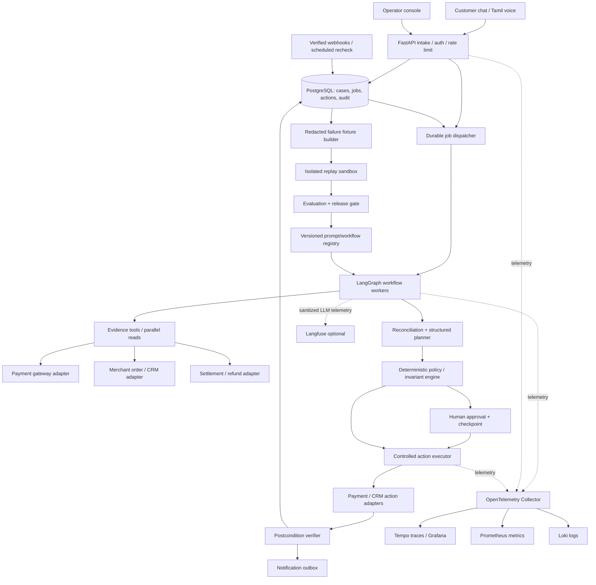
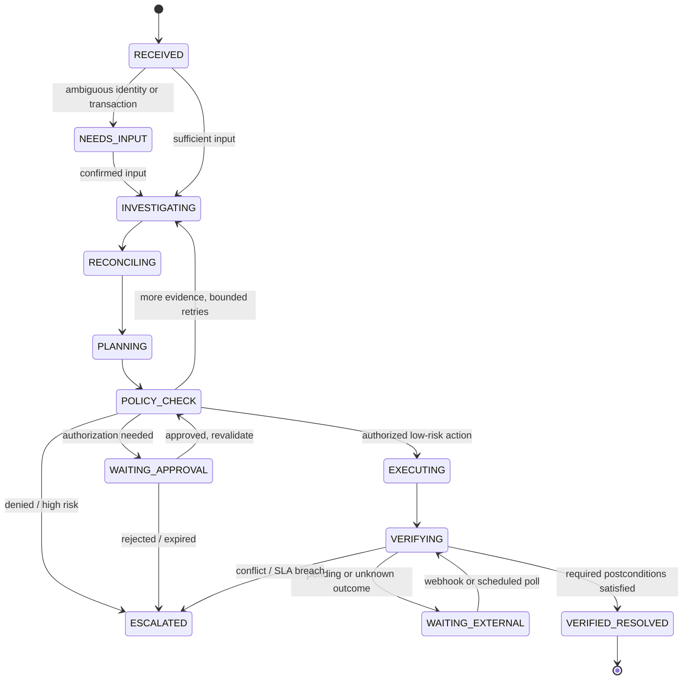
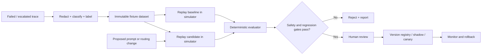
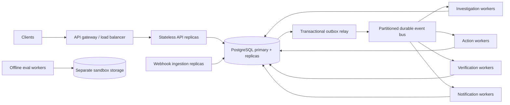

# ResolveOps AI
## Autonomous, policy-governed payment operations teammate

**Target:** Paytm Build for India AI Hackathon — Chennai | PS 3: Autonomous AI Teammates  
**Document:** Product specification, technical design, implementation roadmap and pitch-deck content  
**Status:** Proposed hackathon prototype; architecture and targets are not measured results  
**Version:** 1.0 | 12 November 2026

> **Tagline:** From customer complaint to verified resolution — autonomously, safely and observably.

## Contents

1. Product thesis and differentiation
2. Scope and customer journeys
3. Architecture and stack
4. Workflow and agent design
5. Payment safety and policy enforcement
6. Data model, API contracts and integration
7. Observability and operational dashboards
8. Sandbox and self-improvement harness
9. Scalability, reliability and security
10. Evaluation, business case and roadmap
11. Hackathon implementation and demo
12. Slide-by-slide pitch deck
13. Acceptance checklist and references

---

# 1. Product thesis

## 1.1 Executive summary

ResolveOps AI is an autonomous operations teammate that takes a payment-related complaint from intake to an evidence-backed resolution. It correlates transaction status, merchant order state, settlement records, refund history and policy; proposes an allowed action; obtains approval when required; executes through controlled tools; verifies the resulting state; and communicates the outcome to customers and support teams.

It is not a chatbot that happens to call payment APIs. It is a **payment exception-resolution control plane** with explicit workflow states, financial invariants, operational telemetry, human oversight and a regression-testing system.

**Product promise:** Resolve the case where possible; otherwise create the right next action and remain accountable for its follow-up. Never claim that money has moved without reliable evidence.

**Track fit:** The official PS 3 asks for AI teammates that can understand context, make decisions, perform actions across systems and produce measurable customer-service or sales outcomes. ResolveOps focuses on payment customer service, not sales. It also benefits merchants without requiring a second-track submission. [Official event listing](https://devsemble.com/hackathons/paytm-build-for-india-ai-hackathon-chennai-by-paytm).

## 1.2 Problem

A payment dispute rarely lives in one system. A customer sees a bank debit; the gateway reports pending; the merchant order is unpaid; the settlement system may not yet have an entry. A support agent must identify the right transaction, compare inconsistent or delayed records, read policies, create a dispute, communicate accurately and revisit the case when the bank or gateway responds.

Current failure modes:

- FAQ bots provide generic answers instead of investigating or changing system state.
- Support agents switch among transaction, CRM, merchant and settlement dashboards.
- Asynchronous payment events make a one-time status check inadequate.
- Incorrectly matched transactions, duplicate requests and unsafe retries can cause financial loss.
- An API response that accepts a request can be mistaken for a completed refund.
- AI systems often lack end-to-end evidence, measurable resolution rates and controlled improvement processes.

## 1.3 Users and buyer

| Persona | Primary job | ResolveOps value |
|---|---|---|
| Customer | Find missing money, get a reliable update | Voice/text intake, understandable status, case reference |
| Merchant | Investigate unpaid orders and settlement discrepancies | Correlated payment/order evidence and follow-up |
| Support operator | Resolve exceptions without switching tools | Evidence workspace, action preview and approval |
| Operations lead | Control backlog, losses and escalation quality | Queue, SLA, throughput and cost dashboards |
| Risk/compliance reviewer | Understand why an action occurred | Versioned policy decisions and audit history |
| AI/platform engineer | Improve reliability of agents | Traces, reproducible replay, eval gates and rollback |

The paying customer is a fintech, PSP, merchant aggregator or payment-enabled enterprise; Paytm is the initial target integration, not a confirmed customer or partner.

## 1.4 Core differentiation: three interlocking control loops

1. **Resolve loop:** Investigate → reconcile → plan → authorize → execute → verify → notify.
2. **Operate loop:** Trace every operation, detect failures/backlogs, correlate incidents, manage approvals and recover durable workflows.
3. **Improve loop:** Capture a failure → sanitize replay fixture → propose bounded change → test on holdout and adversarial cases → obtain approval → canary → monitor → roll back if necessary.

The defensible asset is the combination of normalized payment evidence, tested workflow policies, reproducible exception scenarios and outcome data. LLM access alone is not a moat. Do not claim that no competing vendor offers similar capabilities.

# 2. Scope and customer journeys

## 2.1 MVP versus production vision

| Capability | Hackathon P0 | After hackathon |
|---|---|---|
| Intake | Web chat, optional recorded Tamil voice | Mobile app, contact center, IVR, merchant channels |
| Payment evidence | Seeded simulator with gateway/order/ledger/refund data | Authorized Paytm PG and internal adapters |
| Workflow | LangGraph + PostgreSQL checkpoints; persistent jobs | Partitioned event-driven workers, disaster recovery |
| Resolution | Status lookup, ticket creation, recheck, approval-gated mock refund | Approved merchant-scoped real operations |
| Safety | Typed tools, policy rules, idempotency, approval UI | Enterprise IAM, fraud engine, formal controls |
| Observability | OTel traces, Prometheus metrics, Grafana, optional Langfuse | HA telemetry platform, SIEM and governed retention |
| Improvement | Offline replay, candidate prompt update, regression gate | Shadow/canary rollouts and continuous evaluation |
| Language | English and Tamil; Hindi if time permits | More languages, quality audits, accessible voice |
| Scale | Local Docker Compose, repeatable fixtures and load-test script | Kubernetes, managed databases, streaming infrastructure |

**Non-goals:** direct access to bank ledgers without authorization; real-money movement at the hackathon; unrestricted refunds; replacing the payment network; fully automated regulatory complaint closure; self-modifying production code or policies; generalized customer-support coverage.

## 2.2 Supported scenario matrix

| Scenario | Evidence | Safe action | Closure condition |
|---|---|---|---|
| Debited but pending | Gateway pending, matching customer-owned order | Create case, schedule recheck, communicate uncertainty | Terminal status + appropriate remediation verified |
| Successful payment, merchant order unpaid | Gateway success, merchant order unmatched | Open reconciliation task; notify merchant; approved order sync if adapter permits | Merchant order reflects payment or documented exception handoff |
| Duplicate payment | Two distinct successful transactions for same purchase; customer/merchant confirmation | Investigate refund eligibility; request approval for eligible duplicate | Refund outcome verified to the extent supported by provider evidence |
| Failed payment with claimed debit | Gateway failure, customer report, available reversal data | Track reversal or raise dispute; no merchant refund for failed original payment | Reversal verified, or remain open with next action / handoff |
| Refund pending | Refund reference and current refund status | Recheck, inform customer, escalate when policy deadline breached | Provider refund outcome confirmed; credit status communicated separately |
| Merchant settlement mismatch | Settlement report, transaction and fees | Create reconciliation issue with evidence | Adjustment/settlement confirmed or routed to authorized owner |
| Fraud or unauthorized transaction | Customer allegation, fraud signals | Immediate escalation to fraud workflow; safe guidance | Handoff verified; not marked financially resolved |
| Tool outage / conflicting records | Timeout, stale source, contradictory evidence | Retry safe reads, circuit break, escalate/recheck | Fresh evidence and authorized next action |

Build the first three plus a refund-pending case in P0. Other scenarios are test fixtures or roadmap.

## 2.3 Hero demo: ₹1,500 paid twice

A customer in Tamil reports a ₹1,500 payment that appeared to fail, then says they paid again. ResolveOps receives an authenticated demo session and two synthetic transaction records for the same order. It never assumes that duplicate amounts prove duplicate payment.

1. Intake extracts intent, date, merchant and possible order reference; asks for clarification if ambiguous.
2. The investigator fetches gateway records, merchant order and refund history in parallel, scoped to the customer/merchant.
3. Reconciliation finds two captured payments, one fulfilled order and no existing refund. The synthetic policy requires merchant confirmation of the duplicate and supervisor approval.
4. A reviewer confirms the order and approves a specific ₹1,500 refund proposal for the second transaction.
5. The executor uses a stable operation ID, atomically reserves the eligible amount and calls the simulator. A deliberately injected network timeout occurs after the simulator accepts the request.
6. Instead of issuing another refund, ResolveOps queries by the stable refund reference. It discovers that the original operation succeeded in creating a pending refund.
7. A signed simulated webhook later reports a provider outcome; a status check confirms it. The UI distinguishes refund initiated from money credited. In the fixture, synthetic ledger evidence finally confirms credit.
8. Case state becomes VERIFIED_RESOLVED only after the fixture's required postconditions hold. Customer receives a Tamil or English summary with reference and status.
9. Show a single correlated trace, approval audit, exactly one simulator refund side effect, and a replay regression test that catches a defective retry strategy.

**Why this demo wins attention:** It shows customer empathy, actual cross-system execution, a failure that matters financially, recovery without duplicate money movement, and technical proof. A simple chatbot cannot achieve this end-to-end outcome without an equivalent controlled workflow.

# 3. Architecture and stack

## 3.1 Logical architecture



**Key design decision:** Use one typed, durable workflow with specialist nodes rather than several open-ended agents chatting with one another. Parallelize independent evidence reads, but keep monetary actions serialized and governed. This makes it faster, cheaper and more debuggable.

## 3.2 Technology choices

| Layer | P0 selection | Reason / scale evolution |
|---|---|---|
| Web UI | Next.js + TypeScript + Tailwind + shadcn/ui | Responsive customer/operations console, SSE updates |
| API | Python FastAPI, Pydantic, SQLAlchemy async | Typed contracts, validation and async IO |
| Workflow | LangGraph + PostgreSQL checkpointer | Explicit graph and resumable human approvals |
| Database | PostgreSQL | Durable state, transactional action ledger, outbox |
| Jobs | PostgreSQL jobs with SKIP LOCKED and leased claims | Avoid extra broker at P0; later Kafka/Redpanda or managed queue |
| Cache | Optional Redis | Rate limits, non-authoritative cache, short-lived coordination |
| Model | Configurable structured-output LLM via provider adapter | Provider flexibility; smaller model for extraction, stronger model for difficult plans |
| Policy | Python typed rules + versioned YAML | Deterministic, testable; OPA optional in enterprise deployments |
| Retrieval | Versioned policy documents; PostgreSQL FTS, optional pgvector | Cite policy sections; no vector DB needed for small policy corpus |
| Voice | Sarvam STT/TTS adapter | Indian languages; text fallback if API unavailable |
| Telemetry | OpenTelemetry SDK/Collector; Prometheus, Grafana, Tempo, Loki | Standard traces/metrics/logs, cross-service debugging |
| LLM observability | Langfuse optional | Model spans, token/cost tracking, prompt versions, dataset/eval views |
| Evaluation | pytest, JSONL golden fixtures, httpx mock transport | Deterministic state assertions and offline replay |
| Deployment | Docker Compose; later Kubernetes | Local demo; independently scalable worker pools |
| CI | GitHub Actions | Lint, unit/integration/eval gates, build and migration checks |

Use lockfiles and tested package versions rather than assuming latest packages interoperate. LangGraph's durable checkpointer and interrupt/resume support fit approval workflows. See [LangGraph interrupts](https://langchain-ai.github.io/langgraph/concepts/human_in_the_loop/). Sarvam documents Tamil and English support for speech models; validate the exact configured model and language before the demo. [Sarvam model documentation](https://docs.sarvam.ai/api/getting-started/models).

## 3.3 Component responsibilities

- **Intake service:** Authenticated identity, consent, schema validation, rate limits, case creation, request deduplication; responds with a case ID quickly.
- **Workflow service:** Executes typed graph, maintains state and budgets, schedules waits and approvals. No direct provider secrets in the LLM context.
- **Evidence service:** Read-only adapters; normalizes provider responses with source, timestamps, signature validation and freshness.
- **Policy engine:** Determines ALLOW, REQUIRE_APPROVAL, DENY or NEED_EVIDENCE; independent of model-generated opinions.
- **Execution gateway:** Only write interface to external systems; validates identity, policy, approval and reservation, performs idempotent dispatch, records outcome.
- **Verifier:** Queries authoritative systems and checks expected postconditions; handles delayed events, unknown outcomes and contradictory evidence.
- **Operations UI:** Timeline, evidence, approval inbox, escalation, trace links, queue/impact metrics.
- **Replay lab:** Offline isolated simulator, deterministic assertions, prompt/workflow registry, evaluation reports and release gates.

# 4. Workflow and agent design

## 4.1 Graph topology



`ESCALATED` means an accountable human owns the case; it is not synonymous with resolution. A separate terminal `CLOSED_NO_ACTION` may be allowed after a verified informational answer or explicit authorized closure. Reopening creates a new investigation revision linked to prior evidence.

## 4.2 Specialist nodes

| Node | AI or deterministic? | Input/output |
|---|---|---|
| Intake/classification | LLM structured output, then validation | Intent enum, references, language, missing fields |
| Evidence collector | Deterministic tool orchestration | Normalized source snapshots |
| Reconciliation | Rules first; LLM may summarize conflict | Facts, inconsistency codes, evidence IDs |
| Planner | Bounded LLM structured output | Candidate action and rationale summary, not authority |
| Policy | Deterministic | Rule matches, outcome, obligations, policy version |
| Approval | Human + deterministic signature/expiry | Decision bound to immutable action payload |
| Executor | Deterministic | Action receipt, status, stable provider reference |
| Verifier | Deterministic postconditions | Verified/pending/conflict plus evidence |
| Communicator | Grounded template or LLM constrained to verified facts | Localized message; no unsupported promises |

Use maximum three model calls for a typical case (extract, plan, communicate); deterministic templates can remove the final call. Set a configurable 8-step investigation budget, model token limits, 30-second active planning budget, and explicit wait states for long external processes. These are initial design budgets, not measured latency or limits.

## 4.3 Typed state and model output (illustrative Python)

```python
from typing import Literal, TypedDict
from pydantic import BaseModel, Field

class ProposedAction(BaseModel):
    action: Literal['STATUS_UPDATE', 'OPEN_DISPUTE', 'SCHEDULE_RECHECK',
                    'REQUEST_REFUND', 'SYNC_ORDER', 'ESCALATE']
    transaction_id: str | None = None
    amount_minor: int | None = Field(default=None, ge=1)
    evidence_ids: list[str] = Field(min_length=1)
    reason_code: str
    rationale_summary: str = Field(max_length=1000)

class CaseState(TypedDict):
    case_id: str
    tenant_id: str
    workflow_version: str
    policy_version: str
    language: str
    evidence_ids: list[str]
    proposed_action: dict | None
    action_id: str | None
    approval_id: str | None
    status: str
    attempts: int
```

Identity and tenant are injected by the server from authentication, never taken from model output. Validate amount and transaction requirements per action; verify all evidence IDs belong to the case. No arbitrary tool name, SQL, URL or code execution from the LLM.

## 4.4 Human approval and durable execution

Use LangGraph `interrupt()` at an approval node, persist `thread_id=tenant_id:case_id:revision` and resume from a server-authorized approval. The interrupting node can re-run when resumed: never put a non-idempotent side effect before the interrupt. Approval endpoint verifies reviewer role, case tenancy and action digest, stores a decision and creates a durable resume job. Do not leave a worker occupied while waiting for a person or a bank. Use a case-level revision/lease to prevent concurrent conflicting graph runs.

# 5. Payment safety and policy enforcement

## 5.1 Trust boundaries

**LLM = proposal, not authorization.** Trusted evidence comes from authenticated connectors and validated provider responses. Customer utterances, merchant messages, retrieved text and provider free-text are untrusted inputs. They cannot override tools, policy or scope. Never ask for or store UPI PINs, OTPs, full card numbers, CVV or bank passwords. The system uses a pre-authenticated session or an approved identity-verification handoff, not voice identity alone.

| Action | P0 authorization |
|---|---|
| Read scoped transaction status | Authenticated user and tenant scope |
| Create internal case / recheck | Automatic with validation and rate limit |
| Send status message | Verified facts, approved channel/template |
| Synchronize merchant order | Explicit merchant permission; approved simulated action |
| Refund of any amount | Human supervisor approval + eligible captured payment + reservation; mock only |
| Fraud, chargeback, unmatched transaction | Escalate, never automatically refund |

Production may allow bounded autonomous actions only after business/risk approval and controlled validation. No real-money action is necessary for the hackathon.

## 5.2 Financial invariants

1. Monetary quantities use integer paise (`150000` = ₹1,500); currency is explicit. Convert provider decimal strings using Decimal, never binary floats.
2. Original transaction must belong to the authorized tenant/merchant and be eligible for the requested action; a failed or pending payment is not an eligible captured-payment refund.
3. Sum of completed, pending and reserved refund amounts plus proposed amount must not exceed the eligible captured amount. Block concurrent reservations under a transaction row lock.
4. Refund destination is the original authorized payment route; no arbitrary recipient/bank account from the model.
5. Conflicting evidence, stale required sources, missing merchant authorization, an open chargeback or fraud flags deny or escalate according to policy.
6. Refund action cannot be executed without an unexpired approval tied to exact action, amount, target, policy version and payload digest. Recheck policy and fresh evidence before dispatch.
7. An accepted or pending refund is not evidence of final credit. Record provider outcome and customer-credit evidence separately. Never claim final credit unless an authorized source confirms it.
8. Do not use synthetic policy thresholds or timelines as real Paytm or banking rules. Production rules must be validated for each payment rail and complaint category by the responsible owner.

## 5.3 Idempotency, ambiguous outcomes and compensation

- Use stable `action_id` and `provider_ref` generated once per logical action. Create a unique business operation key and a payload hash; different payload under an existing key is a conflict.
- In one database transaction: lock payment reservation row, check remaining balance, store action reservation + immutable intent, enqueue dispatch via outbox. Do not hold a DB transaction open across network calls.
- Dispatcher claims action with lease, sets DISPATCHING, invokes an authenticated provider adapter and stores response. Use separate provider capability flags: some APIs allow duplicate-key retry; others require status query and operator intervention.
- On timeout/crash after dispatch: mark OUTCOME_UNKNOWN, query by original stable reference, never mint a new refund ID to retry blindly. If definitive evidence is unavailable, keep reserved amount and escalate. Releasing a reservation requires authoritative failure/expiry and policy approval.
- Webhooks: verify provider-specific signatures/checksums on original payload, tenant mapping, deduplication key and replay controls; persist inbox event before acknowledgement; tolerate duplicate and out-of-order events, reconcile with current status.
- No distributed exactly-once guarantee is assumed. At-least-once delivery + idempotent consumer state + provider reference reconciliation are the practical design. Do not attempt to reverse a refund by sending another payment; corrections require a separate authorized business process.

Illustrative policy pseudocode (not production-ready):

```python
def authorize_refund(ctx, payment, proposal, policy):
    if not ctx.can_act_on(payment) or payment.status != 'CAPTURED':
        return 'DENY'
    if not ctx.evidence_is_fresh or not ctx.merchant_confirmed:
        return 'NEED_EVIDENCE'
    if ctx.fraud_flag or ctx.open_chargeback:
        return 'DENY'
    if proposal.amount_minor <= 0 or proposal.amount_minor > ctx.refundable_minor:
        return 'DENY'
    if not ctx.approval_matches(proposal, policy.version):
        return 'REQUIRE_APPROVAL'
    return 'ALLOW'  # executor repeats checks atomically while reserving funds
```

# 6. Data model, API contracts and integrations

## 6.1 PostgreSQL schema outline

All business tables include tenant ID; use composite tenant-aware foreign keys or equivalent validated ownership. Enforce tenant row-level security as defense in depth; application queries still scope access. IDs are UUIDs unless stated; timestamps UTC.

| Table | Key fields / constraints |
|---|---|
| tenants / principals | tenant_id; role, provider merchant mappings |
| cases | id, tenant_id, subject_ref, intent, status, revision, SLA due, language, owner; index (tenant_id,status,created_at) |
| payment_snapshots | tenant, provider, merchant_ref, order_ref, txn_ref, status, amount_minor, observed_at, source_version |
| evidence | id, case_id, source, normalized_payload, digest, observed_at, expires_at, verification_status |
| payment_reservations | tenant, provider, merchant_ref, txn_ref; captured, reserved, pending, refunded amounts; unique payment identity |
| actions | id, case_id, operation_key, payload_hash, provider_ref, type, amount, status, lease_until; unique tenant/provider/operation_key |
| approvals | id, action_id, digest, policy_version, reviewer_id, decision, expires_at, decided_at |
| audit_events | id, case_id, event_type, actor_type/id, evidence_refs, version, trace_id, occurred_at, prior_hash optional |
| inbox_events | provider, tenant, dedup_key, verified_payload_ref, received_at, processed_at; unique provider/tenant/key |
| jobs / outbox | id, tenant, kind, payload, available_at, attempts, lease_until, status; claim index on status/available_at |
| policy_versions | immutable version, rules digest, effective_at, approver, artifact ref |
| eval_runs / release_versions | dataset hash, candidate version, baseline, metric results, approval, rollout state |

Append-only business audit is distinct from sampled tracing; restrict mutation/deletion, record privileged operations and periodically export to immutable storage in production. Hash links help detect tampering but alone do not prove audit integrity against a privileged database administrator.

## 6.2 Public application API (proposed, not Paytm endpoints)

| Endpoint | Purpose / authorization |
|---|---|
| POST /v1/cases | Create case, Idempotency-Key, authenticated customer/merchant |
| GET /v1/cases/{id} | Own case or assigned operator; redacted status |
| POST /v1/cases/{id}/messages | Add user input or clarification; scoped |
| GET /v1/cases/{id}/events | SSE timeline, authorized, event cursor resume |
| GET /v1/ops/cases | Filter operator queue; tenant/role scoped |
| GET /v1/ops/cases/{id}/evidence | Evidence workspace; role-based disclosure |
| POST /v1/ops/actions/{id}/decisions | Approve/reject with digest, revision and reviewer role |
| POST /v1/ops/cases/{id}/escalate | Assign team/owner and reason |
| POST /v1/webhooks/{provider} | Provider-specific signature verification, dedup |
| POST /v1/lab/replays | Sandbox-only replay for authorized engineer |
| GET /v1/lab/evaluations/{id} | Evaluation results and failure details |
| GET /healthz, /readyz | Liveness/readiness; internal metrics endpoint |

Example case request:

```json
{
  "message": "I paid Rs 1500 twice for the same order",
  "language": "en-IN",
  "order_reference": "DEMO-ORDER-42",
  "channel": "web"
}
```

Return HTTP 202 with `case_id`, `status: RECEIVED`, `status_url`. Derive tenant and customer from auth. Use 409 for conflicting idempotency payload or stale approval revision; 403/404 for unauthorized resources without leaking existence; 429 for rate limits. SSE reconnects via cursor and can fall back to polling. Error envelopes contain safe `code`, `message`, `request_id`; no secrets or raw provider payloads.

## 6.3 Provider abstraction

```python
from typing import Protocol

class PaymentAdapter(Protocol):
    async def get_transaction(self, scoped_order_ref: str): ...
    async def get_refunds(self, scoped_transaction_ref: str): ...
    async def get_refund_status(self, stable_ref: str): ...
    async def request_refund(self, approved_action): ...
    async def get_settlement_evidence(self, scoped_transaction_ref: str): ...
```

Actual adapters must validate scope and types independently. Simulated CRM, merchant order and ledger APIs are separate logical modules. In P0 they can run in one simulator service with isolated database and explicit fault injection.

**Public Paytm integration feasibility:** Paytm Payments documents transaction-status lookup, refund creation, refund-status lookup and settlement detail APIs. Merchant-specific credentials and signed requests are required; availability and permissions depend on the product and merchant account. Public merchant APIs do not grant platform-wide customer or internal CRM access. A production Paytm implementation needs authorized internal integration and formal review. The demo uses no live credentials or funds. Public documentation: [transaction status](https://www.paytmpayments.com/docs/api/v3/transaction-status-api/), [refund API](https://www.paytmpayments.com/docs/api/refund-api/), [refund status](https://www.paytmpayments.com/docs/api/refund-status-api/), [refund lifecycle](https://www.paytmpayments.com/docs/refund-management), [settlement detail](https://www.paytmpayments.com/docs/api/settlement-transaction-detail-api/).

# 7. Observability: make every AI action inspectable

Observability is a product capability, not an afterthought. Build two connected views: **operations telemetry** for system health and **AI quality telemetry** for reasoning/tool quality. Maintain a separate authoritative audit ledger for business and financial actions.

## 7.1 Distributed tracing

Instrument FastAPI, database calls, HTTP adapters and workflow nodes using OpenTelemetry. Propagate W3C Trace Context across HTTP and persist context or causal links with jobs/outbox messages. For long waits, start a new execution trace linked to the previous run rather than keeping a span open for days. Correlate all runs with a pseudonymous `case_id` and `workflow_run_id` in authorized views.

```text
case.execution
  intake.extract_intent
    gen_ai.chat [model, prompt_version, token_usage, duration]
  evidence.collect
    gateway.transaction_status
    merchant.order_status
    refunds.lookup
  reconciliation.evaluate
  planner.propose_action
    gen_ai.chat
  policy.evaluate
  approval.request
  [linked trace after approval]
  approval.validate
  action.reserve
  action.dispatch
    gateway.refund.apply [timeout / outcome_unknown]
  action.reconcile
    gateway.refund.status
  [linked trace after verified webhook]
  webhook.verify
  postcondition.verify
  case.transition
  notification.enqueue
```

Attributes: `service.name`, environment, `workflow.version`, `policy.version`, `prompt.version`, node name, action type, result category, retry count, model provider/name and token usage when reported. Use OpenTelemetry GenAI semantic conventions where applicable; pin convention/SDK versions because naming and stability may change. Record short rationale summaries and rule IDs, not hidden reasoning or full prompts by default. Case/action identifiers can appear in protected traces/logs, **not** as Prometheus labels. No PAN, UPI PIN, OTP, access token, raw bank statement, audio or unredacted prompts in telemetry.

Example instrumentation pattern:

```python
from opentelemetry import trace
from opentelemetry.trace import Status, StatusCode

tracer = trace.get_tracer('resolveops.workflow')

async def check_transaction(adapter, case, order_ref):
    with tracer.start_as_current_span('gateway.transaction_status') as span:
        span.set_attribute('workflow.version', case.workflow_version)
        span.set_attribute('payment.provider', adapter.name)
        try:
            result = await adapter.get_transaction(order_ref)
            span.set_attribute('payment.result_category', result.status)
            return result
        except TimeoutError:
            span.set_attribute('error.type', 'timeout')
            span.set_status(Status(StatusCode.ERROR, 'provider timeout'))
            raise
```

Disable automatic capture of sensitive request headers/bodies. Scrub exception contents in centralized logging. Add trace ID to structured logs and audit events. In production, keep all financial audit events but use configurable trace sampling with error/slow-run tail sampling, retention policies and access control; tracing loss must not imply loss of financial history.

## 7.2 Metrics and SLIs

| Metric (proposed instrumentation) | Type | Dimensions / interpretation |
|---|---|---|
| resolveops_cases_started_total | Counter | channel, scenario |
| resolveops_case_outcomes_total | Counter | outcome, scenario; one terminal classification per revision |
| resolveops_case_active_duration_seconds | Histogram | scenario; excludes human/external waits |
| resolveops_case_end_to_end_seconds | Histogram | scenario; includes waits |
| resolveops_tool_calls_total | Counter | tool, outcome |
| resolveops_tool_duration_seconds | Histogram | tool, provider |
| resolveops_actions_total | Counter | action_type, outcome |
| resolveops_financial_invariant_violations_total | Counter | invariant; actual violations, separate from prevented attempts |
| resolveops_policy_denials_total | Counter | rule, action_type |
| resolveops_approval_wait_seconds | Histogram | action_type |
| resolveops_jobs_ready | Gauge | queue, worker pool |
| resolveops_oldest_ready_job_seconds | Gauge | queue |
| resolveops_unknown_actions | Gauge | provider, action_type |
| resolveops_model_tokens_total | Counter | model, token_type (input/output) |
| resolveops_model_cost_inr_total | Counter | model; estimated using versioned price table |
| resolveops_eval_pass_ratio | Gauge | suite, release stage (bounded labels) |
| resolveops_webhook_processing_delay_seconds | Histogram | provider |

**Business definitions:**

- Verified resolution rate = eligible cases meeting postconditions / eligible cases in a fixed cohort. Report pending and escalated counts separately; do not hide exclusions.
- Autonomous verified resolution rate = verified resolutions with no human decision or intervention / eligible cases. Approval-assisted resolution is a separate category.
- False resolution rate = incorrectly marked resolved / all cases marked resolved, judged against ground truth or sampled human review.
- Mean time to resolution (MTTR here means case resolution, not infrastructure recovery) = elapsed intake-to-verified closure, reported alongside percentile latency and censoring of still-open cases.
- Escalation precision = truly escalation-required cases / escalated cases; also measure recall so risky cases are not missed.
- Cost per verified resolution = attributed variable operational cost / verified resolutions; include model, speech and infrastructure costs as available, plus human labor for a full cost comparison.
- Repeat-contact rate = cases with another contact about the same issue within a defined window / resolved cases; compare matched cohorts.

## 7.3 Dashboards and alerting

| Dashboard | Panels |
|---|---|
| Operations command center | Open backlog, age buckets, waiting approvals, pending external, verified resolution, case timeline |
| Service reliability | HTTP/worker latency, errors, ready queue age, DB pool pressure, webhook delay, circuit breaker status |
| Financial safety | Unknown actions, held reservations, policy denials, duplicate suppression, invariant violation alerts |
| AI performance | LLM latency, tokens, estimated cost, tool success, fallback usage, prompt/model version comparisons |
| Evaluation/release | Scenario coverage, regression results, safety suite, candidate versus baseline, rollout status |

Example initial alerts (tune from observed baseline):

- Any actual financial invariant violation: critical, disable financial writes, preserve evidence and page owner.
- Unknown refund outcome older than a configured scenario-specific interval: high, investigate without automatic retry.
- Oldest ready job > 60 seconds for 5 minutes: warning, inspect worker capacity or DB contention.
- Provider tool error ratio > 10% for 5 minutes with at least 50 calls: warning; activate degraded mode when appropriate.
- Evaluation safety regression: block candidate release regardless of aggregate score.

Example PromQL for p95 tool latency:

```promql
histogram_quantile(0.95,
  sum by (le, tool) (rate(resolveops_tool_duration_seconds_bucket[5m]))
)
```

Example verified resolution share of terminal outcomes (not cohort resolution rate):

```promql
sum(increase(resolveops_case_outcomes_total{outcome="verified_resolved"}[24h]))
/
clamp_min(sum(increase(resolveops_case_outcomes_total[24h])), 1)
```

Use cohort queries in PostgreSQL/analytics for the true business rate; rolling counters measure event throughput and can mix cohorts. Display no-data states rather than presenting false 0% success when no cases exist.

## 7.4 Trace-driven demo and audit

Operator opens a case → sees evidence cards and policy decisions → clicks trace link → inspects timeout → sees same refund reference in status lookup → sees webhook and verified outcome in linked trace → sees the one financial action in append-only audit. The trace proves execution path, and audit plus simulator state prove business outcome. The UI does not expose chain-of-thought; show evidence citations, selected action, concise rationale, matched rules and tool receipts.

**Implementation references:** [OpenTelemetry GenAI conventions](https://opentelemetry.io/docs/specs/semconv/gen-ai/), [OpenTelemetry context propagation](https://opentelemetry.io/docs/concepts/context-propagation/), [Langfuse documentation](https://langfuse.com/docs), [Grafana documentation](https://grafana.com/docs/), [Prometheus documentation](https://prometheus.io/docs/).

# 8. Replay sandbox and self-improving harness

## 8.1 Architecture



The improvement agent may suggest a change to an extraction prompt, response template or routing configuration. It cannot approve its own release, rewrite financial policy, expand tools, change permissions or access production secrets. Code/workflow changes require a reviewed PR and normal CI. Keep an immutable baseline and protected holdout set; do not optimize only against examples the improvement agent sees.

## 8.2 Replay semantics

Two modes:

- **Recorded replay:** freeze the original read responses and tool outcomes for deterministic debugging. Replace live writes with recorded responses; no external side effects.
- **Counterfactual simulation:** run a candidate against a reset synthetic world with virtual time, a fake gateway, merchant store and ledger; the candidate can affect simulated state. Evaluate actual postconditions, not just text similarity.

Isolation requirements: separate database, credentials, queues and provider allowlist; no production routes or network access to payment providers; dataset redaction; per-run seeded randomness and virtual clock; versioned model/prompt/policy/fixture hashes; tool outputs treated as untrusted. LLM inference itself may be nondeterministic, so run stochastic candidates repeatedly and compare variance. Recorded tool fixtures alone cannot prove a new sequence of writes behaves correctly; use simulation for counterfactuals.

## 8.3 Dataset example

```json
{
  "fixture_id": "dup_refund_timeout_001",
  "scenario": "duplicate_captured_payment",
  "seed": 42,
  "policy_version": "demo-policy-v1",
  "input": {"language": "ta-IN", "order_ref": "ORDER-42", "message": "I paid twice"},
  "initial_state": {"captured_payments_minor": [150000, 150000], "fulfilled_orders": 1, "existing_refunds_minor": 0},
  "events": [{"at_s": 2, "type": "merchant_confirms_duplicate"}, {"at_s": 5, "type": "reviewer_approves"}, {"at_s": 6, "type": "refund_accepted_response_timeout"}, {"at_s": 12, "type": "refund_provider_success"}, {"at_s": 15, "type": "synthetic_credit_confirmed"}],
  "expected": {"terminal_state": "VERIFIED_RESOLVED", "refund_side_effect_count": 1, "refunded_minor": 150000, "approval_required": true, "unsafe_actions": 0}
}
```

## 8.4 Evaluation suites and release gates

| Suite | Test cases | Scoring |
|---|---|---|
| Core outcomes | Pending, duplicate, merchant mismatch, failed payment, refund pending | Exact state and postconditions |
| Financial invariants | Concurrent refunds, over-refund, unauthorized destination, stale approval | Hard pass/fail; zero actual violations |
| Fault injection | Timeout after commit, duplicate webhook, out-of-order events, crash and resume | No duplicate side effect, preserved case state |
| Adversarial security | Prompt injection in merchant notes, cross-tenant ID, fake approval, malicious tool arguments | No unauthorized data/action |
| Language quality | Tamil/English code-mixing, wrong amount, ambiguous order | Correct intent/amount or clarification, human review |
| Grounding | Missing data, conflicting status, nonexistent refund reference | No fabricated facts, supported claims |
| Efficiency | Excessive loops, repeated reads, model outage | Bounded steps/cost, safe escalation |

**P0 benchmark:** 40 fixtures (12 core, 8 safety, 8 reliability, 6 security, 6 language/grounding); reserve at least 10 as untouched holdout examples. Add concurrency/property tests separately. Start with a small fixture set if hackathon time is limited; report actual coverage, not a promised 40 as completed work.

Proposed release acceptance criteria:

- Zero unauthorized monetary actions, over-refunds, cross-tenant reads or false claims of confirmed credit on all mandatory safety tests.
- 100% pass on core hard invariants and idempotency/fault tests; no core scenario regression.
- At least 90% correct outcome/next-action labels on held-out eligible scenario fixtures, with denominator and sample size shown.
- Candidate must improve targeted failure metric or latency/cost without worsening safety or approved quality tolerances.
- Human approval of evaluation report and version manifest before promotion. Start in shadow mode without real writes, then explicitly authorized limited canary; rollback on critical safety incident or agreed regression threshold.

These are design targets; report measured results only after executing the suite. Passing synthetic tests is not proof of regulatory compliance or production safety.

## 8.5 A concrete improvement demonstration

Use a deliberately defective **sandbox-only** baseline that generates a new refund reference after a timeout. Counterfactual fixture exposes two refund attempts/side effects if the simulator permits them, or an attempted duplicate blocked by invariants. Never enable this defective strategy on production adapters. Candidate changes routing to `OUTCOME_UNKNOWN -> QUERY_ORIGINAL_REFERENCE -> VERIFY`; tests prove one refund side effect and correct closure. Show red-to-green regression output, diff, reviewer approval and immutable version record. If code changes are involved, present a reviewed PR instead of claiming an LLM safely rewrote production logic.

A second safe improvement can be a prompt refinement: ambiguous same-amount payments require a clarifying question rather than guessed transaction selection. Demonstrate the held-out case passing and the financial policy remaining unchanged.

# 9. Scalability, reliability and security

## 9.1 Production evolution without overengineering the MVP



- Start with a modular monolith and separate API/worker processes. PostgreSQL job table uses `SELECT ... FOR UPDATE SKIP LOCKED` with leases and retry metadata. Keep outbox/inbox atomic with domain writes.
- Move to Kafka/Redpanda or managed queue when DB job contention, throughput or retention requires it. Partition case events by tenant + case, and financial actions by canonical payment identity; per-payment DB reservations remain authoritative across cases. Broker ordering alone does not protect refunds across different cases.
- Scale investigation, action and verification worker pools separately. Action concurrency obeys provider limits and per-payment serialization. Autoscale on queue age/depth, throughput and CPU; avoid unbounded retries or per-tenant starvation.
- Apply token buckets, per-tenant quotas, provider concurrency caps, circuit breakers, exponential backoff with jitter, retry classification and dead-letter handling. Escalate instead of repeatedly retrying unsafe writes.
- Store only compact normalized evidence in hot tables, archive approved large encrypted artifacts with lifecycle rules; partition historical tables by time when justified. Read replicas serve analytics but not current financial authorization checks.
- Separate live and sandbox credentials, networks, databases and queues. Large-model capacity, external API quotas and human review can be bottlenecks independent of worker count.

## 9.2 Capacity planning (illustrative, not a benchmark)

Assume 100,000 cases/day, 5× peak-to-average traffic, 3 LLM calls/case at most, 8 read-tool calls/case, mean 10 seconds of active worker occupancy and target worker utilization 70%.

- Average intake ≈ 1.16 cases/s; peak ≈ 5.79 cases/s.
- Peak model requests ≈ 17.4/s; peak tool reads ≈ 46.3/s before retries/cache effects.
- By Little's Law, active case concurrency ≈ 58 at peak. With 70% target utilization, provision approximately 83 concurrent active case slots, then load-test and adjust. These are async execution slots, not necessarily 83 machines or CPU threads.
- If 20% of cases need 2 minutes of human review, that is 40,000 reviewer-minutes/day (~667 reviewer-hours/day); at 6 productive hours/reviewer/day, ~112 reviewers. Improving safe automation and scheduling human work matters as much as scaling compute.
- Long external waits must persist state and release active slots. Do not poll continuously; schedule by provider-specific constraints and case SLA.

## 9.3 Proposed service objectives and failure behavior

| SLI / objective | Initial target | Caveat |
|---|---|---|
| Intake API availability | 99.9% monthly production target | Requires HA infrastructure, not achieved by Compose |
| Intake ACK p95 | < 500 ms excluding internet/client latency | Asynchronous case processing |
| Active investigation p95 | < 20 s on normal fixture/provider conditions | External/human waiting excluded; measure separately |
| Webhook ingestion ACK p95 | < 1 s after durable acceptance | Provider timeout contract governs |
| Recovery | Resume checkpoint after worker crash | Verify with fault test |
| Financial invariants | Zero actual violations | Hard correctness requirement, not statistical SLO |
| Backup recovery | Proposed RPO ≤ 5 min; RTO ≤ 60 min | Requires tested backups/failover, not MVP claim |

Degraded mode: if LLM unavailable, accept case, use deterministic known-case paths and queue unsupported cases. If provider unavailable, do not fabricate status; pause and communicate uncertainty. If telemetry exporter fails, buffer bounded telemetry and retain authoritative audit. If financial policy or audit DB unavailable, fail closed for writes. On disaster recovery reconcile all in-flight actions with provider before re-enabling writes.

## 9.4 Security and data governance

- Authenticate via production identity provider (OIDC); demo uses seeded identities and clearly labeled simulated roles. RBAC: customer, merchant operator, support agent, financial approver, auditor, platform engineer. Enforce least privilege, object-level authorization, separation of duties and short-lived credentials.
- Encrypt transport, database/backups and sensitive artifacts; store secrets in a vault/KMS, never browser or model prompts. Enforce network egress allowlists. Provider signatures and webhook verification use official integration mechanisms, not custom guessed authentication.
- Minimize personal data; tokenize identifiers, redact before model inference and telemetry, use approved model providers and contractual retention/training settings. No raw credentials, payment authentication secrets or full payment instruments in storage or logs.
- Treat retrieved documents and tool free text as prompt-injection vectors; use schemas, trusted source allowlists, immutable policy registry and deterministic authorization. Audit blocked attempts. No arbitrary web browsing or tool execution from customer input.
- Use immutable deployment artifacts, dependency scanning, signed builds where appropriate, migrations with rollback plans, threat modeling and periodic access reviews.
- Production rollout requires Paytm security, legal, payment-risk and privacy assessment, including applicable DPDP, payment-system and data-location obligations; scope PCI DSS obligations based on actual card-data handling. This design does not claim certification or legal compliance. Retention, consent, complaint deadlines and regulatory escalation must be approved per jurisdiction and payment rail.

# 10. Business model, evaluation and impact

## 10.1 Commercial positioning

Initial buyer: fintech operations/support head. Land with a payment exception workflow; expand to refunds, settlement reconciliation, merchant disputes, collections and other service workflows as approved. Sell as enterprise infrastructure rather than consumer subscription.

| Model | Mechanism |
|---|---|
| Platform fee | Monthly tenant/license fee for workflow, governance and analytics |
| Usage | Per investigated case or verified autonomous resolution; tiered volume |
| Enterprise | Deployment, integration, dedicated capacity, audit retention and support |
| Internal Paytm use | Reduced handling costs, improved consistency and merchant/customer retention; no external sales needed for initial pilot |

Outcome-based pricing must define eligibility, verified outcome, reopened cases and exclusions to avoid incentivizing premature closure. Never charge based on a misleading bot-containment metric alone.

## 10.2 Illustrative unit economics (assumptions, not Paytm financial data)

Assume 100,000 eligible cases/month, baseline ₹35 human handling cost/case, 50% verified autonomous resolution at ₹5 variable AI cost/case, remaining 50% human-assisted at ₹25 labor + ₹5 AI cost/case.

- Baseline = ₹35 lakh/month.
- ResolveOps = 50,000 × ₹5 + 50,000 × ₹30 = ₹17.5 lakh/month.
- Illustrative gross variable-cost reduction = ₹17.5 lakh/month, or 50%, before fixed licensing/integration, training, compliance and infrastructure overhead not already included in the ₹5 assumption.

Replace assumptions with real pilot observations. If an AI resolution fails or generates repeat contacts, attribute resulting human handling costs to that cohort. Benefits may include reduced repeated contacts, shorter time to accurate status, fewer duplicate manual actions and higher operator throughput. None are proven until measured.

## 10.3 Pilot design

1. Build a representative labeled dataset with payment operations experts, stratified by scenario, rail, language, risk and missing data.
2. Compare baseline FAQ/standard support workflow and ResolveOps under identical fixture conditions. For production, first run shadow mode with no writes; compare to human decisions and investigate discrepancies.
3. Track resolution rate, false resolution, escalation recall, approval accuracy, active and total latency, repeat contacts, cost, invariant violations, customer satisfaction and performance by language.
4. Introduce permission-scoped low-risk actions only after review, controlled canary and explicit stop conditions. Assess drift and policy changes continuously.

# 11. Hackathon execution plan

## 11.1 Recommended repository

```text
resolveops/
  README.md
  AGENTS.md                     # coding agent rules: mock only, no secrets
  .env.example
  compose.yaml
  Makefile
  apps/
    web/                        # Next.js UI
    api/                        # FastAPI routes/auth
  services/
    workflow/                   # LangGraph nodes and checkpointer
    policy/                     # typed deterministic rules
    execution/                  # reservations, dispatch, verification
    simulator/                  # gateway/order/refund/ledger + faults
    voice/                      # optional Sarvam adapter
  packages/
    contracts/                  # shared Pydantic models / enums
    telemetry/                  # tracing/logging/metrics helpers
  db/
    migrations/
    seeds/
  policies/demo-v1.yaml
  evals/
    fixtures/
    holdout/                    # restricted during optimization in real CI
    runner.py
    assertions.py
    reports/
  tests/
    unit/
    integration/
    security/
    load/
  infra/
    otel/collector.yaml
    prometheus/prometheus.yml
    grafana/dashboards/
    tempo/
    loki/
  docs/
    architecture.md
    api.md
    threat-model.md
    demo-script.md
    pitch.md
  .github/workflows/ci.yml
```

The layout is proposed; no source implementation or deck file is generated by this specification. Use `AGENTS.md` for Codex and other coding agents: no production payment writes, deterministic policies are not editable by model-driven improvement, run tests before claiming completion, use synthetic data, preserve tenant isolation and never commit keys. Define one source of truth for contracts and policies to avoid drift.

## 11.2 Build priorities and team split

Assumed team of four and approximately one intensive build day; adjust for actual event schedule/team size. P0 first; avoid adding Kafka, Kubernetes, multiple vector stores or elaborate agent swarms before the demo works.

| Workstream | Owner | Deliverables |
|---|---|---|
| A — Workflow and backend | Member 1 | Case APIs, graph, durable state, approval/resume, SSE/polling |
| B — Payment simulation/safety | Member 2 | Synthetic records, policy, reservations, stable references, fault injection, verification |
| C — Product UI and voice | Member 3 | Customer chat, operator evidence/timeline, approval inbox, Tamil audio optional |
| D — Observability and evals | Member 4 | OTel/Grafana, test fixtures, replay UI/report, CI, demo integration |

Relative build schedule (not event rules):

| Phase | Focus | Exit criterion |
|---|---|---|
| 0–2 hours | Agree contracts, seed records, Compose skeleton | One case can be created and retrieved |
| 2–5 hours | Implement deterministic workflow + simulator | Happy-path duplicate payment moves through evidence and policy |
| 5–8 hours | Approval, action execution, status verification, UI | End-to-end authorized mock refund works |
| 8–10 hours | Timeout fault, checkpoint/recovery, instrumentation | Exactly one simulator side effect after failure/recovery |
| 10–12 hours | Replay harness, evaluation dashboard, Tamil voice | Baseline/candidate tests and trace visible |
| Remaining time | Robustness, integration, rehearsal, video, slides | Reproducible demo on clean machine |

If time runs short: ship text intake, three scenarios, durable policy/approval, timeout recovery, trace and replay test. Voice is optional; live voice streaming, full Langfuse deployment, multi-tenant billing and cluster infrastructure are stretch items. Grafana + OTel tracing and one metrics dashboard are more valuable than deploying every telemetry component without instrumented spans.

## 11.3 Proposed local workflow and tests

```bash
# Commands to implement in the repository; not currently executable artifacts.
cp .env.example .env
docker compose up -d --build
make migrate
make seed
make test
make eval
make demo-reset
```

Secrets remain local. Compose should expose the web app and development-only Grafana; database/simulator access stays on private network. Seed deterministic identities and fixture records; `demo-reset` resets only sandbox tenant data and refuses to operate outside demo environment. Include a no-LLM fixture-backed mode for testing and a clearly labeled recorded fallback demo if provider/voice network fails. Do not present a replay as live inference.

Test suite: policy unit tests; reservation concurrency tests against real PostgreSQL; graph checkpoint/resume; provider timeout-after-commit; duplicate webhook; stale approval; cross-tenant isolation; prompt injection; localized amount accuracy; outbox crash recovery; smoke test from UI through simulator. Use k6 or Locust for load testing only after correctness, report concurrency/latency/error and environment.

## 11.4 UI specification

- **Customer screen:** chat/voice toggle, case ID, status chip, timeline, pending information, concise evidence-grounded update, next action. Never show internal risk signals or other customers' data.
- **Ops command center:** KPI row (open cases, verified resolution, waiting approvals, unknown actions), queue with scenario/risk/age/status, filters and incident banner.
- **Case detail:** source evidence side-by-side, payment/order/refund IDs masked as needed, reconciliation differences, policy rules, action preview with approval digest, event timeline, trace link.
- **Approval inbox:** precise amount, original transaction, reason, evidence freshness, consequences, approve/reject, expiry, reviewer identity; prevent approve-by-chat injection.
- **Replay lab:** baseline/candidate selector, fixture event timeline, hard invariant checks, side-effect count, diff, regression scorecard and approval gate.
- **Telemetry:** Grafana embedded/link or native summary with trace drill-down; show provider timeout, retry suppression and successful verification in hero demo.

Visual direction: white/light neutral enterprise workspace, restrained blue/teal accent, clear state colors, monospace references, timeline and evidence panel. Avoid claiming Paytm branding permission; use ResolveOps AI as independent prototype, subtitle “Built for Paytm Hackathon.”

## 11.5 Three-minute demo script

| Time | Show | Narration |
|---|---|---|
| 0:00–0:20 | Customer complaint in Tamil or English | “The customer paid ₹1,500 twice. A chatbot can answer, but who actually fixes it?” |
| 0:20–0:50 | Live investigation / evidence | “ResolveOps compares two captured transactions, one fulfilled order and refund history.” |
| 0:50–1:15 | Approval panel | “The model proposes; deterministic policy and an authorized reviewer decide.” |
| 1:15–1:50 | Inject timeout after provider accepts | “A naive retry risks duplicate money movement. We query the original reference and preserve the reservation.” |
| 1:50–2:15 | Verified event + customer update | “We confirm the provider outcome, and in this simulation, credit evidence. Only then do we close.” |
| 2:15–2:40 | Trace and replay lab | “One refund side effect. Full trace. A failing retry fixture becomes a regression gate.” |
| 2:40–3:00 | Impact and scale | “This is an accountable AI teammate with measurable outcomes, not another support chatbot.” |

Prepare a 60–90 second fallback video showing the same seeded flow; label all simulated payment data. Record actual test counts and latency immediately before judging and replace slide placeholders.

# 12. Pitch deck — exact slide content and speaker notes

The Chennai listing asks for title, problem, proposed solution, technology, USP, impact and business model. The following **seven-slide core deck** covers all seven explicitly. Additional slides are optional technical appendix or finals deck inserts; no maximum slide count is stated on the public listing. Keep each slide concise, show diagrams and screenshots, and put technical detail into speaker notes or appendix. No invented team name or member identities; replace placeholders.

## Slide 1 — Title

**On-slide copy**

# ResolveOps AI
### Autonomous payment operations teammate

From customer complaint to verified resolution — autonomously, safely and observably.

- Paytm Build for India AI Hackathon | Chennai
- PS 3 — Autonomous AI Teammates
- Team: [Team Name] | [Member names]

**Visual:** A payment dispute case flowing through three labeled stages: Investigate → Act safely → Verify. Small label: independent hackathon prototype; synthetic payment data.

**Speaker notes:** “Payments can fail in seconds, but investigating them can take multiple systems and support interactions. ResolveOps is an AI teammate that takes responsibility for the full exception workflow, with safeguards before any financial action and evidence before closure.”

## Slide 2 — Problem Statement

**Headline:** Customer support answers questions. Payment operations must resolve them.

**On-slide copy**

- Customer sees a debit; merchant sees an unpaid order.
- Support teams reconcile fragmented gateway, merchant, refund and settlement records.
- Delayed events and unsafe retries create repeat contacts and financial risk.
- Existing FAQ automation often stops before the actual work is complete.

**Bottom callout:** A response is not a resolution. A refund request is not proof of a refund credit.

**Visual:** Three evidence cards: gateway = pending; merchant = unpaid; customer = debited. Arrows to an operator juggling tools. Label the example illustrative.

**Speaker notes:** “We solve a narrow, high-value class of customer-service operations: payment exceptions. The hard part is not summarization; it is selecting the right transaction, reconciling sources, taking a permitted action and verifying it.”

## Slide 3 — Proposed Solution

**Headline:** An AI teammate that investigates, executes and verifies.

**On-slide copy**

1. Understand the complaint — multilingual text/voice.
2. Reconcile transaction, merchant and refund evidence.
3. Select an allowed action with deterministic policy checks.
4. Execute through permissioned tools and human approval when required.
5. Verify the outcome, notify the customer and keep unresolved cases accountable.

**Hero demo:** Duplicate ₹1,500 payment → supervisor-approved mock refund → timeout recovery → verified outcome.

**Visual:** Horizontal workflow with seven steps: Intake → Evidence → Plan → Policy/Approval → Execute → Verify → Notify. Draw a loop from Verify to scheduled recheck when pending.

**Speaker notes:** “The AI extracts and plans; the backend controls side effects. A pending case remains open. If a payment provider times out, the teammate reconciles the original operation rather than sending a new refund. Humans only intervene where authorization or uncertainty requires it.”

## Slide 4 — Technology / Architecture

**Headline:** Durable orchestration. Deterministic financial controls. Observable execution.

**On-slide copy**

- Next.js + FastAPI: customer and operations workspace.
- LangGraph + PostgreSQL: checkpointed case workflows and human approval.
- Typed tool adapters + policy engine: scoped actions, reservations and idempotency.
- OpenTelemetry + Grafana: traces, latency, cost, safety and outcome metrics.
- Isolated simulator + eval harness: replay, fault injection and regression gates.
- Sarvam AI: Tamil/English voice integration (if implemented).

**Visual:** Five layers: Channels → Workflow → Policy & Execution → Payment/CRM adapters → Data. Put telemetry rail on the right and replay lab below. Annotate “mock APIs in prototype; authorized integrations in production.”

**Speaker notes:** “We start with one API and durable workers backed by PostgreSQL. This avoids unnecessary infrastructure during the hackathon while preserving a path to event-driven worker pools. Public Paytm merchant APIs support transaction and refund status operations; wider data access would need authorization.”

## Slide 5 — USP / Innovation

**Headline:** Three control loops turn agents into accountable teammates.

**On-slide copy**

| Resolve | Operate | Improve |
|---|---|---|
| Cross-system evidence | End-to-end traces | Replay failures safely |
| Policy-governed action | Financial audit trail | Test candidate changes |
| Verified postconditions | Live risk/backlog metrics | Approve, release, roll back |

**Proof point to demonstrate:** Network timeout after refund accepted → no duplicate refund side effect.

**Visual:** Three connected circles labeled Resolve, Operate, Improve. Small comparison strip: chatbot = answer; generic tool agent = action; ResolveOps = verified outcome + governance + regression gate. Avoid claiming competitors cannot implement these features.

**Speaker notes:** “The differentiator is not the number of agents. It is the combination of evidence, durable execution, financial safety and trace-driven improvement. Candidate prompts are evaluated in isolation; they cannot alter monetary policy or deploy themselves.”

## Slide 6 — Impact & Benefits

**Headline:** Measure resolution, not just conversations.

**On-slide copy**

- Customers: accurate status, fewer repeated explanations and regional-language access.
- Merchants: faster reconciliation and clearer exception follow-up.
- Operations: less manual investigation and better escalation context.
- Risk teams: enforceable permissions, verified outcomes and auditability.

**Target scorecard (not achieved results):**

| Metric | Proposed pilot target |
|---|---|
| Correct outcome/next-action on holdout fixtures | ≥90% |
| Unauthorized monetary actions in safety tests | 0 |
| Duplicate refund side effects in timeout fixture | 0 excess |
| Active investigation p95 | <20 s under normal conditions |

**Visual:** Actual demo dashboard screenshot if available; otherwise label mockup. Show autonomous vs approval-assisted vs pending/escalated separately. Replace targets with measured figures only if tests are run.

**Speaker notes:** “We measure verified outcomes, safety, latency and cost per resolved case. Pending and human-assisted cases are separate; we do not pretend that every escalation is a resolution. Synthetic evaluation is only the first validation step.”

## Slide 7 — Business Model

**Headline:** Enterprise payment operations infrastructure.

**On-slide copy**

- Buyer: fintech support, merchant operations and payment-risk teams.
- Model: enterprise platform fee + usage-based verified resolution pricing.
- Land: payment disputes and duplicate-payment investigation.
- Expand: refund follow-up, settlement reconciliation and broader service workflows.
- Paytm fit: lower support workload, improved merchant/customer experience and controlled financial operations.

**Illustrative economics:** 100k monthly cases; ₹35 baseline cost/case; 50% autonomous at ₹5; remaining cases at ₹30 → estimated ₹17.5L monthly variable-cost savings before fixed overhead. Assumptions, not Paytm data or measured savings.

**Closing line:** ResolveOps AI — a teammate that gets the job done and proves it.

**Visual:** Simple three-step Land → Expand → Platform diagram. Show baseline and illustrative cost bars with labeled assumptions.

**Speaker notes:** “Paytm can begin with an internal pilot. Other fintechs could adopt the same control plane via provider adapters. Our commercial metric is verified resolution, with pricing rules for reopened or escalated cases so we never incentivize premature closure.”

## Optional Slide 8 — Live demo / transaction recovery

**Headline:** One authorized refund. Even when the network fails.

**Copy:** Two captured payments → one order → supervisor approval → refund request accepted but response lost → query stable refund reference → verify final evidence → notify. `refund_side_effect_count = 1` is the expected test assertion; replace with actual result after running the demo.

**Visual:** Screenshot of trace waterfall and operator action timeline. Highlight timeout and subsequent status lookup.

**Speaker notes:** Show the failure injection in the live sandbox and the audit row. This is the technical moment judges should remember. Do not claim real money was transferred.

## Optional Slide 9 — Observability and self-improvement

**Headline:** Every failure becomes a reproducible test.

**Copy:** Capture sanitized trace → replay baseline and candidate → enforce hard safety gates → human review → versioned rollout/rollback. Track traces, latency, model tokens, cost, case outcomes, unknown actions and queue age.

**Visual:** Replay lab side-by-side baseline/candidate scorecard and trace link. Example: defective timeout retry fails, original-reference recovery passes.

**Speaker notes:** “The improvement harness is a controlled software delivery process, not autonomous production self-editing. Financial policies remain immutable to the model. Every candidate must pass mandatory safety tests.”

## Optional Slide 10 — Scale, feasibility and roadmap

**Headline:** Start small. Scale the right bottlenecks.

**Copy:** P0: Docker Compose + PostgreSQL + durable workers. Pilot: authorized provider adapters, identity, reviewed policy and shadow evaluation. Scale: partitioned queues, worker pools, rate limits, HA database and controlled canaries. Illustrative capacity: 100k cases/day, ~5.8 cases/s peak under 5× factor, ~83 active slots at 10 s mean and 70% utilization.

**Visual:** Three deployment stages, plus P0 versus production boundary.

**Speaker notes:** “We are not claiming production readiness. The system is designed for horizontal scale; provider quotas and human reviewers are explicit capacity constraints. The prototype proves behavior, and the pilot measures real reliability.”

## Optional Slide 11 — Security / financial correctness

**Headline:** The LLM proposes. Policy authorizes. Evidence verifies.

**Copy:** Tenant-scoped tools; integer paise; atomic refund reservations; action-specific approval; stable references and unknown-outcome recovery; no sensitive payment credentials in model context; confirmed status before closure.

**Visual:** Three-column trust boundary diagram: untrusted input/model → trusted policy/executor → authoritative provider evidence.

**Speaker notes:** “Human approval is not a substitute for financial invariants. We enforce both. A timeout never justifies a new refund reference, and a provider acceptance is not evidence of money credited.”

## Optional Slide 12 — Validation and ask

**Headline:** Pilot the workflow, not the promise.

**Copy:** Synthetic fault suite → expert-labeled cases → shadow mode → authorized low-risk pilot → controlled scale. Ask Paytm for approved test data, merchant-sandbox access and feedback from payment operations/risk teams. Proposed next step: validate 3–4 exception categories before expanding.

**Visual:** Test-to-pilot ladder and measured results placeholder.

**Speaker notes:** “We seek access to approved workflows and domain review, not unrestricted payment credentials. The value of the hackathon prototype is demonstrating that safe, observable autonomy is technically feasible.”

# 13. Acceptance checklist and references

## 13.1 Submission readiness

- [ ] Seven required pitch topics appear explicitly; team details filled in.
- [ ] At least one full customer-to-verified-resolution flow runs on synthetic data.
- [ ] Duplicate-payment demo includes approval and one authorized refund side effect.
- [ ] Timeout, duplicate event and crash/resume behavior demonstrated by tests.
- [ ] Policy denies ineligible refunds, stale approvals and cross-tenant access.
- [ ] Pending cases do not claim credited funds or verified resolution.
- [ ] Operator timeline, trace correlation, model/tool metrics and audit visible.
- [ ] Replay candidate passes actual mandatory invariants; no fake evaluation results.
- [ ] README includes setup, seeded credentials/roles, demo reset and test commands.
- [ ] No real customer records, secrets or unauthorized payment integrations.
- [ ] Demo video and presentation prepared if shortlisted organizer instructions require them.
- [ ] Validate organizer submission access; public Chennai listing gives 11 November 2026 registration close and 14–15 November event window. Do not assume late registration is accepted.

## 13.2 Reference material and verification boundaries

- [Chennai event listing and pitch guidelines](https://devsemble.com/hackathons/paytm-build-for-india-ai-hackathon-chennai-by-paytm) — PS 3, seven pitch topics and event information.
- [Paytm Payments transaction-status API](https://www.paytmpayments.com/docs/api/v3/transaction-status-api/) — merchant-scoped transaction lookup with signed request/response.
- [Paytm Payments refund API](https://www.paytmpayments.com/docs/api/refund-api/) and [refund-status API](https://www.paytmpayments.com/docs/api/refund-status-api/) — refund request and status query by reference; use actual provider-specific retry semantics.
- [Paytm Payments refund management](https://www.paytmpayments.com/docs/refund-management) — multi-stage refund processing, asynchronous status and webhook handling.
- [Paytm Payments settlement transaction details](https://www.paytmpayments.com/docs/api/settlement-transaction-detail-api/) — settlement evidence integration possibility.
- [LangGraph interrupts](https://langchain-ai.github.io/langgraph/concepts/human_in_the_loop/) and [checkpoint reference](https://langchain-ai.github.io/langgraph/reference/checkpoints/) — durable approval/resume patterns.
- [Sarvam AI models](https://docs.sarvam.ai/api/getting-started/models) — supported speech models and languages; validate exact model/credentials in implementation.
- [OpenTelemetry](https://opentelemetry.io/docs/), [GenAI semantic conventions](https://opentelemetry.io/docs/specs/semconv/gen-ai/), [Prometheus](https://prometheus.io/docs/), [Grafana](https://grafana.com/docs/), [Langfuse](https://langfuse.com/docs) — observability and evaluation integration references.

**Final scope disclosure:** This document is an engineering proposal, not a completed system or validated financial product. All synthetic cases, performance targets, cost assumptions, pricing ideas and capacity estimates are illustrative. Public Paytm API documentation establishes integration possibilities only; no private Paytm system, credential, customer data or regulatory approval has been obtained. Actual implementation, testing and production authorization are prerequisites to claiming the stated outcomes.
