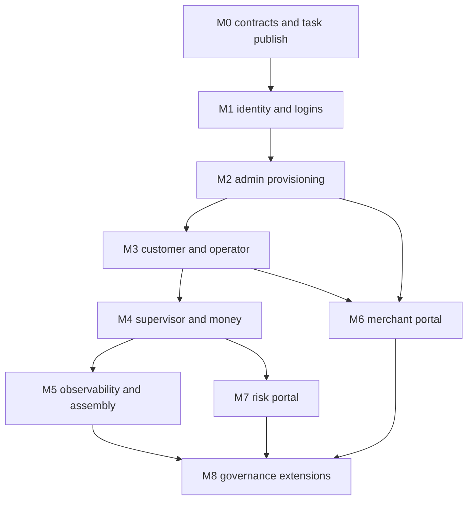

# Role Portals, Identity & Six-Workspace Implementation Plan

> **For agentic workers:** REQUIRED SUB-SKILL: Use superpowers:subagent-driven-development (recommended) or superpowers:executing-plans to implement this plan task-by-task. Steps use checkbox (`- [ ]`) syntax for tracking.

**Goal:** Implement the full six human-facing portals, centralized identity/RBAC, Platform Admin provisioning, merchant/risk extensions, and assembled role-driven money-path evidence defined in [`docs/roles.md`](../../roles.md).

**Architecture:** New owned modules `services/identity` and `services/risk` plus coordinated contract extensions. Browser sessions live in identity; Next.js server routes act as BFF and mint narrowly scoped peer credentials from the verified session. Action ledger remains sole money authority. Customers self-register only; Platform Admin invites/assigns all other human roles. Service principals (`workflow`, `dispatcher`, `verifier`, `sandbox-admin`) never get interactive logins.

**Tech Stack:** FastAPI + PostgreSQL (identity/risk schemas), Next.js/TypeScript (`apps/web`), existing Case API / workflow / ledger / dispatcher / verifier / merchant-* peers, pinned `sentinel.task-contracts.v1` wire contracts, module-local `uv`/`npm` manifests, Playwright for portal E2E.

**Spec:** [`docs/roles.md`](../../roles.md) v1.0 (sections 0–18). This plan implements the whole roadmap (M0–M8), not a cut-down MVP.

## Global Constraints

- Money path: models propose; authenticated supervisor + policy + ledger reservation + dispatcher write + verifier credit evidence only. Admin never gains payment approval or provider write.
- Customer registration cannot create staff roles; reject `role_id=customer` on staff invite/grant.
- Merchant internal `approver` is not ledger approval. Merchant subroles stay namespaced (`merchant:viewer|operator|approver|admin`).
- No silent fixture fallback in `real-peers`. Never put bearers in `NEXT_PUBLIC_*`.
- Independent module ownership: new work gets new SN tasks / owned roots; no deep imports; stubs for absent peers.
- Synthetic sandbox data and payment simulator only unless separately authorized.
- Preserve lock order / idempotent `provider_ref` / unsampled financial audit (SN-009/010).
- Route login URLs are presentation hints; server resolves role from session assignment, never from client-selected role.

## Review Focus

1. Privilege escalation via forged session, role header, or workspace switch.
2. Cross-tenant / cross-merchant data leakage in dashboards and caches.
3. Merchant or admin path that bypasses ledger supervisor approval.
4. Session still authorized after revoke/suspend/`authz_version` bump.
5. Fixture or provider-only assembly labeled as full RBAC+money evidence.

## Locked decisions (builder defaults from spec)

| Decision | Choice |
|---|---|
| Human roles | `customer`, `merchant`, `operator`, `supervisor`, `risk_officer`, `platform_admin` |
| Staff provisioning | Platform Admin only (merchant self-invite behind flag, off) |
| Account classes | Separate `customer` vs `staff` accounts; no casual promotion |
| Session propagation | Cookie session → BFF → short-lived scoped service credential / principal projection (§12.4 option C; temporary dual-run with seeded scoped tokens during M1) |
| New modules | `services/identity` (identity.v1), `services/risk` (risk.v1) |
| Web | Single Next.js app with six portal trees under `apps/web` |
| Task IDs (proposed) | SN-035…SN-042 (register via owner process before claim) |

## Proposed task register (owner must publish)

| ID | Root | Produces | Scope summary |
|---|---|---|---|
| SN-035 | `services/identity/**` | `identity.v1` | Users, sessions, invites, role grants, audit/outbox |
| SN-036 | `services/risk/**` | `risk.v1` | Investigations, findings, restrictions |
| SN-037 | `apps/api/**` (coord) | case-api role projections | Auth adapter, claim, customer/ops/supervisor projections |
| SN-038 | `apps/web/**` | six portals + BFF | Logins, dashboards, protected layouts, Playwright |
| SN-039 | `services/merchant-teams/**` + merchant portal adapters | membership projection | Identity-authoritative membership |
| SN-040 | peer auth adapters (ledger/workflow/policy/evidence as needed) | principal catalog extension | New human roles in contracts |
| SN-041 | `integration/core/**` | RBAC assembly journeys | AUTH/FLOW tests across peers |
| SN-042 | observability/admin eval surfaces | metrics + admin health | Identity/risk spans; gated FinHarness |

Cross-module contract edits require coordinated PRs and versioned adapters; do not silently break SN-001–034 consumers.

## File / module map

```text
services/identity/                 # NEW — SN-035
services/risk/                     # NEW — SN-036
apps/api/                          # identity resolver, claim, dashboard projections
apps/web/src/app/{customer,merchant,operator,supervisor,risk,admin}/
apps/web/src/lib/server/{auth,authorization,api-client}.ts
apps/web/src/components/{auth,layout,dashboards,identity,approvals}/
services/merchant-teams/           # project from identity memberships
services/action-ledger/            # principal adapter only; no second ledger
services/workflow/, policy/        # risk resume / role-aware checks where needed
integration/core/                  # compose DB + journey scripts + live RBAC tests
docs/independent-task-contracts.md # versioned role/permission additions (owner-gated)
docs/tasks.json / task-register    # SN-035+ entries (owner-gated)
```

---

## Milestone M0 — Baseline and contracts

### Task M0.1 — Freeze role catalog and ownership

**Files:** propose edits to `docs/independent-task-contracts.md`, `docs/tasks.json`, `docs/task-register.md`, `docs/roles.md` handoff checklist (owner PR).

- [ ] Open owner issue(s) for SN-035–SN-042 with disjoint roots and acceptance from `docs/roles.md` §16.
- [ ] Freeze canonical role IDs and permission identifiers (§1.1, §9.1).
- [ ] Document principal projection: session assignment → `{principal_id, tenant_id, roles[], subject_refs[], case_ids[], merchant_refs[]}`.
- [ ] Record decision: BFF credential minting; no client-supplied role authority.
- [ ] Exit: reviewed contract delta + published task issues; no money-table ownership changes.

---

## Milestone M1 — Identity service and login sessions

### Task M1.1 — Scaffold `services/identity`

**Files:** `services/identity/**` (domain, application, adapters, migrations, contracts, Makefile, README, CHANGELOG).

- [ ] Write failing contract/unit tests for register/login/invite/grant/revoke/session resolve.
- [ ] Implement domain invariants: account_type split; deny staff grant of `customer`; deny service roles as human assignments; `authz_version` bump on grant/revoke/suspend.
- [ ] PostgreSQL schema per §11 (`users`, `external_identities`, `role_assignments`, `sessions`, `staff_invitations`, `privileged_change_requests`, `identity_audit_events`, `identity_outbox`, role/permission catalogs, merchant_memberships, customer_subject_links, teams).
- [ ] HTTP surface §12.1 auth endpoints + capabilities probe `mode=fixture|real-peers`.
- [ ] Seed synthetic distinct accounts: customer, merchant, operator, supervisor, risk_officer, platform_admin + negative cross-tenant user.
- [ ] `make -C services/identity check` green with stubs only.

### Task M1.2 — Session security

- [ ] HttpOnly Secure SameSite cookies (or equivalent); token stored hashed; MFA gate for staff/admin privileged sessions (§2.5, AUTH-18).
- [ ] Workspace select only among active assignments (AUTH-16).
- [ ] Revoke-all on suspend; deny after `authz_version` mismatch (AUTH-13/14/19).
- [ ] Rate-limit login; generic errors (no account enumeration).
- [ ] Tests AUTH-01…AUTH-05, AUTH-11, AUTH-15, AUTH-17, AUTH-19, AUTH-22, AUTH-24.

### Task M1.3 — Web shared auth + six login routes

**Files:** `apps/web/src/app/**/login`, `apps/web/src/components/auth/**`, `apps/web/src/lib/server/auth.ts`.

- [ ] Shared `RoleLogin` component; role-specific headings; customer register link only on customer portal.
- [ ] Routes: `/customer/login|register`, `/merchant/login`, `/operator/login`, `/supervisor/login`, `/risk/login`, `/admin/login`, shared `/auth/*`.
- [ ] Protected layouts redirect unauthenticated users; middleware is convenience only — authorize at data layer.
- [ ] Role mismatch page offers only the user's authorized workspaces.
- [ ] Fixture mode uses seeded identity doubles; real-peers refuses public bearer config.

---

## Milestone M2 — Platform Admin provisioning

### Task M2.1 — Admin APIs

**Files:** `services/identity` admin routes §12.2.

- [ ] Invite, list, revoke invitations; grant/revoke roles; suspend/reactivate; session revoke; audit list; privileged-change decision.
- [ ] Reject customer/service role grants; derive actor from session; idempotency keys on invites.
- [ ] Independent review path for privileged grants (no silent self-escalation) — AUTH-12.
- [ ] Tests AUTH-03/04/10/11/12/13/14/20.

### Task M2.2 — Admin portal UI

**Files:** `apps/web/src/app/admin/(protected)/**`, `components/identity/**`.

- [ ] Dashboard, users directory, invite form, user detail role/scope editor, roles catalog, tenants/merchants/teams stubs wired to APIs, audit, security (session revoke).
- [ ] `PermissionPreview` advisory only.
- [ ] Playwright: admin invites operator+supervisor; customer absent from grant dropdown; revoked operator denied.

---

## Milestone M3 — Customer + Support Operator portals

### Task M3.1 — Case API identity integration

**Files:** `apps/api/**`.

- [ ] Replace static token-only principal resolution with identity-validated / BFF-minted principal adapter (keep opaque-token path for service peers).
- [ ] Customer dashboard/list projections §12.3; subject binding remains server-side.
- [ ] Operator: queue aggregates, `POST /v1/ops/cases/{caseId}/claim` atomic assignment (conflict → 409).
- [ ] Role-specific event/evidence projections; fail closed on peer errors.
- [ ] Tests AUTH-06/08 + claim concurrency.

### Task M3.2 — Customer portal UI

**Files:** `apps/web/src/app/customer/(protected)/**`.

- [ ] Dashboard, transactions, report/intake, cases, case detail/timeline, notifications, profile.
- [ ] Reuse existing intake form semantics; language selector; mobile-first.
- [ ] Journey C1/C2 wiring against real case API in real-peers.

### Task M3.3 — Operator portal UI

**Files:** `apps/web/src/app/operator/(protected)/**`.

- [ ] Dashboard, queue, case workspace, evidence panel, escalations, messages, activity.
- [ ] Evidence-first layout; claim action; no approval controls.
- [ ] Journeys O1/O2; AUTH-05/06.

---

## Milestone M4 — Supervisor + money path

### Task M4.1 — Supervisor APIs and ledger identity

**Files:** `apps/api` decision proxy, `services/action-ledger` principal adapter, `packages/approval-ui` embed path.

- [ ] Supervisor dashboard + approvals list projection from ledger (read) without second ledger.
- [ ] Decision proxy preserves original supervisor `principal_id` into ledger approve/reject.
- [ ] Stale digest/revision/expiry rejected; no reservation on reject.
- [ ] Tests FLOW-01…FLOW-09, AUTH-06/09/14/21.

### Task M4.2 — Supervisor portal UI

**Files:** `apps/web/src/app/supervisor/(protected)/**`.

- [ ] Dashboard, approvals queue, exact ApprovalPanel (SN-013), history, team, escalations, audit.
- [ ] High-contrast amount; non-editable financial payload; stale indicator.
- [ ] Hero ₹1,500 duplicate-payment demo path through simulator with single `provider_ref`.

### Task M4.3 — Dispatcher/verifier continuity under human revoke

- [ ] FLOW-12: suspend supervisor mid-unknown; workload continues reconcile; human UI denied.
- [ ] Customer/merchant views stay pending until credit confirmed (FLOW-07/08).

---

## Milestone M5 — Observability and validation

### Task M5.1 — Telemetry and audit separation

- [ ] Spans §15.1; metrics §15.2 with bounded labels.
- [ ] Identity audit vs financial audit access controls.
- [ ] Admin observability pages show redacted aggregates only.

### Task M5.2 — Assembly evidence

**Files:** `integration/core/**`.

- [ ] Extend compose with identity + risk DBs.
- [ ] `run_sandbox_journeys` / new RBAC journey script covering admin→customer→operator→supervisor→dispatcher→verifier.
- [ ] Require full path (`SENTINEL_V1_REQUIRE_FULL_PATH`) to pass with SN-009 authority exercised — update honesty labels only when true.
- [ ] Record commands, SHAs, modes; fixture-only UI clearly labeled.

---

## Milestone M6 — Merchant portal (full, not deferred out of plan)

### Task M6.1 — Identity-authoritative merchant membership

**Files:** `services/identity` merchant_memberships; `services/merchant-teams` adapter.

- [ ] Platform Admin provisions merchant users + subroles.
- [ ] merchant-teams reads/projects membership; refuses to be second role authority.
- [ ] Outbox propagation for membership changes.
- [ ] Tests AUTH-07/09/10, FLOW-13/14.

### Task M6.2 — Merchant BFF + UI

**Files:** `apps/web/src/app/merchant/(protected)/**`, case-api or BFF merchant aggregate routes.

- [ ] Dashboard, transactions, settlements, exceptions, refunds (request only), disputes, tasks, analytics, team, settings.
- [ ] Wire settlement/inbox/refunds/disputes/analytics/comms adapters; internal approve ≠ ledger.
- [ ] Merchant A/B isolation Playwright.

---

## Milestone M7 — Risk & Fraud portal (full)

### Task M7.1 — `services/risk`

**Files:** `services/risk/**`.

- [ ] Investigations, findings, restrictions domain + Postgres + HTTP §12.3 risk routes.
- [ ] Restriction decision does not approve money; resume events to workflow/policy.
- [ ] Contract `risk.v1`; local stubs; `make check`.
- [ ] Tests FLOW-10/11, AUTH-21.

### Task M7.2 — Risk portal UI + case/policy hooks

**Files:** `apps/web/src/app/risk/(protected)/**`, workflow/policy adapters.

- [ ] Dashboard, queue, investigation detail, transactions, holds, reports, analytics, audit.
- [ ] Fraud queue routing from existing `FRAUD` owner; block refund path while restricted.
- [ ] Clearance requires re-evaluation + separate supervisor approval for money.

---

## Milestone M8 — Governance extensions

### Task M8.1 — Privileged reviews and platform config

- [ ] Privileged change requests UI/API fully enforced for sensitive grants.
- [ ] Admin policies, integrations, security pages backed by real versioned config where modules exist.
- [ ] FinHarness / FinBench / evaluation runner gated; optional; never required for money safety exit.

### Task M8.2 — Localization and polish

- [ ] Tamil/Hindi strings for customer surfaces; preserve original complaint text.
- [ ] Design system: monochrome graphite/white, blue primary, role-differentiated by content (§13.1).
- [ ] All dashboards: loading/empty/error/unauthorized/stale/unavailable states.

---

## Cross-cutting test matrix (must stay green)

Execute and keep evidence for:

- AUTH-01…AUTH-24 (§16.1)
- FLOW-01…FLOW-16 (§16.2)
- Playwright multi-context portal suite (§16.3)
- Release gates (§16.4): no unauthorized/duplicate financial writes; full assembled journey; no critical cross-tenant defect

## Delivery lanes (parallelizable after M0)



- Lane A: SN-035 identity + admin APIs
- Lane B: SN-037/040 money-path auth + SN-036 risk
- Lane C: SN-038 portals
- Lane D: SN-041 assembly + evidence

## Demo order (exit of M5+; merchant/risk when M6/M7 land)

Per §17.2: Admin invite → Customer case → Operator evidence → Supervisor exact ₹1500 approve → simulator timeout reconcile → Verifier credit → Admin audit → optional risk/merchant.

## Out of scope for false claims

- Live payment rails / production IdP until separately authorized
- Claiming `assembled_mvp` or SN-009 authority before M5 evidence
- Giving Platform Admin refund approval
- Interactive logins for workflow/dispatcher/verifier

## First execution step after plan approval

1. Owner publishes SN-035–SN-042 issues and contract baseline bump PR.
2. Claim SN-035; worktree `feat/sn-035-identity`; implement M1.1.
3. Do not start portal UI until identity auth contract snapshot exists for stubs.
